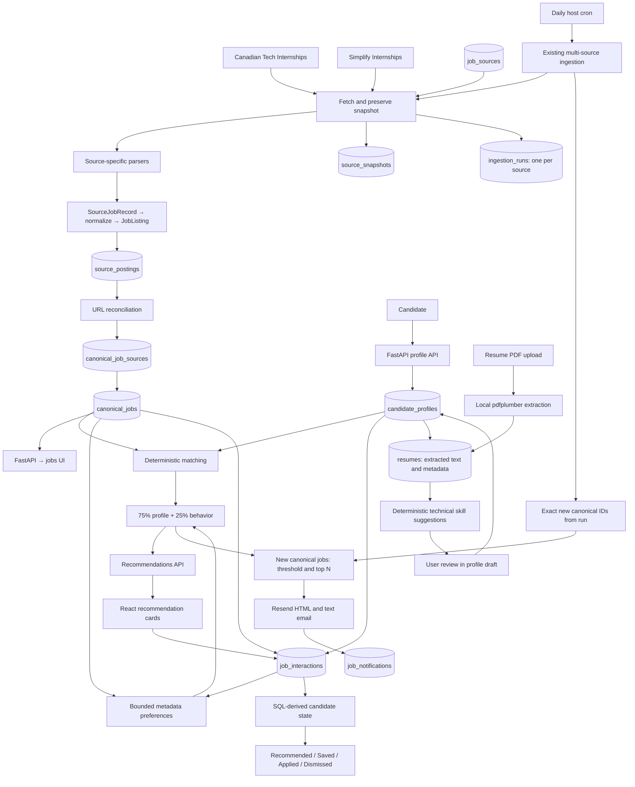

# InternshipFeed

InternshipFeed collects GitHub internship listings into one searchable,
deduplicated feed. Each repository has its own parser; both feed one normalizer
and the same PostgreSQL repository.



The complete table structure, constraints, identity rules, indexes, migration,
and example queries are documented in **[docs/database.md](docs/database.md)**.

Daily automation is available as a one-shot command for external cron:

```sh
.venv/bin/python -m internshipfeed.daily_refresh --dry-run
```

It refreshes both enabled sources, records exact new canonical IDs, reuses the
personalized ranker, and can send a Resend HTML/plain-text email digest of new
matches. Defaults are final score ≥60 and at most five jobs. PostgreSQL history
prevents ordinary duplicate sends, including after canonical merges. Configure
`RESEND_API_KEY`, `DAILY_EMAIL_FROM`, and `DAILY_EMAIL_TO` in `.env`; the sender must
be verified in Resend. `DAILY_NOTIFICATION_CHANNEL=email` is the only supported
channel. Dry runs need no email credentials.
See **[daily refresh setup, retry behavior, and cron examples](docs/daily-refresh.md)**.
The schedule is external and is not installed automatically.
The complete [profile/email implementation report](docs/profile-and-email-report.md)
lists files, test results, assumptions, and code review points.

## Sources

| Key | Dataset | Format |
| --- | --- | --- |
| `canadian-tech` | [Canadian Tech Internships](https://github.com/negarprh/Canadian-Tech-Internships-2027) | `main/README.md`, Markdown table |
| `simplify` | [SimplifyJobs Summer 2027](https://github.com/SimplifyJobs/Summer2027-Internships) | `dev/README.md`, HTML tables |

The supplied Simplify Summer2026 repository link redirects to Summer2027. Its
2026 archive is a separate file. The parser reads the term from document context;
relative ages such as `2d` are retained as raw text, not guessed posting dates.
Simplify includes international listings, so the combined feed is not Canada-only.

PostgreSQL `job_sources` controls repository, file path, branch, display name, and
whether a source is enabled. The code registry supplies parser implementations.

## Local setup

Python 3.9+ and PostgreSQL are required:

```sh
python3 -m venv .venv
source .venv/bin/activate
python -m pip install --upgrade pip
python -m pip install -e '.[test]'
```

Use the configured PostgreSQL service, or Docker:

```sh
docker compose up -d --wait
# Copy only if .env has not already been configured.
cp .env.example .env
```

Alternatively the development launcher can run PostgreSQL locally:

```sh
python -m pip install -e '.[local-postgres]'
python -m internshipfeed.dev_db
```

Keep its terminal running. Data is retained in `data/postgres`. Existing `.env`
configuration is preserved; a connection URL is created only if the file is absent.
Environment variables take precedence over `.env`.

In another terminal with the environment activated:

```sh
# Build the React profile interface (Node.js 22.12+).
npm --prefix frontend ci
npm --prefix frontend run build

python -m internshipfeed.db
python -m uvicorn internshipfeed.api:app --host 127.0.0.1 --port 8000
```

Open **http://127.0.0.1:8000/** for Recommended. All listings is at `/listings`,
with Saved, Applied, and Dismissed in the same compact navigation. Profile opens in a drawer;
click a job title for details without leaving the feed. The legacy `/feed` alias
opens All listings, and `/profile` opens the Profile drawer over Recommended.
Profile edits and PDF uploads use the backend APIs. Build output is ignored by Git; rebuild
after frontend changes. [Frontend setup and architecture](docs/frontend.md)
includes the optional Vite development workflow.
Saved jobs are at `/saved`, application history at `/applied`, and dismissed jobs at `/dismissed`. Restart
FastAPI after updating backend routes.

Open **http://localhost:8000/listings** and click **Update listings** to run both enabled
sources. The background workflow fetches, snapshots, parses, normalizes, optionally
reads descriptions, reconciles URLs, and persists metadata. Progress includes both
overall batch counts and per-source execution counts.

The small public `CanonicalJob` API contract remains:

```text
id, company, title, location, application_url, posted_at, status
```

PostgreSQL stores additional canonical description, keywords, observation, and
creation/update metadata. The UI reads a `JobDetails` envelope containing the core
job, term, description, keywords, and source provenance.

## Parsing, descriptions, and reconciliation

The Canadian parser handles inherited companies (`↳`), nested application badges,
full dates, and closed markers. Simplify parsing handles category HTML tables,
location details, employer links versus companion links, and stable companion IDs.
Both emit `SourceJobRecord` and share `normalize()`.

Description extraction checks robots.txt and reads public pages using JSON-LD or
readable job HTML. Explicit keyword/qualification rules identify technology mentions
and requirement lines. JavaScript-only or blocked pages can remain unavailable.
Successful descriptions and recent dead-link checks are reused for 24 hours.

Reconciliation uses normalized application URLs, preserving job identifiers while
removing known tracking parameters. Similar titles, missing URLs, and generic
careers pages do not cause a merge. Each source posting retains its own identity;
the mapping table records its canonical assignment, method, confidence, and URL
evidence. Confirmed redirects from readable job descriptions can link URL aliases.

A source posting, its mapping, and refreshed canonical metadata commit atomically.
A source failure does not roll back other sources. Closed/dead listings are hidden
from the feed; one source closing a listing does not hide another source's open
observation. Source disappearance alone does not prove closure.

## Optional command line

```sh
# Both enabled sources.
python -m internshipfeed

# Listing metadata only.
python -m internshipfeed --no-enrich

# One source, or a saved source snapshot.
python -m internshipfeed --source simplify --no-enrich
python -m internshipfeed --source simplify --input path/to/README.md --no-enrich
```

`--input` without `--source` replays Canadian data. `--enrich-limit` caps page attempts,
`--delay` controls pacing, and `--refresh-descriptions` bypasses the description cache.

PostgreSQL is authoritative for source snapshots and ingestion history. Ignored
`data/snapshots`, `data/source_records.json`, `data/run.json`, and `data/runs` files
remain local diagnostics/replay artifacts.

## API

- `GET /api/profile`: the seeded development candidate profile, including ID and timestamps.
- `PUT /api/profile`: replace all five editable fields; return the normalized, persisted profile.
- `POST /api/resumes`: upload one PDF in multipart field `file`; return HTTP 201 with metadata and extracted text.
- `GET /api/resumes/latest`: latest development-candidate filename/date metadata, or null; excludes extracted text.
- `GET /api/recommendations`: eligible jobs ordered by deterministic profile + behavior ranking; unchanged `score`/components, added `profile_score`, `behavior_score`, `final_score`, `behavior_reasons`, and SQL-derived `interaction_state`. Optional `min_score=0..100` still filters profile fit.
- `GET /api/saved`: saved, nondismissed jobs, including applied jobs; newest save first.
- `GET /api/applied`: application history, newest applied event first, including closed/dismissed jobs.
- `GET /api/dismissed`: dismissed history, newest dismissal first, with Restore actions.
- `POST /api/jobs/{id}/interactions`: append `click`, `save`, `unsave`, `dismiss`, `undismiss`, `applied`, or `unapplied` for the development profile; merged IDs resolve to their surviving canonical job.
- `GET /api/interactions`: effective flags, latest interaction/save/application timestamps, and event cursor, grouped by current canonical job.
- `GET /api/sources`: configured datasets, including source IDs and enabled state.
- `GET /api/jobs`: seven-field canonical jobs; optional `source_id` (dataset ID), `source` (repository URL), `status`, and `q` filters.
- `GET /api/jobs/{id}`: a canonical job; merged IDs resolve to their survivor.
- `GET /api/jobs/{id}/details`, `GET /api/feed`: core jobs with separate source/enrichment context.
- `POST /api/sync`: start or return the active multi-source batch.
- `GET /api/ingestion-batches/latest`, `GET /api/ingestion-batches/{uuid}`: overall UI progress.
- `GET /api/ingestion-runs`, `GET /api/ingestion-runs/latest`, `GET /api/ingestion-runs/{uuid}`: per-source operational records; the list accepts `source_id`.
- `GET /api/health`: database connectivity; `GET /docs`: API documentation.

Sync, profile updates, résumé uploads, and job actions use the existing local-only mutation policy. Internet
deployment needs an authenticated operator interface and durable background worker
management.

Candidate profile persistence + FastAPI profile API is implemented using the one
seeded development profile. PUT requires `target_roles`, `skills`,
`preferred_locations`, `preferred_terms`, and `graduation_year`, even when clearing
them with empty lists and null. List items must be strings; whitespace and blank
items are removed, and exact case-sensitive duplicates keep their first order and
spelling. Graduation year must be null or an integer from 1900 to 2200, matching
the existing database constraint. Extra fields (including IDs/timestamps), missing
fields, and invalid types receive HTTP 422. A missing seed or unavailable database
receives HTTP 503. Reads never create a profile.

For example, with the application running:

```sh
curl http://127.0.0.1:8000/api/profile
curl -X PUT http://127.0.0.1:8000/api/profile \
  -H 'Content-Type: application/json' \
  -d '{"target_roles":["Software Engineering","Backend Engineering"],"skills":["Python","SQL"],"preferred_locations":["Toronto","Ottawa"],"preferred_terms":["Summer 2027"],"graduation_year":2027}'
curl http://127.0.0.1:8000/api/profile
```

Résumé PDF upload → local `pdfplumber` text extraction → PostgreSQL `resumes` is
implemented. Uploads must have a `.pdf` extension (case-insensitive) and contain
a parseable PDF. `application/pdf` is accepted; missing MIME types or generic
`application/octet-stream` still require successful parsing. Other MIME types
and file extensions receive HTTP 415.

The file limit is **5 MiB (5,242,880 bytes)** and the page limit is **10 pages**.
Oversized files receive HTTP 413 before extraction. Corrupt PDFs, too many pages,
and PDFs without readable text receive HTTP 422. Scanned/image-only PDFs are
unsupported: there is no OCR or AI. Page/line order and technical symbols are
preserved, with normalized line endings and collapsed excess blank lines.

```sh
curl -X POST -F 'file=@/path/to/resume.pdf;type=application/pdf' \
  http://127.0.0.1:8000/api/resumes
```

Every successful upload appends a record for the development profile, preserving
earlier résumé versions. Only the basename, extracted text, candidate ID, and
timestamp are stored; PDF bytes and temporary paths are not retained. Extraction
does not modify the candidate profile or send its contents to external services.
The response contains `id`, `candidate_profile_id`, `filename`, `extracted_text`,
and `uploaded_at`; the frontend retains metadata only. Profile's Upload/Replace
PDF uses the latest résumé for optional technical skill suggestions:

```text
PDF → pdfplumber → stored extracted text → controlled technical skills
    → user selects suggestions → local draft → Save changes → candidate profile
```

`GET /api/resumes/{resume_id}/skill-suggestions` returns candidate-scoped
`resume_id`, canonical `skills`, and shared normalization `aliases`, without raw
text. Extraction reuses the job vocabulary and matching aliases, including
Postgres → PostgreSQL, K8s → Kubernetes, NodeJS → Node.js, and Google Cloud → GCP.
Longest phrase matching distinguishes React Native/React and C++/C#/C; JavaScript
does not imply Java. Results are deduplicated and sorted. Generic prose is excluded.
No AI, OCR, profile inference, or automatic profile writes are involved.

Profile uses 2026–2030 graduation choices (Not specified saves null), fifteen
Winter/Summer/Fall term choices with removable chips, and open-ended tags for
roles, skills, and locations. Existing out-of-range years and legacy terms are
preserved until the user edits them. Suggestions filter normalized saved/draft
skills, enter only the draft, and persist only on Save. New uploads replace the
suggestion set, preserving selected skills. Suggestion failures have a separate
retry and never undo a successful PDF upload. See [frontend details](docs/frontend.md).

Candidate Profile + Canonical Jobs → Deterministic Matching → Recommendations API
is implemented. It uses string rules and explicit aliases: role **40**, detected
job-skill overlap **30**, location **20**, and term **10** points. Every awarded
component includes its matching evidence. Active alternate source titles,
locations, and terms supplement the representative canonical fields.

Scores are calculated on each request and are not stored. Empty preferences or
missing metadata earn zero in that dimension. Recommended also derives bounded
metadata preferences from click (+1), save (+2), applied (+4), and dismiss (−3),
once per event type/current canonical job. Role, skills, company, location, and
term affinity produces behavior 0–100, neutral 50. Final rank is 75% profile +
25% behavior, rounded half up. The existing `score` remains profile fit; the UI
discloses both signals. Ranking updates on Recommended navigation/refresh.
The generic feed retains chronological/search ordering. There is no AI,
résumé-text ranking, stored behavior profile, or automatic profile mutation.
Exact profile rules are in **[docs/matching.md](docs/matching.md)**; weights,
normalization, and ranking rules are in **[docs/behavioral.md](docs/behavioral.md)**.

```sh
curl 'http://127.0.0.1:8000/api/recommendations?min_score=20'
```

The Profile drawer supports shared skill tags, explicit saves, inline feedback,
and compact PDF upload/replace. Latest filename/date metadata restores on reopen
and refresh. Uploads do not change the form or candidate preferences.
The Recommended and Saved screens offer **Apply → Save → Applied → Dismiss**. Apply opens
the external application in a new tab and attempts to record a click; a recording
failure never blocks navigation or implies an application was completed. Save
uses an active bookmark, Applied uses a clock, and Dismiss removes the card only
after the server confirms the event. Marking Applied moves the job out of
discovery and into Applied. It may remain in Saved too. The Applied view shows
the application date and an Open application link. State returns after refresh. A compact score
disclosure exposes the unchanged matching breakdown and reasons.

Interaction history is append-only. Effective flags and timestamps are derived in
SQL and follow canonical merge redirects. Profile scores never use interaction
state; Recommended uses separate bounded behavioral evidence for ordering.
Collections and action receipts carry server-derived state, which React consumes
without replaying events. Click Saved again to unsave, or Applied again to unmark
it. The latest action in each pair wins, survives refresh, and cancels the
corresponding preference signal. Dismissed jobs have a **Restore** action that
appends `undismiss`, removes them from Dismissed, and cancels negative dismissal
evidence. Saved/Applied flags stay intact; active jobs return to discovery when
not applied. Migrations `008_reversible_interactions.sql` and
`011_reversible_dismissals.sql` extend the allowed event types without changing
historical rows or adding state columns.
See [docs/interactions.md](docs/interactions.md) for contracts and exact semantics.
Dismissed/applied jobs are also excluded from normal `/api/jobs` and `/api/feed`
discovery; the underlying canonical records remain stored. Saved/Applied/Dismissed history
retains closed, dead, and unlinked jobs. Global ingestion/reconciliation counts
remain source-level operational records. Authentication is future work.

## Tests

```sh
# Local unit checks; database tests skip without TEST_DATABASE_URL.
python -m unittest discover -s tests -v

# Use the existing local PostgreSQL service, isolated test schemas only.
python scripts/test_with_existing_postgres.py

# Or explicitly launch a disposable server (requires local-postgres extra).
python scripts/test_with_postgres.py

# Frontend pure-function tests and TypeScript/production-build checks.
npm --prefix frontend test
npm --prefix frontend run build
```

Prefer `scripts/check_recommendations_ui.py --browser-executable /path/to/chromium`
for real UI/profile/PDF checks in a disposable schema with automatic server cleanup.
`check_profile_ui.py` alone restores profile preferences but appends generated
PDFs to that target database. `check_daily_email.py` verifies fixture ingestion,
CLI dry run, and rendered email without contacting Resend. See
[docs/frontend.md](docs/frontend.md#verification) for the exact command and checks.

Tests cover source parsing, snapshot deduplication/ownership, per-source runs,
raw versus normalized values, within-source identities, cross-source URL matching,
canonical metadata, disabled sources, failure isolation, migration preservation,
profile seeding, profile API validation/persistence/timestamps, résumé PDF uploads,
local text extraction, format/size/page limits, résumé history and resource closure,
event append semantics, and API/UI contracts. Database tests isolate both their
schemas and advisory sync-lock keys from the running application.
Matching tests cover explicit role/skill aliases, technical-token boundaries,
Canadian/remote geography, season/year pairing, explanations, exact totals,
visibility, stable tie-breaking, and ranking changes after profile updates.
Behavior tests cover bounded affinities, capped repeated signals, mixed events,
metadata contributions, exact 75/25 composition, neutral ordering, canonical
merges, candidate isolation, and unchanged profile fit. Frontend checks cover
final-score display, preserved server ordering, and separate history-view scores.
`scripts/check_recommendations_ui.py` runs the action workflow plus the profile
and feed browser checks against an isolated PostgreSQL schema and removes its
temporary server/schema afterward. It leaves live candidate history untouched.

## Modules

- `fetch.py`, `sources/`, `source.py`: transport, registry, and source parsers.
- `records.py`, `normalize.py`, `models.py`: shared intermediate/domain contracts.
- `enrich.py`: description and deterministic keyword extraction.
- `resumes.py`: bounded local PDF text extraction and conservative cleanup.
- `matching.py`: unchanged profile scoring, explanations, shared normalization, and profile ordering.
- `behavioral.py`: ephemeral interaction affinities and bounded preference scoring.
- `recommendations.py`: independent score composition and personalized ordering.
- `reconciliation.py`: URL matching, explainable mappings, canonical metadata refresh.
- `db.py`, `migrations/`: PostgreSQL configuration, lineage, repositories, and schema.
- `ingestion.py`, `sync.py`, `cli.py`: source runs, batch progress, background workflow.
- `api.py`: database-backed API and shared React page serving.
- `frontend/`: unified React + TypeScript product, shared drawers/tags/actions, Vite build, and self-hosted fonts.
- `index.html`, `web/app.js`: compatibility redirects for cached older pages.
