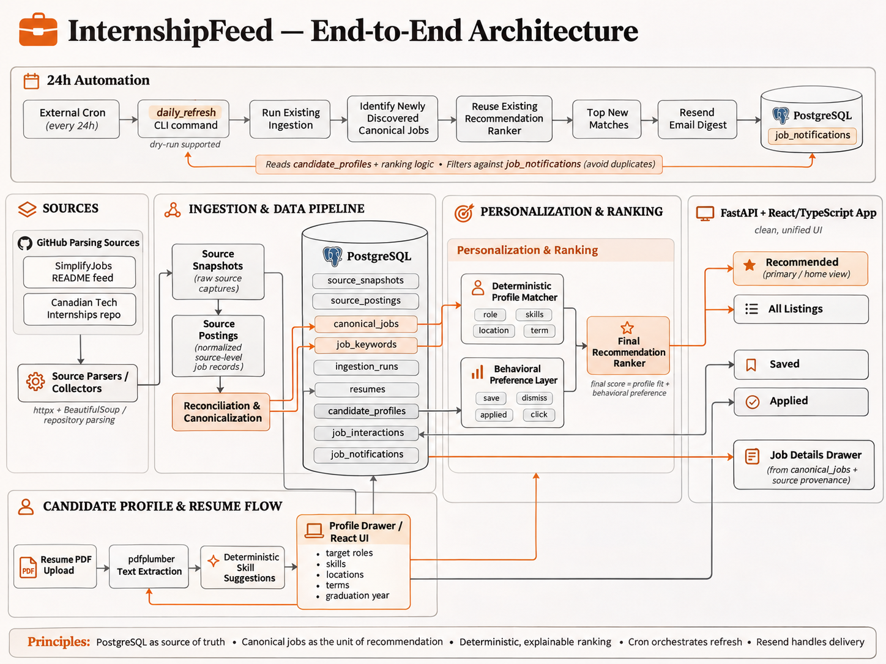

# InternshipFeed

**Problem Statement:** Canadian students are often limited towards co-op portals and LinkedIn when searching for tech internships. These postings tend to be generalized and it may be difficult for students to see which postings would provide a good fit to their strengths and abilities. InternshipFeed aims to provide a personalized feed of postings based on a students previous experiences, strengths, and interests as an applicant.

[Architecture](#architecture) · [Ingestion](#ingestion) · [Database](#database) ·
[Ranking](#ranking) · [Frontend](#frontend) · [API](#api) ·
[Daily email](#daily-email) · [Run locally](#run-locally) · [Verification](#verification)

## Product requirements

- Combine source listings without duplicate opportunities or lost source identities.
- Show available descriptions, technical requirements, dates, status, and application links.
- Explain ranking; preserve reversible Saved, Applied, and Dismissed state.
- Keep résumé suggestions subject to review and explicit profile saves.
- Email the best eligible new jobs, with persistent notification deduplication.

## Architecture



*Conceptual overview; implementation contracts are specified below.*

**Backend:** Python, FastAPI, Pydantic 2, psycopg 3, and PostgreSQL.
**Frontend:** React, TypeScript, and Vite. The API, ingestion, and daily command
share persistence, eligibility, and ranking logic.

<details>
<summary>Implementation map</summary>

| Area | Code |
| --- | --- |
| Fetch, parse, normalize, enrich | [fetch.py](internshipfeed/fetch.py), [source.py](internshipfeed/source.py), [sources/](internshipfeed/sources/), [normalize.py](internshipfeed/normalize.py), [enrich.py](internshipfeed/enrich.py) |
| Ingestion and reconciliation | [ingestion.py](internshipfeed/ingestion.py), [reconciliation.py](internshipfeed/reconciliation.py) |
| Contracts and storage | [models.py](internshipfeed/models.py), [db.py](internshipfeed/db.py), [migrations/](internshipfeed/migrations/) |
| Ranking | [matching.py](internshipfeed/matching.py), [behavioral.py](internshipfeed/behavioral.py), [recommendations.py](internshipfeed/recommendations.py) |
| Interface | [api.py](internshipfeed/api.py), [frontend/src/](frontend/src/) |
| Résumés and email | [resumes.py](internshipfeed/resumes.py), [resume_skills.py](internshipfeed/resume_skills.py), [daily_refresh.py](internshipfeed/daily_refresh.py), [notifications.py](internshipfeed/notifications.py) |

</details>

## Ingestion

### Sources and normalization

| Source key | Repository | Dataset/parser |
| --- | --- | --- |
| `canadian-tech` | [Canadian Tech Internships](https://github.com/negarprh/Canadian-Tech-Internships-2027) | `main/README.md`; Markdown tables, inherited company names, badges, dates, closed markers. |
| `simplify` | [SimplifyJobs Summer 2027](https://github.com/SimplifyJobs/Summer2027-Internships) | `dev/README.md`; category HTML tables, location details, companion IDs, document terms. Includes international jobs. |

`job_sources` configures each dataset; the registry binds its key to a parser.
Python `urllib` fetches source files; Markdown rules and `HTMLParser` parse them.
Both emit `SourceJobRecord` → `normalize()` → `JobListing`, preserving source
identity, raw cells, job fields, term/status, snapshot, and enrichment results.
Relative ages such as `2d` stay raw; missing exact dates remain null.

### Reconciliation and descriptions

- **Within source:** upsert by `(source_id, external_id)`.
- **Across sources:** compare normalized application URLs, removing known tracking/transport differences while preserving job IDs, path case, and meaningful hash routes. Missing URLs, generic careers pages, and similar titles do not establish a match.
- **Evidence:** mappings record `exact_application_url`, `resolved_application_url`, or `source_identity`, confidence, and matched URL. Confidence describes the rule decision, not a probability. ATS-specific/fuzzy matching is not implemented.
- **Enrichment:** respect robots.txt; extract JSON-LD or readable job HTML, then apply explicit technology and requirement-section rules. Blocked/JavaScript-only pages may lack descriptions. Successful descriptions and recent dead-link checks are reused for 24 hours.
- **Visibility:** closed/dead jobs are excluded from discovery. An active observation can keep a job visible when another source closes it; disappearance alone does not prove closure. Temporary fetch failures do not prove a dead link.

HTTP limits: **20 s timeout, 5 MB responses, two transient-error retries**.
Posting/mapping/canonical changes commit atomically; row/source failures preserve
other work. Advisory locks serialize sync/reconciliation. Batch and source reports
count fetched, parsed, inserted, updated, skipped, and failed records, with separate
enrichment failures. Parse failures retain snapshots.

## Database

Source observations and canonical opportunities have separate identities.
Entity IDs use `bigint`, ingestion IDs `UUID`, posting dates `date`, and operational
timestamps `timestamptz`. Public contracts:

```text
CanonicalJob { id, company, title, location, application_url, posted_at, status }
JobDetails   { job: CanonicalJob, term, description, keywords, sources }
```

Statuses: `open`, `unknown`, `closed`, `dead`. Keywords are JSONB on canonical
jobs, grouping languages, frameworks, tools/platforms, concepts, and requirements.

| Table | Purpose and important constraints |
| --- | --- |
| `job_sources` | Dataset configuration; unique `key` and `(repository, file_path, branch)`. |
| `source_snapshots` | SHA-256, raw content, optional verified commit SHA, fetch time; unique `(source_id, content_hash)`. Identical content reuses its snapshot. |
| `source_postings` | Source/external ID, latest snapshot, raw and normalized cells, term/status, enrichment, first/last seen; unique `(source_id, external_id)`. Composite foreign key enforces snapshot ownership. |
| `canonical_jobs` | Seven public fields plus description, JSONB keywords, first/last seen, created/updated timestamps; materialized from linked observations. Active evidence wins; dates and keyword unions are retained deterministically. |
| `canonical_job_sources` | Canonical ↔ source-posting mapping, method/confidence/URL evidence; one current assignment per posting. |
| `canonical_job_identities`, `canonical_job_urls` | Stable identity allocation, merge redirects, and URL aliases; historical IDs continue resolving to the surviving job. |
| `ingestion_batches`, `ingestion_runs` | Overall sync progress and per-source execution status/counts, timing, snapshot, errors, and diagnostic reports. Batch reports retain exact new canonical IDs. |
| `candidate_profiles` | `target_roles`, `skills`, `preferred_locations`, `preferred_terms` as `text[]`; nullable integer `graduation_year`; created/updated timestamps. |
| `resumes` | Candidate ID, filename, extracted text, upload time. Uploads append versions; raw PDF files are not retained. |
| `job_interactions` | Append-only candidate/job/type/time behavior events; effective Saved/Applied/Dismissed flags remain derived. |
| `job_applications` | Current application status and submission/update timestamps; unique `(candidate_profile_id, canonical_job_id)`, checked statuses, candidate/job foreign keys. |
| `job_notifications` | Candidate/job/channel, provider message ID, acceptance time; unique `(candidate_profile_id, canonical_job_id, channel)`. |

[Migrations](internshipfeed/migrations/) are tracked in `schema_migrations`;
repeatable initialization preserves IDs/events. Snapshots retain dataset versions;
postings retain their latest observation. Unrecoverable legacy content and unverified
commit SHAs stay null. PostgreSQL is authoritative; `data/` holds diagnostics.

### Application tracking and indexes

`job_applications` stores `id`, candidate/job IDs, `status`, `applied_at`,
`status_updated_at`, `created_at`, and `updated_at`. An `applied` event and its
initial tracker row commit together. Repeated Apply preserves the original date
and progression; status-only updates change `status_updated_at`/`updated_at`
without adding behavior events. Unmark removes the current tracker row and retains
interaction history; reapplying starts a fresh record. Migration 012 backfills only
effectively applied jobs, using the first submission after the latest Unmark.

Canonical merges consolidate trackers per candidate: the latest effective Apply/
Unmark decides retention; the latest status update wins, with the earliest stored
submission date retained. Historical interaction IDs are preserved. Application
outcomes do not change recommendation weights or behavior evidence.

| Query pattern | Index | Benefit |
| --- | --- | --- |
| Applied for one candidate, ordered by latest update | `job_applications(candidate_profile_id, updated_at DESC, id DESC)` | Supports default history ordering. |
| Applied filtered by candidate and status, same order | `job_applications(candidate_profile_id, status, updated_at DESC, id DESC)` | Narrows status views before loading job metadata. |
| Reconcile trackers when canonical IDs merge | `job_applications(canonical_job_id)` | Finds affected candidate records without scanning all applications. |
| Candidate/job history and latest-event lookup across aliases | `job_interactions(candidate_profile_id, canonical_job_id, id DESC)` | Supports candidate-scoped identity joins and event lookup. |

Migrations 012/013 add these indexes. Existing interaction candidate/time and job/time indexes remain. The mapping
primary key `(canonical_job_id, source_posting_id)` and unique `source_posting_id`
already cover both mapping directions. No duplicate mapping indexes were added.
Canonical status/date indexes already exist. Current canonical visibility/sorting
occurs after loading, so no combined status/date index was added. Discovery uses
exact IDs, and event-type filtering follows effective-state resolution; neither
needs the additional proposed time/type indexes.

## Ranking

Rule scores are computed on request. Each dimension takes its best evidence;
missing preferences/metadata earn zero without reweighting. Graduation is not scored.

| Profile component | Points | Rule |
| --- | ---: | --- |
| Role | 0–40 | 40 for a target phrase/shared role family; otherwise 30 for two overlapping tokens including a specialty, 15 for one specialty, or 0. Generic words alone do not match. |
| Skills | 0–30 | `round_half_up(30 × matched unique job skills / unique detected job skills)`; no detected skills or overlap earns 0. Requirements prose is excluded. |
| Location | 0–20 | 20 for city/region or explicit remote fit, 15 for province, 8 for country; conflicting known regions block that location match. Remote Canada requires Canadian evidence. |
| Term | 0–10 | 10 for season+year, 6 for season with a missing year, 4 for year with a missing season. Missing/conflicting evidence earns 0; posting dates never supply terms. |

Normalization folds case/accents/separators while preserving `C++`, `C#`, `.NET`,
and `Node.js`. Explicit aliases include Postgres → PostgreSQL, K8s → Kubernetes,
NodeJS → Node.js, Google Cloud → GCP, and Amazon Web Services → AWS. Canonical
metadata and active source titles/locations/terms supply evidence. Exact taxonomies
and geographic rules live in [matching.py](internshipfeed/matching.py).

**Behavior:** active signals contribute once per type/current canonical job:
click **+1**, save **+2**, applied **+4**, dismiss **−3**; internal view is ignored.
Unsave/Unapplied/Undismiss cancel their corresponding signal. Net job weights
accumulate per metadata key and are capped at **−10…+10**. Dimension alignment
averages the target job's keys, including unseen keys as zero; matching locations
use the full location rule. Role/skill/company/location/term multipliers are
**4 / 3 / 0.5 / 1 / 0.5**. Missing dimensions remain neutral in the fixed denominator.

```text
C              = sum(weighted dimension alignments), bounded to −90…+90
behavior_score = clamp(round_half_up(50 + 50 × C / 90), 0, 100)
profile_score  = role + skills + location + term
final_score    = round_half_up(0.75 × profile_score + 0.25 × behavior_score)
```

Neutral behavior is 50. Order is final score, profile score, exact posting date
(null last), then canonical ID, descending. `score` remains profile fit; Recommended
adds `profile_score`, `behavior_score`, `final_score`, and up to two positive behavior
reasons. **API `min_score` filters profile fit; daily-email minimum filters final score.**
History views show profile fit and sort by their action time. All listings stays
chronological. Behavior is derived from saved interactions/current job metadata;
résumé text, embeddings, and LLMs are not scoring inputs.

## Frontend

### Stack and design

**React 19 + TypeScript + Vite 7**, plain CSS, shared SVG icons, self-hosted IBM
Plex Sans, and monospace skill tags. Node.js **22.12+** builds the app; FastAPI
serves its entry and `/profile/assets`. No router/state/UI framework is added.

| Design token | Value / use |
| --- | --- |
| Background / surface / muted surface | `#f6f4ef` / `#fffefa` / `#f0eee7` |
| Text / muted text | `#252522` / `#6c6a63` |
| Border / stronger border | `#dedbd3` / `#bcb8ae` |
| Accent / soft accent / error | `#a44c30` / `#f4eae3` / `#993d31` |
| Spacing / radius | 4, 8, 12, 16, 24, 32, 48 px; 3 px controls/panels, 2 px tags. |

[Tokens](frontend/src/styles/tokens.css) and [styles.css](frontend/src/styles.css)
control compact typography, thin borders, restrained accents, and responsive layout.
Apply is primary; other actions are secondary. Tags wrap and narrow navigation
scrolls. Drawers support focus trapping/restoration, Escape/backdrop close, inert
backgrounds, and mobile widths. Loading/retry states, accessible labels, keyboard
focus, and reduced-motion support are shared requirements.

### Tabs and interaction contract

| Tab | Route | Membership and order |
| --- | --- | --- |
| Recommended | `/`, `/recommendations` | Active/unknown, not saved, dismissed, or applied; personalized rank. |
| All listings | `/listings` | Active/unknown, not dismissed or applied; saved jobs included. Search/metadata filters, chronological order, no scores. |
| Applied | `/applied` | Submitted jobs at every application status, including inactive/dismissed jobs; most recently updated application first. |
| Saved | `/saved` | Saved and not dismissed, including applied jobs; latest save first. |
| Dismissed | `/dismissed` | Dismissed, including saved/applied/inactive jobs; latest dismissal first, with Restore. |

Profile and job details open in drawers over the current tab. `/profile` opens
Profile over Recommended; `/feed` aliases All listings. Shared components display
server scores/order, progressively rendering 24 cards or 40 directory rows.

Apply opens HTTP(S) immediately in a new tab (`noopener noreferrer`), records
`click` without blocking navigation, and asks **Did you apply for this role?**

| Confirmation | Existing interaction / result |
| --- | --- |
| Yes, I applied | `applied`; enters Applied and leaves Recommended, preserving Saved. |
| Save for later | `save` unless already saved; enters Saved and leaves Recommended. Saved jobs remain in All listings. |
| Keep in feed / Escape / close / outside click | No additional event; existing workflow state remains intact. |

Click means interest; Applied confirms submission and retains its stronger ranking
weight. Already-applied jobs open their application without another prompt. Cards
show Apply, Save, and Dismiss/Restore; **Job Details → Mark applied** supports
applications completed elsewhere. Applied history retains its Unmark control.

Save/Unsave, Applied/Unmark, and Dismiss/Restore remain independent. SQL resolves
merged IDs and selects the latest event per family, returning flags, dates, and
`last_event_id`. React reconciles confirmed snapshots without reloading, rejects
stale responses, and keeps failed confirmation actions open for retry. Restoring a
job preserves Saved/Applied and posting status. No new event types or stored
workflow flags are introduced.

### Applied tracker

Navigation order is **Recommended → All listings → Applied → Saved → Dismissed**;
Profile remains a drawer. Applied cards expose a compact status selector:
**Applied, Interview, Rejected, Ghosted, Offered**. Every status remains in Applied.
The filter offers All or one status; edits surface recently updated applications
without changing their original Applied date. Failed requests retain the old status
and allow retry. Cards in other tabs and job details omit this control.

`GET /api/applied?status=interview` returns application metadata with each card.
`PATCH /api/jobs/{id}/application` accepts `{ "status": "interview" }` and returns
the confirmed tracker record. The same candidate/local-write rules apply; a job
without an existing application returns 404, and unsupported statuses return 422.
Status editing uses the tracker, while Dismissed/Restore continues to use the
existing derived interaction state and never deletes history.

### Profile and résumé

The profile API replaces all five editable fields together. Arrays trim blanks
and exact duplicates; backend graduation year is an integer 1900–2200 or null.
The UI offers **2026–2030** plus Not specified, and **Winter/Summer/Fall × 2026–2030**
term chips with an add dropdown. Existing legacy values remain until edited.
Roles, skills, and locations stay open-ended tags; only explicit Save commits drafts.

PDFs must be readable, **≤5 MiB and ≤10 pages**. `pdfplumber` extracts text locally;
no OCR or AI is used. The latest successful résumé supplies controlled technical
skill suggestions using shared vocabulary/aliases, token boundaries, longest-phrase
precedence, canonical labels, and stable deduplication. Java/JavaScript,
C/C++/C#, and React/React Native remain distinct. Generic prose is excluded.

Suggestion chips/Add all update only the draft and exclude selected/pending aliases.
New PDFs replace suggestions, preserving profile skills. Suggestions retry separately
from uploads. Metadata/suggestion reads and UI state exclude raw text; the upload
API returns extracted text. No other preferences are inferred.

## API

FastAPI's **`/docs`** is the full request/response reference. Core surfaces:

| Method/path | Contract |
| --- | --- |
| `GET /api/jobs`, `/api/feed` | Candidate-visible canonical jobs or detail envelopes; `q`, `source`, `source_id`, `status` filters. |
| `GET /api/jobs/{id}`, `/api/jobs/{id}/details` | Single job/detail, resolving merged IDs. |
| `GET /api/recommendations`, `/api/saved`, `/api/applied`, `/api/dismissed` | Scored collections with SQL-derived state, term, and keywords; Recommended accepts `min_score=0..100`; Applied includes `application` metadata and accepts a status filter. |
| `GET /api/profile`, `PUT /api/profile` | Development profile; PUT requires all five fields, rejects extra fields, and returns persisted values. |
| `POST /api/resumes` | Multipart `file` upload; HTTP 201 with résumé metadata and extracted text. |
| `GET /api/resumes/latest`, `/api/resumes/{id}/skill-suggestions` | Candidate-scoped metadata or `{resume_id, skills, aliases}`; no raw text. |
| `GET /api/interactions` | Effective candidate/job state; jobs without events default to false flags. |
| `PATCH /api/jobs/{id}/application` | Update an existing submitted application; checked `status`, immutable submission date. |
| `POST /api/jobs/{id}/interactions` | `{type: click \| save \| unsave \| applied \| unapplied \| dismiss \| undismiss}`; HTTP 201 event + state snapshot. |
| `POST /api/sync` | HTTP 202: start or return the active multi-source batch. |
| `GET /api/sources`, `/api/ingestion-batches/latest`, `/api/ingestion-batches/{uuid}` | Source configuration and overall progress. |
| `GET /api/ingestion-runs`, `/api/ingestion-runs/latest`, `/api/ingestion-runs/{uuid}` | Per-source execution records; list accepts `source_id`. |
| `GET /api/health` | Database connectivity. |

The lowest-ID candidate is the development profile; reads never reseed it.
Writes require loopback clients and a matching supplied Origin. Errors: invalid
input **422**, missing resource **404**, unavailable storage/profile **503**, PDF
format/size **415/413**. Multi-user authentication remains a production gap.

## Daily email

External cron runs `python -m internshipfeed.daily_refresh`; FastAPI does not
schedule jobs. The command refreshes all enabled sources and compares canonical
identities before/after ingestion under the sync lock. Exact surviving new IDs are
stored in the batch report; updates and source duplicates are excluded. Neither
`posted_at` nor inherited `first_seen_at` determines discovery.

The shared ranker selects new, unnotified, eligible matches: **final score ≥60,
top 5** by default. The official Resend SDK sends one escaped HTML/plain-text digest
with company, title, score, location, term, matched skills, and application links.
Private history, résumé text, internal IDs, and score components are excluded.

| Variable | Purpose/default |
| --- | --- |
| `DATABASE_URL` | Required PostgreSQL connection. |
| `DAILY_NOTIFICATION_CHANNEL` | `email`; other values are rejected. |
| `RESEND_API_KEY` | Required for sending. |
| `DAILY_EMAIL_FROM`, `DAILY_EMAIL_TO` | Verified Resend sender and one recipient. |
| `DAILY_EMAIL_MIN_SCORE`, `DAILY_EMAIL_TOP_N` | `60` (0–100), `5` (1–5). |
| `APP_BASE_URL` | Optional HTTP(S) app link in the footer. |

Environment overrides root `.env`; see [.env.example](.env.example). Configure a
Resend key and verified sender separately. Ledger writes occur **after acceptance**;
no SQL transaction spans the network call. Merge-aware candidate/job/email
uniqueness and Resend's 24-hour payload idempotency prevent ordinary repeats.
Acceptance is not inbox delivery; check ambiguous send/ledger failures before retrying.

```sh
python -m internshipfeed.daily_refresh --dry-run
python -m internshipfeed.daily_refresh --no-ingest --batch-id BATCH_UUID --dry-run
# After review/configuration, omit --dry-run to send that retained batch.
```

**Dry run persists ingestion**, prints subject/text/HTML, and neither sends nor
records notifications; credentials are not required. `--no-enrich` and
`--enrich-limit N` control job-page fetching. Fresh runs do not replay prior unsent
batches. Empty matches send nothing. Partial ingestion may email successful
results but exits 1; full/provider failure exits 1, preserving committed ingestion.
Provider failure writes no ledger rows. Configuration errors exit 2; success/no
matches exit 0. Daily-command locks prevent overlap; no implicit send retry occurs.

```cron
0 9 * * * cd /absolute/path/to/internshipfeed && /absolute/path/to/internshipfeed/.venv/bin/python -m internshipfeed.daily_refresh >> /absolute/path/to/internshipfeed/data/daily-refresh.log 2>&1
```

Replace/quote paths and create the log directory before installing the entry.
This means **09:00 in the cron host's timezone**; DST changes elapsed intervals.
The host/database must stay awake. [Cron template](scripts/daily_refresh.cron.example)
is not installed automatically; Compose provides PostgreSQL only.

## Run locally

Requires **Python 3.9+**, **Node.js 22.12+**, and **PostgreSQL** (Compose uses 16).

```sh
python3 -m venv .venv
source .venv/bin/activate
python -m pip install -e '.[test]'
test -f .env || cp .env.example .env
docker compose up -d --wait
npm --prefix frontend ci
npm --prefix frontend run build
python -m internshipfeed.db
python -m uvicorn internshipfeed.api:app --host 127.0.0.1 --port 8000
```

Open **http://127.0.0.1:8000/**. Use **Update listings** in All listings to run the
shared ingestion/enrichment workflow and view progress. After frontend changes,
rebuild; restart FastAPI after backend changes. For live UI development, run
`npm --prefix frontend run dev` alongside FastAPI and open port **5173**;
`BACKEND_URL=http://127.0.0.1:8004` selects a different backend.

An existing PostgreSQL service can replace Compose. Without Docker, install
`'.[local-postgres]'`, run `python -m internshipfeed.dev_db` in another terminal,
and keep it running. It retains data under `data/postgres` and creates `.env` only
when absent; otherwise set `DATABASE_URL` to its printed connection URI.

```sh
python -m internshipfeed                                      # All enabled sources
python -m internshipfeed --source simplify --no-enrich         # Metadata only
python -m internshipfeed --source simplify --input snapshot.md --no-enrich
```

`--input` without a source replays Canadian data; `--enrich-limit`, `--delay`, and
`--refresh-descriptions` control enrichment. Ignored `data/` artifacts support
inspection/replay; credentials, snapshots, and exports are not public UI assets.

## Verification

```sh
python scripts/test_with_existing_postgres.py  # Isolated schemas on configured server
npm --prefix frontend test
npm --prefix frontend run build
# Optional browser dependency; supply your Chromium executable if needed.
python -m pip install -e '.[browser]'
python -m playwright install chromium
python scripts/check_recommendations_ui.py --browser-executable /path/to/chromium
python scripts/check_apply_ui.py --browser-executable /path/to/chromium
python scripts/check_daily_email.py --browser-executable /path/to/chromium
```

Checks cover parsing/deduplication, migrations, merges, ranking, reversible state,
PDF suggestions, application progression/backfill/indexes, UI/keyboard/mobile behavior, failure isolation, and email dry runs.
Browser runners clean up temporary schemas/API processes; providers are mocked.
Prefer the isolated runner: `check_profile_ui.py` alone appends fixture résumés.
Unit-only command: `python -m unittest discover -s tests -v`; DB tests require
`TEST_DATABASE_URL`. Previews/screenshots go to `data/screenshots`.

**Production gaps:** authentication/multi-user ownership, durable ingestion workers,
delivery webhooks/bounce handling, and deployment monitoring. Blocked descriptions,
unknown technologies, and unrecognized locations remain incomplete. Real inbox
rendering/delivery, installed cron execution, and broader device/screen-reader
coverage require deployment verification. No LLM/embedding/OCR services, SMS,
application submission automation, or additional scheduler infrastructure are used.
