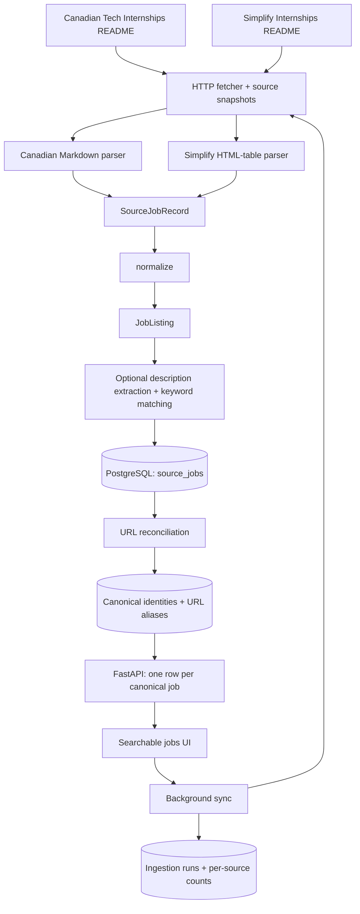
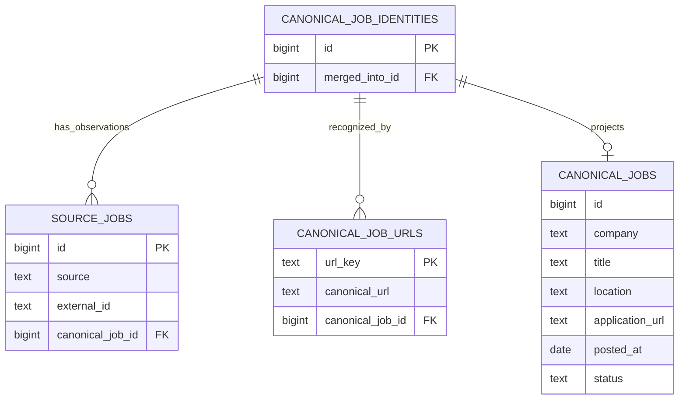

# InternshipFeed

InternshipFeed collects internship listings from GitHub repositories into one
searchable feed. Each source has its own parser, while normalization, PostgreSQL
storage, description extraction, and the API are shared.



The main transformation is:

```text
Source A ──> Canadian parser ──┐
                              ├──> SourceJobRecord ──> normalize() ──> JobListing
Source B ──> Simplify parser ──┘                                       │
                                                              source_jobs → URL reconciliation → canonical_jobs
```

## Sources

| Key | Repository | Format |
| --- | --- | --- |
| `canadian-tech` | [negarprh/Canadian-Tech-Internships-2027](https://github.com/negarprh/Canadian-Tech-Internships-2027) | `main/README.md`: Markdown table |
| `simplify` | [SimplifyJobs/Summer2027-Internships](https://github.com/SimplifyJobs/Summer2027-Internships) | `dev/README.md`: category HTML tables |

The supplied [Summer2026 repository link](https://github.com/SimplifyJobs/Summer2026-Internships)
currently redirects to Summer2027. The second source follows the current main
README reached by that link. The historical 2026 list is a separate
[`archived/README-2026.md`](https://github.com/SimplifyJobs/Summer2027-Internships/blob/dev/archived/README-2026.md)
file and is not imported by default. The parser reads the term from the document
heading rather than hardcoding a year.

Simplify includes international listings. Importing it does not imply that every
job is located in Canada. The UI shows source labels and an All sources filter.

## Architecture and module boundaries

- `fetch.py`: shared HTTP transport, timeouts, retries, and response-size limits.
- `sources/__init__.py`: registry of source names, URLs, and parser callables.
- `source.py`: Canadian source parser; handles Markdown badges, closed markers, and inherited company names.
- `sources/simplify.py`: Simplify parser; handles multiple HTML tables, inherited company names, location details, application links, companion IDs, and relative ages.
- `records.py`: source-neutral `SourceJobRecord` intermediate representation.
- `normalize.py`: one transformation used by both parsers; returns a validated `JobListing`.
- `models.py`: common application schema and keyword groups.
- `enrich.py`: optional readable description extraction and deterministic keyword matching.
- `db.py`, `migrations/`: source/canonical PostgreSQL storage, backfill, and schema setup.
- `reconciliation.py`: conservative URL normalization, alias matching, canonical identities, and group merges.
- `ingestion.py`: multi-source orchestration, source isolation, snapshots, deduplication, and run reporting.
- `sync.py`: background execution guarded by a PostgreSQL session lock.
- `api.py`: database-backed API and static UI hosting.
- `cli.py`: optional command-line wrapper around the same workflow used by the UI.
- `dev_db.py`: optional local development PostgreSQL launcher.

Fetching, parsing, normalization, enrichment, and persistence stay separate. A new
repository needs a parser and a registry entry, rather than another database table
or API-specific schema. Source-specific rules do not belong in the shared normalizer.

The project is a modular monolith. PostgreSQL remains the system of record;
a separate message broker, search service, and distributed workers are not needed
for this stage. Candidate profiles, saved/applied interactions, and explainable
matching can be added later on top of the common job repository.

## Common job schema

Both parsers normalize into the same `JobListing`, persisted independently in
`source_jobs`. Canonical opportunities use a separate, exact seven-field contract:

```text
CanonicalJob
    id
    company
    title
    location
    application_url
    posted_at
    status
```

`CanonicalJob` forbids extra fields. `GET /api/jobs` and `GET /api/jobs/{id}` return
only those fields; missing application URLs and posting dates remain `null`.
The database `canonical_jobs` view exposes the same seven columns in the same
order, derived from linked source observations. Identity creation and merge
metadata live in `canonical_job_identities` rather than on the canonical entity.

Descriptions, keyword groups, terms, and source provenance are separate
`JobDetails` context. `GET /api/jobs/{id}/details` returns
`{job: CanonicalJob, term, description, keywords, sources}`. The UI uses
`GET /api/feed`, which returns a list of these detail envelopes while keeping
each nested `job` within the exact contract.

The normalized **source record** retains its independent schema:

| Field | Meaning |
| --- | --- |
| `id` | Database-generated **source-job** ID |
| `canonical_job_id` | Foreign key to the canonical opportunity |
| `company`, `title`, `location` | Required listing text |
| `url` | Actual application URL, nullable if unavailable |
| `last_known_url` | Previously seen application URL retained when a source removes it |
| `source` | Canonical source repository URL |
| `external_id` | Stable identity within that source |
| `posted_at` | Exact posting date if provided; otherwise `null` |
| `term` | Explicit season/year from the title, or source-provided term context |
| `status` | `open`, `closed`, `unknown`, or confirmed `dead` |
| `description` | Extracted original job text, nullable |
| `keywords` | Languages, frameworks, tools/platforms, concepts, and requirement lines |
| `enrichment_status`, `enrichment_error` | Description-fetch outcome |
| `extraction_method`, `resolved_url`, `enriched_at` | Description provenance |
| `link_checked_at` | Most recent application-page fetch attempt |
| `snapshot_id`, `source_line` | Source lineage |
| `first_seen_at`, `last_seen_at` | Observation timestamps |

### Source-specific normalization

The Canadian README supplies full dates such as `Oct 30, 2026`; these become
`posted_at = 2026-10-30`. Its `↳` rows inherit the previous company name. Nested
badge links resolve to the outer application link.

Simplify typically supplies relative ages such as `2d`. These remain in raw source
records; they are **not** converted into a guessed exact posting date. Yearless
dates are also left as `posted_at = null`. The parser prefers the employer's
application link over the companion Simplify link. If only a Simplify application
link exists, it is retained. A `<details>` location cell becomes a readable list
of actual locations, excluding the summary text such as “9 locations”. Company
inheritance resets at category table boundaries.

Term information in a title takes precedence over source context. Missing terms
are not inferred from unrelated information.

### Within-source identity

The original `jobs` table is migrated to **`source_jobs`**, retaining all existing
numeric IDs, timestamps, data, and the unique constraint on `(source, external_id)`.
Each source keeps its own identity even when it describes an opportunity also
listed elsewhere. Source insertion and canonical reconciliation commit together.

The Canadian source's fingerprint uses source, company, title, location, and exact
posting date. Status and application URL remain excluded so closure does not
change its identity. Simplify uses its companion `/p/<id>` identifier when available,
otherwise a deterministic fingerprint. Relative ages are excluded from identity.

### Cross-source URL reconciliation

`canonical_job_identities` stores stable opportunity IDs and merge lifecycle
metadata. `canonical_jobs` projects each opportunity's seven domain fields.
Every source record has a non-null `canonical_job_id` referencing the identity. `canonical_job_urls` maps normalized URL hashes
to canonical IDs and retains the corresponding normalized URLs for inspection.
A transactional PostgreSQL lock serializes source writes and alias/group changes,
so concurrent imports cannot create competing canonical groups for the same key.



For example, Simplify source job **875** and Canadian source job **125** can both
reference canonical job **420**. The feed returns job 420 once, with both
original records in the surrounding `JobDetails.sources` array. Source IDs and canonical IDs are separate
namespaces; `/api/jobs/{id}` now takes a canonical ID.

Matching uses application URLs, **never title similarity**. Normalization:

- Treats HTTP/HTTPS as equivalent and normalizes host casing and default ports.
- Removes trailing path slashes and known tracking parameters (`utm_*`, `ref`, `source`, `gh_src`, etc.).
- Sorts query keys while preserving duplicate-parameter order.
- Preserves job identifiers such as `gh_jid`, `jobId`, and requisition parameters.
- Preserves path case, encoded slashes, nondefault ports, and meaningful fragments/hash routes.
- Excludes obvious careers/search landing pages without a job identifier from matching.

Different job IDs, missing URLs, and generic careers pages remain separate, even
with identical titles. A previously unseen URL gets a new canonical identity.
There are no network calls or blind redirect following during reconciliation.
A resolved URL is additional evidence only after a readable job description was
successfully extracted. This can bridge a Simplify wrapper and an employer URL.
Unresolved wrappers remain separate until there is evidence linking their URLs.
URL matching assumes a job-specific URL identifies the same opportunity; it does
not detect every employer's URL reuse or semantically equivalent URL format.

When verified aliases bridge existing groups, the lowest canonical ID survives.
Source records and URL aliases move to it atomically; old canonical IDs retain a
`merged_into_id` link and detail lookups resolve them to the surviving job.
If a source corrects its URL to a different opportunity, only that source record
moves; its source ID is retained and its old peers are not dragged along. A failed
fetch for a changed URL does not reuse the old page's description or redirect.

The migration backfills existing observations through the same reconciliation
function and enforces the non-null mapping in the same transaction. Reinitializing
the database does not rerun the backfill or recreate the old `jobs` table.

### Canonical presentation and status

Canonical display fields are derived from the linked observations, so no second
copy of company/title data can become stale. An open observation takes precedence
over unknown/closed/dead ones. Among equally active records, exact-date metadata
is preferred, followed by the oldest source ID for deterministic selection. The
posting date is the earliest known exact date. The newest available description
is selected with active observations preferred, and keyword lists are unioned.
Each member's original title, location, dates, URL, status, snapshot, and source ID
remain inspectable under `JobDetails.sources`.

A canonical job is visible while at least one member is open or unknown. One source
closing a listing does not hide another source's open observation. When all members
are closed/dead the job is hidden. Removing a URL on closure preserves the existing
canonical mapping and last-known URL. Source filters match any **active** linked
observation; search can match alternate source titles as well as the chosen title.

Source updates preserve `id` and `first_seen_at`. Description failures/skips retain
previously read text when the application URL still matches. Missing source rows
are not automatically marked closed. Corrections to fingerprint fields can still
produce a new within-source identity.

## Running locally

Requires Python 3.9+ and PostgreSQL. From the project root:

```sh
python3 -m venv .venv
source .venv/bin/activate
python -m pip install --upgrade pip
python -m pip install -e '.[test]'
```

For Docker users:

```sh
docker compose up -d --wait
# Copy only if you have not already configured .env.
cp .env.example .env
```

Or set `DATABASE_URL` to an existing PostgreSQL database. Environment variables
take precedence over `.env`.

Without Docker or an installed PostgreSQL service, use the development launcher:

```sh
python -m pip install -e '.[local-postgres]'
python -m internshipfeed.dev_db
```

Keep that terminal running. The launcher retains database files in `data/postgres`
and writes a local connection URL to `.env` only if that file does not exist.
An existing configuration is preserved. Ctrl+C stops the server. This launcher is
for development; deployments should use an independently administered database.

In another terminal with the environment activated:

```sh
python -m internshipfeed.db
python -m uvicorn internshipfeed.api:app --host 127.0.0.1 --port 8000
```

Open **http://localhost:8000** and click **Sync & enrich**. One action imports both
repositories, normalizes and reconciles their rows, and reads available descriptions. Progress
and per-source counts appear in the UI. Refresh reloads saved database records.
The app needs the source checkout's `index.html` and `web/` files.

Optional CLI workflows:

```sh
# Both sources, with description extraction.
python -m internshipfeed

# Both sources, listing metadata only.
python -m internshipfeed --no-enrich

# Just one source.
python -m internshipfeed --source simplify --no-enrich

# Reprocess a saved snapshot for a specified source.
python -m internshipfeed --source simplify --input path/to/README.md --no-enrich
```

`--input` without `--source` preserves the original Canadian-source replay behavior.
For a multi-source replay in Python, pass `input_paths={"canadian-tech": path_a,
"simplify": path_b}` to `run_ingestion()`. `--enrich-limit` optionally caps page
attempts across a run; the default has no limit. `--delay` sets the delay between
attempts, and `--refresh-descriptions` bypasses the 24-hour description cache.

## Description extraction

Description extraction checks robots.txt and reads public application pages.
It first looks for a single JSON-LD `JobPosting` description, then tries readable
`main`/`article` HTML with recognizable job sections. JavaScript-only pages,
access restrictions, and ambiguous pages may remain unavailable.

Keyword extraction uses the explicit vocabulary and qualification-section rules
in `enrich.py`. Matches represent mentions, not proof that every technology is
mandatory. The original description remains available for inspection.

Closed source rows are saved for lineage but hidden from the feed and detail API.
They do not trigger application-page requests. HTTP 404/410 from an application
page marks the link `dead` and hides the listing; a recent dead check is reused for
24 hours. Timeouts, blocked requests, and unreadable pages do not prove closure.
Not every expired HTTP-200 page can be detected.

## Observability and failure isolation

The existing insertion/update/duplicate counters continue to count **source records**.
Each completed run also records `reconciliation` totals: source records, canonical
identities with members, groups spanning multiple sources, active source records,
unique visible jobs, and duplicate feed listings removed.

Each run stores overall and per-source counters for scraped, processed, inserted,
updated, duplicate, and failed rows, plus description outcomes and closed/dead
counts. Each source report includes its snapshot ID, README URL, outcome, and
source-specific error if applicable.

A fetch/parse failure in one repository does not prevent the other source from
being imported. Row validation/storage failures do not roll back other committed
jobs. A run with a failed source or row exits with code 1; successfully imported
jobs remain available.

For parsed rows, `scraped = inserted + updated + skipped_duplicates + failed`.
Source failures that occur before parsing are counted separately in
`source_failures`, since the number of missing jobs is unknown.

Generated artifacts (ignored by Git):

- `data/snapshots/<sha256>.md`: exact retained source content.
- `data/source_records.json`: both parsers' common records with source provenance.
- `data/run.json`: latest local run report.
- `data/runs/<uuid>.json`: local run history.

Run reports also live in PostgreSQL `ingestion_runs`. A global database lock prevents
overlapping UI/CLI syncs. Interrupted runs are marked failed on restart.

## API

- `GET /api/sources`: supported source names, keys, and repository URLs.
- `GET /api/jobs`: unique canonical jobs, newest exact posting date first; optional `source`, `status`, and `q` filters.
- `GET /api/jobs/{id}`: one seven-field `CanonicalJob`; merged IDs resolve to their survivor.
- `GET /api/jobs/{id}/details`: canonical job plus separate term, description, keywords, and source provenance.
- `GET /api/feed`: detail envelopes used by the UI, with optional `source`, `status`, and `q` filters.
- `POST /api/sync`: start a background run of both sources, or return the active run.
- `GET /api/ingestion-runs/latest`: most recent persisted report.
- `GET /api/ingestion-runs/{uuid}`: run progress and outcome.
- `GET /api/health`: database connectivity check.
- `GET /docs`: generated API documentation.

Closed/dead records are excluded from public job responses. Database failures return
503. The app serves only UI assets, not snapshots, exports, or `.env`.
The sync action is local-only and rejects cross-origin requests; deployment needs
an authenticated operator interface and a durable worker process.

## Validation

```sh
# Unit tests; database tests skip without TEST_DATABASE_URL.
python -m unittest discover -s tests -v

# Full suite against a disposable real PostgreSQL cluster.
python scripts/test_with_postgres.py
```

The second command requires the `local-postgres` extra. Alternatively set
`TEST_DATABASE_URL` to a test database; each database test creates/drops its own
schema. Coverage includes both source formats, common normalization, identity
stability, multi-source imports, failure isolation, concurrent deduplication,
status updates, description retention, API filtering, and background sync. Reconciliation
coverage includes tracking variants, meaningful query IDs, conservative URL matching,
closure retention, URL corrections, verified redirect bridges, concurrent cross-source
writes, legacy migration/backfill idempotence, and exact canonical model, database,
and API field contracts.
