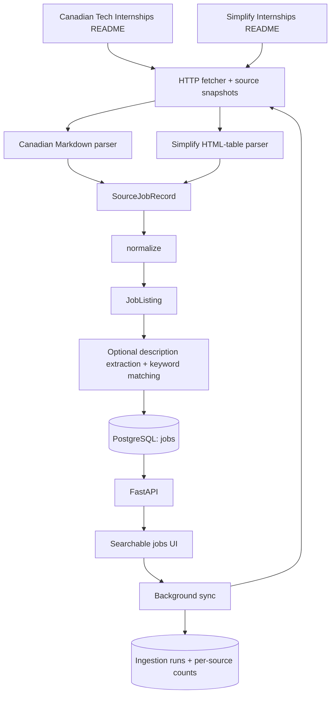

# InternshipFeed

InternshipFeed collects internship listings from GitHub repositories into one
searchable feed. Each source has its own parser, while normalization, PostgreSQL
storage, description extraction, and the API are shared.



The main transformation is:

```text
Source A ──> Canadian parser ──┐
                              ├──> SourceJobRecord ──> normalize() ──> JobListing
Source B ──> Simplify parser ──┘                                       │
                                                              common jobs table
```

## Sources

| Key | Repository | Format |
| --- | --- | --- |
| `canadian-tech` | [negarprh/Canadian-Tech-Internships-2027](https://github.com/negarprh/Canadian-Tech-Internships-2027) | `main/README.md`: Markdown table |
| `simplify` | [SimplifyJobs/Summer2027-Internships](https://github.com/SimplifyJobs/Summer2027-Internships) | `dev/README.md`: category HTML tables |

The supplied [Summer2026 repository link](https://github.com/SimplifyJobs/Summer2026-Internships)
currently redirects to Summer2027. The second source follows the current main
README reached by that link. The historical 2026 list is a separate
[`archived/README-2026.md`](https://github.com/SimplifyJobs/Summer2027-Internships/blob/dev/archived/README-2026.md)
file and is not imported by default. The parser reads the term from the document
heading rather than hardcoding a year.

Simplify includes international listings. Importing it does not imply that every
job is located in Canada. The UI shows source labels and an All sources filter.

## Architecture and module boundaries

- `fetch.py`: shared HTTP transport, timeouts, retries, and response-size limits.
- `sources/__init__.py`: registry of source names, URLs, and parser callables.
- `source.py`: Canadian source parser; handles Markdown badges, closed markers, and inherited company names.
- `sources/simplify.py`: Simplify parser; handles multiple HTML tables, inherited company names, location details, application links, companion IDs, and relative ages.
- `records.py`: source-neutral `SourceJobRecord` intermediate representation.
- `normalize.py`: one transformation used by both parsers; returns a validated `JobListing`.
- `models.py`: common application schema and keyword groups.
- `enrich.py`: optional readable description extraction and deterministic keyword matching.
- `db.py`, `migrations/`: common PostgreSQL repository and schema setup.
- `ingestion.py`: multi-source orchestration, source isolation, snapshots, deduplication, and run reporting.
- `sync.py`: background execution guarded by a PostgreSQL session lock.
- `api.py`: database-backed API and static UI hosting.
- `cli.py`: optional command-line wrapper around the same workflow used by the UI.
- `dev_db.py`: optional local development PostgreSQL launcher.

Fetching, parsing, normalization, enrichment, and persistence stay separate. A new
repository needs a parser and a registry entry, rather than another database table
or API-specific schema. Source-specific rules do not belong in the shared normalizer.

The project is a modular monolith. PostgreSQL remains the system of record;
a separate message broker, search service, and distributed workers are not needed
for this stage. Candidate profiles, saved/applied interactions, and explainable
matching can be added later on top of the common job repository.

## Common job schema

Both sources produce the same `JobListing`:

| Field | Meaning |
| --- | --- |
| `id` | Database-generated integer primary key |
| `company`, `title`, `location` | Required listing text |
| `url` | Actual application URL, nullable if unavailable |
| `last_known_url` | Previously seen application URL retained when a source removes it |
| `source` | Canonical source repository URL |
| `external_id` | Stable identity within that source |
| `posted_at` | Exact posting date if provided; otherwise `null` |
| `term` | Explicit season/year from the title, or source-provided term context |
| `status` | `open`, `closed`, `unknown`, or confirmed `dead` |
| `description` | Extracted original job text, nullable |
| `keywords` | Languages, frameworks, tools/platforms, concepts, and requirement lines |
| `enrichment_status`, `enrichment_error` | Description-fetch outcome |
| `extraction_method`, `resolved_url`, `enriched_at` | Description provenance |
| `link_checked_at` | Most recent application-page fetch attempt |
| `snapshot_id`, `source_line` | Source lineage |
| `first_seen_at`, `last_seen_at` | Observation timestamps |

### Source-specific normalization

The Canadian README supplies full dates such as `Oct 30, 2026`; these become
`posted_at = 2026-10-30`. Its `↳` rows inherit the previous company name. Nested
badge links resolve to the outer application link.

Simplify typically supplies relative ages such as `2d`. These remain in raw source
records; they are **not** converted into a guessed exact posting date. Yearless
dates are also left as `posted_at = null`. The parser prefers the employer's
application link over the companion Simplify link. If only a Simplify application
link exists, it is retained. A `<details>` location cell becomes a readable list
of actual locations, excluding the summary text such as “9 locations”. Company
inheritance resets at category table boundaries.

Term information in a title takes precedence over source context. Missing terms
are not inferred from unrelated information.

### Deduplication and reconciliation

The `jobs` table has a unique constraint on `(source, external_id)`. Repeated and
concurrent ingestion cannot create duplicate rows for the same source identity.

The Canadian source has no durable upstream ID, so its identity uses source,
company, title, location, and posting date. Status and application URL are excluded
because the source removes URLs on closure. Existing Canadian identities are
preserved by this change.

Simplify companion `/p/<id>` links provide a stable identifier when present.
Otherwise a deterministic fingerprint uses source, company, title, location, and
any exact date. Relative ages are excluded, so a change from `2d` to `3d` does not
create a new job.

Both sources write to one `jobs` table. Source provenance remains explicit; a job
listed by both repositories can have one record per source. Cross-source entity
merging is a separate future reconciliation step, rather than an assumption that
similar company/title text proves two records describe the same opportunity.

Updates preserve `id`, `first_seen_at`, and previously extracted descriptions if
a later description fetch fails or is skipped. Missing rows are retained and are
not automatically marked closed. Source corrections to fingerprint fields can
produce a new identity.

## Running locally

Requires Python 3.9+ and PostgreSQL. From the project root:

```sh
python3 -m venv .venv
source .venv/bin/activate
python -m pip install --upgrade pip
python -m pip install -e '.[test]'
```

For Docker users:

```sh
docker compose up -d --wait
# Copy only if you have not already configured .env.
cp .env.example .env
```

Or set `DATABASE_URL` to an existing PostgreSQL database. Environment variables
take precedence over `.env`.

Without Docker or an installed PostgreSQL service, use the development launcher:

```sh
python -m pip install -e '.[local-postgres]'
python -m internshipfeed.dev_db
```

Keep that terminal running. The launcher retains database files in `data/postgres`
and writes a local connection URL to `.env` only if that file does not exist.
An existing configuration is preserved. Ctrl+C stops the server. This launcher is
for development; deployments should use an independently administered database.

In another terminal with the environment activated:

```sh
python -m internshipfeed.db
python -m uvicorn internshipfeed.api:app --host 127.0.0.1 --port 8000
```

Open **http://localhost:8000** and click **Sync & enrich**. One action imports both
repositories, normalizes their rows, and reads available descriptions. Progress
and per-source counts appear in the UI. Refresh reloads saved database records.
The app needs the source checkout's `index.html` and `web/` files.

Optional CLI workflows:

```sh
# Both sources, with description extraction.
python -m internshipfeed

# Both sources, listing metadata only.
python -m internshipfeed --no-enrich

# Just one source.
python -m internshipfeed --source simplify --no-enrich

# Reprocess a saved snapshot for a specified source.
python -m internshipfeed --source simplify --input path/to/README.md --no-enrich
```

`--input` without `--source` preserves the original Canadian-source replay behavior.
For a multi-source replay in Python, pass `input_paths={"canadian-tech": path_a,
"simplify": path_b}` to `run_ingestion()`. `--enrich-limit` optionally caps page
attempts across a run; the default has no limit. `--delay` sets the delay between
attempts, and `--refresh-descriptions` bypasses the 24-hour description cache.

## Description extraction

Description extraction checks robots.txt and reads public application pages.
It first looks for a single JSON-LD `JobPosting` description, then tries readable
`main`/`article` HTML with recognizable job sections. JavaScript-only pages,
access restrictions, and ambiguous pages may remain unavailable.

Keyword extraction uses the explicit vocabulary and qualification-section rules
in `enrich.py`. Matches represent mentions, not proof that every technology is
mandatory. The original description remains available for inspection.

Closed source rows are saved for lineage but hidden from the feed and detail API.
They do not trigger application-page requests. HTTP 404/410 from an application
page marks the link `dead` and hides the listing; a recent dead check is reused for
24 hours. Timeouts, blocked requests, and unreadable pages do not prove closure.
Not every expired HTTP-200 page can be detected.

## Observability and failure isolation

Each run stores overall and per-source counters for scraped, processed, inserted,
updated, duplicate, and failed rows, plus description outcomes and closed/dead
counts. Each source report includes its snapshot ID, README URL, outcome, and
source-specific error if applicable.

A fetch/parse failure in one repository does not prevent the other source from
being imported. Row validation/storage failures do not roll back other committed
jobs. A run with a failed source or row exits with code 1; successfully imported
jobs remain available.

For parsed rows, `scraped = inserted + updated + skipped_duplicates + failed`.
Source failures that occur before parsing are counted separately in
`source_failures`, since the number of missing jobs is unknown.

Generated artifacts (ignored by Git):

- `data/snapshots/<sha256>.md`: exact retained source content.
- `data/source_records.json`: both parsers' common records with source provenance.
- `data/run.json`: latest local run report.
- `data/runs/<uuid>.json`: local run history.

Run reports also live in PostgreSQL `ingestion_runs`. A global database lock prevents
overlapping UI/CLI syncs. Interrupted runs are marked failed on restart.

## API

- `GET /api/sources`: supported source names, keys, and repository URLs.
- `GET /api/jobs`: common jobs, newest exact posting date first; optional `source`, `status`, and `q` filters.
- `GET /api/jobs/{id}`: one listing with description and keywords.
- `POST /api/sync`: start a background run of both sources, or return the active run.
- `GET /api/ingestion-runs/latest`: most recent persisted report.
- `GET /api/ingestion-runs/{uuid}`: run progress and outcome.
- `GET /api/health`: database connectivity check.
- `GET /docs`: generated API documentation.

Closed/dead records are excluded from public job responses. Database failures return
503. The app serves only UI assets, not snapshots, exports, or `.env`.
The sync action is local-only and rejects cross-origin requests; deployment needs
an authenticated operator interface and a durable worker process.

## Validation

```sh
# Unit tests; database tests skip without TEST_DATABASE_URL.
python -m unittest discover -s tests -v

# Full suite against a disposable real PostgreSQL cluster.
python scripts/test_with_postgres.py
```

The second command requires the `local-postgres` extra. Alternatively set
`TEST_DATABASE_URL` to a test database; each database test creates/drops its own
schema. Coverage includes both source formats, common normalization, identity
stability, multi-source imports, failure isolation, concurrent deduplication,
status updates, description retention, API filtering, and background sync.
