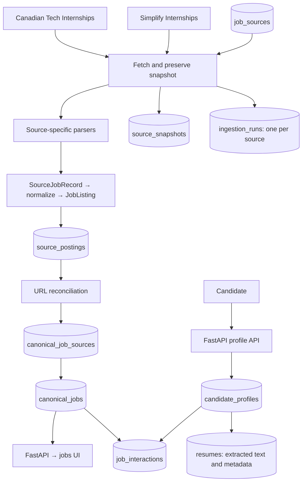

# InternshipFeed

InternshipFeed collects GitHub internship listings into one searchable,
deduplicated feed. Each repository has its own parser; both feed one normalizer
and the same PostgreSQL repository.



The complete table structure, constraints, identity rules, indexes, migration,
and example queries are documented in **[docs/database.md](docs/database.md)**.

## Sources

| Key | Dataset | Format |
| --- | --- | --- |
| `canadian-tech` | [Canadian Tech Internships](https://github.com/negarprh/Canadian-Tech-Internships-2027) | `main/README.md`, Markdown table |
| `simplify` | [SimplifyJobs Summer 2027](https://github.com/SimplifyJobs/Summer2027-Internships) | `dev/README.md`, HTML tables |

The supplied Simplify Summer2026 repository link redirects to Summer2027. Its
2026 archive is a separate file. The parser reads the term from document context;
relative ages such as `2d` are retained as raw text, not guessed posting dates.
Simplify includes international listings, so the combined feed is not Canada-only.

PostgreSQL `job_sources` controls repository, file path, branch, display name, and
whether a source is enabled. The code registry supplies parser implementations.

## Local setup

Python 3.9+ and PostgreSQL are required:

```sh
python3 -m venv .venv
source .venv/bin/activate
python -m pip install --upgrade pip
python -m pip install -e '.[test]'
```

Use the configured PostgreSQL service, or Docker:

```sh
docker compose up -d --wait
# Copy only if .env has not already been configured.
cp .env.example .env
```

Alternatively the development launcher can run PostgreSQL locally:

```sh
python -m pip install -e '.[local-postgres]'
python -m internshipfeed.dev_db
```

Keep its terminal running. Data is retained in `data/postgres`. Existing `.env`
configuration is preserved; a connection URL is created only if the file is absent.
Environment variables take precedence over `.env`.

In another terminal with the environment activated:

```sh
python -m internshipfeed.db
python -m uvicorn internshipfeed.api:app --host 127.0.0.1 --port 8000
```

Open **http://localhost:8000** and click **Sync & enrich** to run both enabled
sources. The background workflow fetches, snapshots, parses, normalizes, optionally
reads descriptions, reconciles URLs, and persists metadata. Progress includes both
overall batch counts and per-source execution counts.

The small public `CanonicalJob` API contract remains:

```text
id, company, title, location, application_url, posted_at, status
```

PostgreSQL stores additional canonical description, keywords, observation, and
creation/update metadata. The UI reads a `JobDetails` envelope containing the core
job, term, description, keywords, and source provenance.

## Parsing, descriptions, and reconciliation

The Canadian parser handles inherited companies (`↳`), nested application badges,
full dates, and closed markers. Simplify parsing handles category HTML tables,
location details, employer links versus companion links, and stable companion IDs.
Both emit `SourceJobRecord` and share `normalize()`.

Description extraction checks robots.txt and reads public pages using JSON-LD or
readable job HTML. Explicit keyword/qualification rules identify technology mentions
and requirement lines. JavaScript-only or blocked pages can remain unavailable.
Successful descriptions and recent dead-link checks are reused for 24 hours.

Reconciliation uses normalized application URLs, preserving job identifiers while
removing known tracking parameters. Similar titles, missing URLs, and generic
careers pages do not cause a merge. Each source posting retains its own identity;
the mapping table records its canonical assignment, method, confidence, and URL
evidence. Confirmed redirects from readable job descriptions can link URL aliases.

A source posting, its mapping, and refreshed canonical metadata commit atomically.
A source failure does not roll back other sources. Closed/dead listings are hidden
from the feed; one source closing a listing does not hide another source's open
observation. Source disappearance alone does not prove closure.

## Optional command line

```sh
# Both enabled sources.
python -m internshipfeed

# Listing metadata only.
python -m internshipfeed --no-enrich

# One source, or a saved source snapshot.
python -m internshipfeed --source simplify --no-enrich
python -m internshipfeed --source simplify --input path/to/README.md --no-enrich
```

`--input` without `--source` replays Canadian data. `--enrich-limit` caps page attempts,
`--delay` controls pacing, and `--refresh-descriptions` bypasses the description cache.

PostgreSQL is authoritative for source snapshots and ingestion history. Ignored
`data/snapshots`, `data/source_records.json`, `data/run.json`, and `data/runs` files
remain local diagnostics/replay artifacts.

## API

- `GET /api/profile`: the seeded development candidate profile, including ID and timestamps.
- `PUT /api/profile`: replace all five editable fields; return the normalized, persisted profile.
- `GET /api/sources`: configured datasets, including source IDs and enabled state.
- `GET /api/jobs`: seven-field canonical jobs; optional `source_id` (dataset ID), `source` (repository URL), `status`, and `q` filters.
- `GET /api/jobs/{id}`: a canonical job; merged IDs resolve to their survivor.
- `GET /api/jobs/{id}/details`, `GET /api/feed`: core jobs with separate source/enrichment context.
- `POST /api/sync`: start or return the active multi-source batch.
- `GET /api/ingestion-batches/latest`, `GET /api/ingestion-batches/{uuid}`: overall UI progress.
- `GET /api/ingestion-runs`, `GET /api/ingestion-runs/latest`, `GET /api/ingestion-runs/{uuid}`: per-source operational records; the list accepts `source_id`.
- `GET /api/health`: database connectivity; `GET /docs`: API documentation.

Sync and profile updates use the existing local-only mutation policy. Internet
deployment needs an authenticated operator interface and durable background worker
management.

Candidate profile persistence + FastAPI profile API is implemented using the one
seeded development profile. PUT requires `target_roles`, `skills`,
`preferred_locations`, `preferred_terms`, and `graduation_year`, even when clearing
them with empty lists and null. List items must be strings; whitespace and blank
items are removed, and exact case-sensitive duplicates keep their first order and
spelling. Graduation year must be null or an integer from 1900 to 2200, matching
the existing database constraint. Extra fields (including IDs/timestamps), missing
fields, and invalid types receive HTTP 422. A missing seed or unavailable database
receives HTTP 503. Reads never create a profile.

For example, with the application running:

```sh
curl http://127.0.0.1:8000/api/profile
curl -X PUT http://127.0.0.1:8000/api/profile \
  -H 'Content-Type: application/json' \
  -d '{"target_roles":["Software Engineering","Backend Engineering"],"skills":["Python","SQL"],"preferred_locations":["Toronto","Ottawa"],"preferred_terms":["Summer 2027"],"graduation_year":2027}'
curl http://127.0.0.1:8000/api/profile
```

Résumé/event tables and helpers remain storage foundations. Profile editing UI,
résumé upload/extraction, recommendations/matching, and authentication are future work.

## Tests

```sh
# Local unit checks; database tests skip without TEST_DATABASE_URL.
python -m unittest discover -s tests -v

# Use the existing local PostgreSQL service, isolated test schemas only.
python scripts/test_with_existing_postgres.py

# Or explicitly launch a disposable server (requires local-postgres extra).
python scripts/test_with_postgres.py
```

Tests cover source parsing, snapshot deduplication/ownership, per-source runs,
raw versus normalized values, within-source identities, cross-source URL matching,
canonical metadata, disabled sources, failure isolation, migration preservation,
profile seeding, profile API validation/persistence/timestamps, résumé text,
event append semantics, and API/UI contracts. Database tests isolate both their
schemas and advisory sync-lock keys from the running application.

## Modules

- `fetch.py`, `sources/`, `source.py`: transport, registry, and source parsers.
- `records.py`, `normalize.py`, `models.py`: shared intermediate/domain contracts.
- `enrich.py`: description and deterministic keyword extraction.
- `reconciliation.py`: URL matching, explainable mappings, canonical metadata refresh.
- `db.py`, `migrations/`: PostgreSQL configuration, lineage, repositories, and schema.
- `ingestion.py`, `sync.py`, `cli.py`: source runs, batch progress, background workflow.
- `api.py`, `web/`: database-backed API and UI.
