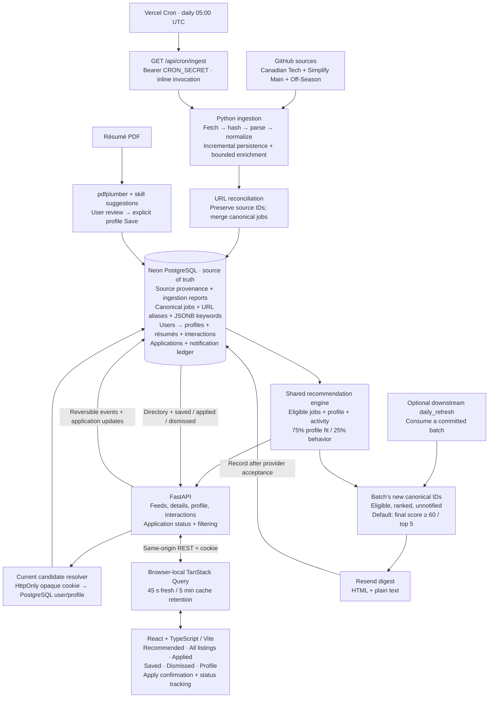

# InternshipFeed

**Problem Statement:** Canadian students are often limited towards co-op portals and LinkedIn when searching for tech internships. These postings tend to be generalized and it may be difficult for students to see which postings would provide a good fit to their strengths and abilities. InternshipFeed aims to provide a personalized feed of postings based on a students previous experiences, strengths, and interests as an applicant.

[Architecture](#architecture) · [Ingestion](#ingestion) · [Database](#database) ·
[Ranking](#ranking) · [Frontend](#frontend) · [API](#api) ·
[Daily email](#daily-email) · [Run locally](#run-locally) · [Vercel](#vercel) · [Verification](#verification)

## Product requirements

- Combine source listings without duplicate opportunities or lost source identities.
- Show available descriptions, technical requirements, dates, status, and application links.
- Explain ranking; preserve reversible Saved, Applied, and Dismissed state.
- Keep résumé suggestions subject to review and explicit profile saves.
- Email the best eligible new jobs, with persistent notification deduplication.

## Architecture



**Backend:** Python, FastAPI, Pydantic 2, psycopg 3, and PostgreSQL.
**Frontend:** React, TypeScript, and Vite. The API, ingestion, and daily command
share persistence, eligibility, and ranking logic.

<details>
<summary>Implementation map</summary>

| Area | Code |
| --- | --- |
| Fetch, parse, normalize, enrich | [fetch.py](internshipfeed/fetch.py), [source.py](internshipfeed/source.py), [sources/](internshipfeed/sources/), [normalize.py](internshipfeed/normalize.py), [enrich.py](internshipfeed/enrich.py) |
| Ingestion and reconciliation | [ingestion.py](internshipfeed/ingestion.py), [reconciliation.py](internshipfeed/reconciliation.py) |
| Contracts and storage | [models.py](internshipfeed/models.py), [db.py](internshipfeed/db.py), [migrations/](internshipfeed/migrations/) |
| Ranking | [matching.py](internshipfeed/matching.py), [behavioral.py](internshipfeed/behavioral.py), [recommendations.py](internshipfeed/recommendations.py) |
| Interface | [api.py](internshipfeed/api.py), [frontend/src/](frontend/src/) |
| Résumés and email | [resumes.py](internshipfeed/resumes.py), [resume_skills.py](internshipfeed/resume_skills.py), [daily_refresh.py](internshipfeed/daily_refresh.py), [notifications.py](internshipfeed/notifications.py) |

</details>

## Ingestion

### Sources and normalization

| Source key | Repository | Dataset/parser |
| --- | --- | --- |
| `canadian-tech` | [Canadian Tech Internships](https://github.com/negarprh/Canadian-Tech-Internships-2027) | `main/README.md`; Markdown tables, inherited company names, badges, dates, closed markers. |
| `simplify` | [SimplifyJobs Summer 2027](https://github.com/SimplifyJobs/Summer2027-Internships) | `dev/README.md`; category HTML tables, location details, companion IDs, document terms. Includes international jobs. |
| `simplify-off-season` | Same Simplify repository | `dev/README-Off-Season.md`; same `parse_simplify`, including per-row terms and archived tables with an omitted Term heading. |

`job_sources` configures each dataset; the registry binds its key to a parser.
Python `urllib` fetches source files; Markdown rules and `HTMLParser` parse them.
All emit `SourceJobRecord` → `normalize()` → `JobListing`, preserving source
identity, raw cells, job fields, term/status, snapshot, and enrichment results.
Relative ages such as `2d` stay raw; missing exact dates remain null.

**Posting dates:** Canadian Tech's full dates and any full Simplify dates normalize
to nullable `DATE` values (API: `YYYY-MM-DD`), retaining `raw_posted_at` on source
postings. Relative ages, yearless values, and malformed dates stay undated; no fetch
time or inferred year supplies a fake date. Canonical `posted_at` is the earliest
non-null linked upstream date and updates when earlier evidence arrives.
`first_seen_at` remains discovery metadata; daily email uses exact batch discovery
IDs independently of upstream dates. Existing posting-date indexes cover this field.

### Reconciliation and descriptions

- **Within source:** upsert by `(source_id, external_id)`.
- **Across sources:** compare normalized application URLs, removing known tracking/transport differences while preserving job IDs, path case, and meaningful hash routes. Missing URLs, generic careers pages, and similar titles do not establish a match.
- **Evidence:** mappings record `exact_application_url`, `resolved_application_url`, or `source_identity`, confidence, and matched URL. Confidence describes the rule decision, not a probability. ATS-specific/fuzzy matching is not implemented.
- **Enrichment:** commit new/changed metadata before reading application pages; respect robots.txt and extract JSON-LD/readable HTML with deterministic keyword rules. Unchanged jobs retain descriptions/keywords/resolved URLs without daily page fetches. Explicitly closed jobs are never enriched. `--refresh-descriptions` forces a deliberate backfill; blocked/JavaScript-only pages may remain incomplete.
- **Visibility:** closed/dead jobs are excluded from discovery. An active observation can keep a job visible when another source closes it; absence from a fully parsed/validated successful source snapshot closes that source posting. Fetch/parse/validation/storage failures suppress missing-posting closure; history is retained. Temporary fetch failures do not prove a dead link.

HTTP limits: **20 s timeout, 5 MB responses, two transient-error retries**.
Source hashes are compared against the last **successfully applied** incremental snapshot, never merely the last download. Identical hashes record successful no-change runs and skip parsing/enrichment. Changed sources normalize every row; unchanged observations update lineage/last-seen metadata in bulk, while material changes use normal reconciliation. Failed/partial snapshots are retried.

Posting/mapping/canonical changes commit atomically; row/source failures preserve
other work. Advisory locks serialize sync/reconciliation. Batch and source reports
count fetched, parsed, inserted, updated, skipped, and failed records, with separate
enrichment failures. Parse failures retain snapshots.

## Database

Source observations and canonical opportunities have separate identities.
Entity IDs use `bigint`, ingestion IDs `UUID`, posting dates `date`, and operational
timestamps `timestamptz`. Public contracts:

```text
CanonicalJob { id, company, title, location, application_url, posted_at, status }
JobDetails   { job: CanonicalJob, term, description, keywords, sources }
```

Statuses: `open`, `unknown`, `closed`, `dead`. Keywords are JSONB on canonical
jobs, grouping languages, frameworks, tools/platforms, concepts, and requirements.

| Table | Purpose and important constraints |
| --- | --- |
| `job_sources` | Dataset configuration; unique `key` and `(repository, file_path, branch)`. |
| `source_snapshots` | SHA-256, raw content, optional verified commit SHA, fetch time; unique `(source_id, content_hash)`. Identical content reuses its snapshot. |
| `source_postings` | Source/external ID, latest snapshot, raw and normalized cells, term/status, enrichment, first/last seen; unique `(source_id, external_id)`. Composite foreign key enforces snapshot ownership. |
| `canonical_jobs` | Seven public fields plus description, JSONB keywords, first/last seen, created/updated timestamps; materialized from linked observations. Active evidence wins; dates and keyword unions are retained deterministically. |
| `canonical_job_sources` | Canonical ↔ source-posting mapping, method/confidence/URL evidence; one current assignment per posting. |
| `canonical_job_identities`, `canonical_job_urls` | Stable identity allocation, merge redirects, and URL aliases; historical IDs continue resolving to the surviving job. |
| `ingestion_batches`, `ingestion_runs` | Overall sync progress and per-source execution status/counts, timing, snapshot, errors, and diagnostic reports. Batch reports retain exact new canonical IDs. |
| `users` | Anonymous UUID identity; database-generated created/last-seen timestamps. |
| `candidate_profiles` | Unique, required `user_id` FK to `users`; `target_roles`, `skills`, `preferred_locations`, `preferred_terms` as `text[]`; nullable integer `graduation_year`; created/updated timestamps. |
| `resumes` | Candidate ID, filename, extracted text, upload time. Uploads append versions; raw PDF files are not retained. |
| `job_interactions` | Append-only candidate/job/type/time behavior events; effective Saved/Applied/Dismissed flags remain derived. |
| `job_applications` | Current application status and submission/update timestamps; unique `(candidate_profile_id, canonical_job_id)`, checked statuses, candidate/job foreign keys. |
| `job_notifications` | Candidate/job/channel, provider message ID, acceptance time; unique `(candidate_profile_id, canonical_job_id, channel)`. |

[Migrations](internshipfeed/migrations/) are tracked in `schema_migrations`;
repeatable initialization preserves IDs/events. Snapshots retain dataset versions;
postings retain their latest observation. Unrecoverable legacy content and unverified
commit SHAs stay null. PostgreSQL is authoritative; `data/` holds diagnostics.

### Anonymous identity and ownership

Source datasets, canonical jobs, and ingestion remain **global**. Each anonymous
`users` row owns one `candidate_profiles` row; interactions, applications, résumés,
and notifications retain their existing candidate foreign keys and indexes. The
user primary key and unique profile owner supply the required indexes.

`GET /api/session` resolves a server-generated UUID cookie or atomically creates a
new user and blank profile. The cookie is **HttpOnly, host-only, SameSite=Lax,
Path=/, 180 days**, and Secure on Vercel deployments. Unknown/malformed cookies
receive fresh server-generated identities. Durable identity and state live in Neon;
there is no in-memory session store, account/password/OAuth service, or browser
profile-ID authorization. Last-seen writes are throttled to once per 15 minutes.

React establishes the session once before mounting parallel data queries, then
sends same-origin cookies. Each page owns its QueryClient; API responses use
`private, no-store` and `Vary: Cookie`. Recommendations combine shared jobs with
only that candidate's preferences/history. User writes check Origin/Fetch Metadata;
Vercel proxy host/protocol headers are trusted only in the Vercel environment.
Source sync retains its local/admin guard, and cron still requires `CRON_SECRET`.

[Migration 015](internshipfeed/migrations/015_anonymous_users.sql) assigns every
existing profile a generated owner without changing profile IDs/timestamps or
child history. The legacy seed remains available to internal/local tools and the
optional single-candidate email command; it is never assigned to public visitors.
New visitors start blank. Anonymous users receive no automatic multi-user email.

**Identity is browser-specific:** refreshes/reopens retain state while the cookie
exists. Clearing it, using incognito, or using another device creates a separate
profile. There is no account recovery or cross-device synchronization in this slice.

### Application tracking and indexes

`job_applications` stores `id`, candidate/job IDs, `status`, `applied_at`,
`status_updated_at`, `created_at`, and `updated_at`. An `applied` event and its
initial tracker row commit together. Repeated Apply preserves the original date
and progression; status-only updates change `status_updated_at`/`updated_at`
without adding behavior events. Unmark removes the current tracker row and retains
interaction history; reapplying starts a fresh record. Migration 012 backfills only
effectively applied jobs, using the first submission after the latest Unmark.

Canonical merges consolidate trackers per candidate: the latest effective Apply/
Unmark decides retention; the latest status update wins, with the earliest stored
submission date retained. Historical interaction IDs are preserved. Application
outcomes do not change recommendation weights or behavior evidence.

| Query pattern | Index | Benefit |
| --- | --- | --- |
| Applied for one candidate, ordered by latest update | `job_applications(candidate_profile_id, updated_at DESC, id DESC)` | Supports default history ordering. |
| Applied filtered by candidate and status, same order | `job_applications(candidate_profile_id, status, updated_at DESC, id DESC)` | Narrows status views before loading job metadata. |
| Reconcile trackers when canonical IDs merge | `job_applications(canonical_job_id)` | Finds affected candidate records without scanning all applications. |
| Candidate/job history and latest-event lookup across aliases | `job_interactions(candidate_profile_id, canonical_job_id, id DESC)` | Supports candidate-scoped identity joins and event lookup. |

Migrations 012/013 add these indexes. Existing interaction candidate/time and job/time indexes remain. The mapping
primary key `(canonical_job_id, source_posting_id)` and unique `source_posting_id`
already cover both mapping directions. No duplicate mapping indexes were added.
Canonical status/date indexes already exist. Current canonical visibility/sorting
occurs after loading, so no combined status/date index was added. Discovery uses
exact IDs, and event-type filtering follows effective-state resolution; neither
needs the additional proposed time/type indexes.

## Ranking

Rule scores are computed on request. Each dimension takes its best evidence;
missing preferences/metadata earn zero without reweighting. Graduation is not scored.

| Profile component | Points | Rule |
| --- | ---: | --- |
| Role | 0–40 | 40 for a target phrase/shared role family; otherwise 30 for two overlapping tokens including a specialty, 15 for one specialty, or 0. Generic words alone do not match. |
| Skills | 0–30 | `round_half_up(30 × matched unique job skills / unique detected job skills)`; no detected skills or overlap earns 0. Requirements prose is excluded. |
| Location | 0–20 | 20 for city/region or explicit remote fit, 15 for province, 8 for country; conflicting known regions block that location match. Remote Canada requires Canadian evidence. |
| Term | 0–10 | 10 for season+year, 6 for season with a missing year, 4 for year with a missing season. Missing/conflicting evidence earns 0; posting dates never supply terms. |

Normalization folds case/accents/separators while preserving `C++`, `C#`, `.NET`,
and `Node.js`. Explicit aliases include Postgres → PostgreSQL, K8s → Kubernetes,
NodeJS → Node.js, Google Cloud → GCP, and Amazon Web Services → AWS. Canonical
metadata and active source titles/locations/terms supply evidence. Exact taxonomies
and geographic rules live in [matching.py](internshipfeed/matching.py).

**Behavior:** active signals contribute once per type/current canonical job:
click **+1**, save **+2**, applied **+4**, dismiss **−3**; internal view is ignored.
Unsave/Unapplied/Undismiss cancel their corresponding signal. Net job weights
accumulate per metadata key and are capped at **−10…+10**. Dimension alignment
averages the target job's keys, including unseen keys as zero; matching locations
use the full location rule. Role/skill/company/location/term multipliers are
**4 / 3 / 0.5 / 1 / 0.5**. Missing dimensions remain neutral in the fixed denominator.

```text
C              = sum(weighted dimension alignments), bounded to −90…+90
behavior_score = clamp(round_half_up(50 + 50 × C / 90), 0, 100)
profile_score  = role + skills + location + term
final_score    = round_half_up(0.75 × profile_score + 0.25 × behavior_score)
```

Neutral behavior is 50. Order is final score, exact posting date
(null last), then canonical ID, descending. `score` remains profile fit; Recommended
adds `profile_score`, `behavior_score`, `final_score`, and up to two positive behavior
reasons. **API `min_score` filters profile fit; daily-email minimum filters final score.**
History views show profile fit and sort by their action time. All listings stays
chronological. Behavior is derived from saved interactions/current job metadata;
résumé text, embeddings, and LLMs are not scoring inputs.

## Frontend

### Stack and design

**React 19 + TypeScript + Vite 7 + TanStack Query 5**, plain CSS, shared SVG icons, self-hosted IBM
Plex Sans, and monospace skill tags. Node.js **22.12+** builds the app; FastAPI
serves its entry and `/profile/assets`. Ordinary tab clicks use history navigation;
direct links, modified clicks, and browser Back/Forward retain their normal behavior.

| Design token | Value / use |
| --- | --- |
| Background / surface / muted surface | `#f6f4ef` / `#fffefa` / `#f0eee7` |
| Text / muted text | `#252522` / `#6c6a63` |
| Border / stronger border | `#dedbd3` / `#bcb8ae` |
| Accent / soft accent / error | `#a44c30` / `#f4eae3` / `#993d31` |
| Spacing / radius | 4, 8, 12, 16, 24, 32, 48 px; 3 px controls/panels, 2 px tags. |

[Tokens](frontend/src/styles/tokens.css) and [styles.css](frontend/src/styles.css)
control compact typography, thin borders, restrained accents, and responsive layout.
Apply is primary; other actions are secondary. Tags wrap and narrow navigation
scrolls. Drawers support focus trapping/restoration, Escape/backdrop close, inert
backgrounds, and mobile widths. Loading/retry states, accessible labels, keyboard
focus, and reduced-motion support are shared requirements.

### Fetching and cache

One [query client](frontend/src/lib/queries.ts) keeps data fresh for **45 seconds**,
retains inactive queries for **5 minutes**, retries once, and disables window-focus
refetching. Stable keys separate development-candidate collections, Applied status
filters, directory data, job IDs, profile, résumé metadata/suggestions, and sources.
Directory filters remain local. Cache is in memory for the current page session.

A shared subtle spinner appears only without loaded data. Cached lists/forms/details
remain visible during background refresh and failures, with secondary refresh/retry
feedback. Tab revisits reuse fresh data immediately; stale data revalidates in place.
Confirmed interactions (including clicks), application updates, profile saves, and
completed ingestion invalidate job queries across tabs and details. Event cursors
prevent older cached snapshots from reversing confirmed state. Profile saves and
résumé uploads also update their respective caches; unsaved drafts remain local.

Every job view and details display known upstream dates as **Posted Nov 3, 2026**,
using UTC calendar formatting and an exact `<time>` value. Unknown dates are omitted
on cards and shown as unavailable in details. Discovery timestamps never substitute.

### Tabs and interaction contract

| Tab | Route | Membership and order |
| --- | --- | --- |
| Recommended | `/`, `/recommendations` | Active/unknown, not saved, dismissed, or applied; personalized rank. |
| All listings | `/listings` | Active/unknown, not dismissed or applied; saved jobs included. Search/metadata filters, chronological order, no scores. |
| Applied | `/applied` | Submitted jobs at every application status, including inactive/dismissed jobs; most recently updated application first. |
| Saved | `/saved` | Saved and not dismissed, including applied jobs; latest save first. |
| Dismissed | `/dismissed` | Dismissed, including saved/applied/inactive jobs; latest dismissal first, with Restore. |

Profile and job details open in drawers over the current tab. `/profile` opens
Profile over Recommended; `/feed` aliases All listings. Shared components display
server scores/order, progressively rendering 24 cards or 40 directory rows.

Cards retain one **% match** value (Recommended uses the existing final score) and
a short evidence summary. **Why this job?** expands matched roles, skills,
locations, terms, and supported activity reasons; component scores and formulas
stay in the API. Scores below 40 receive a UI-only **Limited match** label and
brief gaps only for configured preferences with available job metadata. Empty
profiles see setup guidance and **Edit profile**, with no baseline math.
The [explanation transformer](frontend/src/lib/recommendation-explanation.ts)
formats existing evidence without changing scoring or ordering.

Apply opens HTTP(S) immediately in a new tab (`noopener noreferrer`), records
`click` without blocking navigation, and asks **Did you apply for this role?**

| Confirmation | Existing interaction / result |
| --- | --- |
| Yes, I applied | `applied`; enters Applied and leaves Recommended, preserving Saved. |
| Save for later | `save` unless already saved; enters Saved and leaves Recommended. Saved jobs remain in All listings. |
| Keep in feed / Escape / close / outside click | No additional event; existing workflow state remains intact. |

Click means interest; Applied confirms submission and retains its stronger ranking
weight. Already-applied jobs open their application without another prompt. Cards
show Apply, Save, and Dismiss/Restore; **Job Details → Mark applied** supports
applications completed elsewhere. Applied history retains its Unmark control.

Save/Unsave, Applied/Unmark, and Dismiss/Restore remain independent. SQL resolves
merged IDs and selects the latest event per family, returning flags, dates, and
`last_event_id`. React reconciles confirmed snapshots without reloading, rejects
stale responses, and keeps failed confirmation actions open for retry. Restoring a
job preserves Saved/Applied and posting status. No new event types or stored
workflow flags are introduced.

### Applied tracker

Navigation order is **Recommended → All listings → Applied → Saved → Dismissed**;
Profile remains a drawer. Applied cards expose a compact status selector:
**Applied, Interview, Rejected, Ghosted, Offered**. Every status remains in Applied.
The filter offers All or one status; edits surface recently updated applications
without changing their original Applied date. Failed requests retain the old status
and allow retry. Cards in other tabs and job details omit this control.

`GET /api/applied?status=interview` returns application metadata with each card.
`PATCH /api/jobs/{id}/application` accepts `{ "status": "interview" }` and returns
the confirmed tracker record. The same candidate/local-write rules apply; a job
without an existing application returns 404, and unsupported statuses return 422.
Status editing uses the tracker, while Dismissed/Restore continues to use the
existing derived interaction state and never deletes history.

### Profile and résumé

The profile API replaces all five editable fields together. Arrays trim blanks
and exact duplicates; backend graduation year is an integer 1900–2200 or null.
The UI offers **2026–2030** plus Not specified, and **Winter/Summer/Fall × 2026–2030**
term chips with an add dropdown. Existing legacy values remain until edited.
Roles, skills, and locations stay open-ended tags; only explicit Save commits drafts.

PDFs must be readable, **≤5 MiB and ≤10 pages**. `pdfplumber` extracts text locally;
no OCR or AI is used. The latest successful résumé supplies controlled technical
skill suggestions using shared vocabulary/aliases, token boundaries, longest-phrase
precedence, canonical labels, and stable deduplication. Java/JavaScript,
C/C++/C#, and React/React Native remain distinct. Generic prose is excluded.

Suggestion chips/Add all update only the draft and exclude selected/pending aliases.
New PDFs replace suggestions, preserving profile skills. Suggestions retry separately
from uploads. Metadata/suggestion reads and UI state exclude raw text; the upload
API returns extracted text. No other preferences are inferred.

## API

FastAPI's **`/docs`** is the full request/response reference. Core surfaces:

| Method/path | Contract |
| --- | --- |
| `GET /api/jobs`, `/api/feed` | Candidate-visible canonical jobs or detail envelopes; `q`, `source`, `source_id`, `status` filters. |
| `GET /api/jobs/{id}`, `/api/jobs/{id}/details` | Single job/detail, resolving merged IDs. |
| `GET /api/recommendations`, `/api/saved`, `/api/applied`, `/api/dismissed` | Scored collections with SQL-derived state, term, and keywords; Recommended accepts `min_score=0..100`; Applied includes `application` metadata and accepts a status filter. |
| `GET /api/session` | Establish the anonymous cookie; returns only `anonymous`/`created` metadata. |
| `GET /api/profile`, `PUT /api/profile` | Current-session profile; PUT requires all five fields, rejects extra fields, and returns persisted values. |
| `POST /api/resumes` | Multipart `file` upload; HTTP 201 with résumé metadata and extracted text. |
| `GET /api/resumes/latest`, `/api/resumes/{id}/skill-suggestions` | Candidate-scoped metadata or `{resume_id, skills, aliases}`; no raw text. |
| `GET /api/interactions` | Effective candidate/job state; jobs without events default to false flags. |
| `PATCH /api/jobs/{id}/application` | Update an existing submitted application; checked `status`, immutable submission date. |
| `POST /api/jobs/{id}/interactions` | `{type: click \| save \| unsave \| applied \| unapplied \| dismiss \| undismiss}`; HTTP 201 event + state snapshot. |
| `POST /api/sync` | HTTP 202: start or return the active multi-source batch. |
| `GET /api/sources`, `/api/ingestion-batches/latest`, `/api/ingestion-batches/{uuid}` | Source configuration and overall progress. |
| `GET /api/ingestion-runs`, `/api/ingestion-runs/latest`, `/api/ingestion-runs/{uuid}` | Per-source execution records; list accepts `source_id`. |
| `GET /api/health` | Database connectivity. |
| `GET /api/ingestion-status` | Persisted last successful ingestion time, latest batch, and server-authorized manual-sync capability. |
| `GET /api/cron/ingest` | Bearer `CRON_SECRET`; synchronous production ingestion summary. Busy returns 200; failed/partial ingestion returns 503 with committed work retained. |

Candidate-specific reads/writes resolve ownership from the cookie, never from
payload/query user IDs. Profile, interaction, application, and résumé writes are
available on Vercel with same-origin protection; manual source sync stays restricted.
Sources and individual job details are global. Errors: invalid input **422**, missing
or unowned resource **404**, unavailable storage **503**, cross-origin write **403**,
and PDF format/size **415/413**.

## Daily email

Vercel Cron invokes ingestion directly; **email is optional and downstream**.
`python -m internshipfeed.daily_refresh` can ingest then notify, or consume a
committed cron batch with `--no-ingest --batch-id BATCH_UUID`. It validates email
configuration only after ingestion commits. The pipeline compares canonical
identities before/after ingestion under the sync lock. Exact surviving new IDs are
stored in the batch report; updates and source duplicates are excluded. Neither
`posted_at` nor inherited `first_seen_at` determines discovery.

The shared ranker selects new, unnotified, eligible matches: **final score ≥60,
top 5** by default. The official Resend SDK sends one escaped HTML/plain-text digest
with company, title, score, location, term, matched skills, and application links.
Private history, résumé text, internal IDs, and score components are excluded.

| Variable | Purpose/default |
| --- | --- |
| `DATABASE_URL` | Required PostgreSQL connection. |
| `DAILY_NOTIFICATION_CHANNEL` | `email`; other values are rejected. |
| `RESEND_API_KEY` | Required for sending. |
| `DAILY_EMAIL_FROM`, `DAILY_EMAIL_TO` | Verified Resend sender and one recipient. |
| `DAILY_EMAIL_MIN_SCORE`, `DAILY_EMAIL_TOP_N` | `60` (0–100), `5` (1–5). |
| `APP_BASE_URL` | Optional HTTP(S) app link in the footer. |

Environment overrides root `.env`; see [.env.example](.env.example). Configure a
Resend key and verified sender separately. Ledger writes occur **after acceptance**;
no SQL transaction spans the network call. Merge-aware candidate/job/email
uniqueness and Resend's 24-hour payload idempotency prevent ordinary repeats.
Acceptance is not inbox delivery; check ambiguous send/ledger failures before retrying.

```sh
python -m internshipfeed.daily_refresh --dry-run
python -m internshipfeed.daily_refresh --no-ingest --batch-id BATCH_UUID --dry-run
# After review/configuration, omit --dry-run to send that retained batch.
```

**Dry run persists ingestion**, prints subject/text/HTML, and neither sends nor
records notifications; credentials are not required. `--no-enrich` and
`--enrich-limit N` control job-page fetching. Fresh runs do not replay prior unsent
batches. Empty matches send nothing. Partial ingestion may email successful
results but exits 1; a full ingestion failure exits 1. Missing email settings yield
`notification_status=skipped_unconfigured`; provider/ledger failures yield
`failed`/`record_failed`, without changing `ingestion_status` or its exit code.
Provider failure writes no ledger rows. Success/no matches exit 0. Daily-command locks prevent overlap; no implicit send retry occurs.

The [host crontab example](scripts/daily_refresh.cron.example) is an optional
external email workflow, not the production ingestion schedule. It is not installed
automatically. The Vercel cron never requires Resend settings.

## Run locally

Requires **Python 3.9+**, **Node.js 22.12+**, and **PostgreSQL** (Compose uses 16).

```sh
python3 -m venv .venv
source .venv/bin/activate
python -m pip install -e '.[test]'
test -f .env || cp .env.example .env
docker compose up -d --wait
npm --prefix frontend ci
npm --prefix frontend run build
python -m internshipfeed.db
python -m uvicorn internshipfeed.api:app --host 127.0.0.1 --port 8000
```

Open **http://127.0.0.1:8000/**. Use **Update listings** in All listings to run the
shared ingestion/enrichment workflow and view progress. After frontend changes,
rebuild; restart FastAPI after backend changes. For live UI development, run
`npm --prefix frontend run dev` alongside FastAPI and open port **5173**;
`BACKEND_URL=http://127.0.0.1:8004` selects a different backend.

An existing PostgreSQL service can replace Compose. Without Docker, install
`'.[local-postgres]'`, run `python -m internshipfeed.dev_db` in another terminal,
and keep it running. It retains data under `data/postgres` and creates `.env` only
when absent; otherwise set `DATABASE_URL` to its printed connection URI.

```sh
python -m internshipfeed                                      # All enabled sources
python -m internshipfeed --source simplify --no-enrich         # Metadata only
python -m internshipfeed --source simplify --input snapshot.md --no-enrich
```

`--input` without a source replays Canadian data; `--enrich-limit`, `--delay`, and
`--refresh-descriptions` control enrichment. Ignored `data/` artifacts support
inspection/replay; credentials, snapshots, and exports are not public UI assets.

## Vercel

[vercel.json](vercel.json) deploys two independently built services in one project:

| Service | Root / entrypoint | Public routing |
| --- | --- | --- |
| `app` | `.` / `internshipfeed.api:app` (FastAPI) | `/api` and `/api/...`; original paths are preserved. |
| `frontend` | `frontend` (Vite; `npm ci`, `npm run build`, `dist`) | All remaining paths and assets; service-scoped SPA rewrites cover the existing navigation routes. |

The browser uses same-origin `/api/...` requests. Neither deployed service calls
the other server-side, so **no internal bindings are required**. Do not put an
internal URL into a `VITE_*` variable: bindings resolve only in runtime functions.
The standalone Vite development proxy uses optional `BACKEND_URL` (default port
8000); Vercel development and deployment use the shared routing table instead.

With `VERCEL=1`, Vite builds root-relative assets and FastAPI skips local static
mounts, keeping service builds independent. Ordinary local builds retain
`/profile/assets` for FastAPI hosting. [.vercelignore](.vercelignore) excludes local
credentials, environments, cached dependencies, generated builds, and runtime data.

1. Create/import one Vercel project with repository root **`.`**; leave build
   settings in the service configuration. Configure a reachable hosted PostgreSQL
   `DATABASE_URL` for the intended environment; local Compose/socket URLs cannot
   work on Vercel. Use a separate preview database to isolate test data from production.
2. With `DATABASE_URL` pointing at the hosted database, run
   `python -m internshipfeed.db`, then `python -m internshipfeed --enrich-limit 20`
   from an external machine. This loads all three sources and limits initial description
   fetching to 20 jobs; omit the limit for full enrichment. API startup applies
   migrations but does not scrape jobs: `/api/health` can return 200 while feeds are
   empty. Keep credentials in environment settings, never deployment JSON.
3. Use **Python 3.12** (pinned in `.python-version`) with a matching virtualenv for
   Vercel's current Python runtime; an existing Python 3.9 local-app environment
   cannot run the current Vercel dev runtime. Run `npx vercel@latest dev` from the
   repository root. For local-only testing without
   Vercel authentication, use `npx vercel@latest dev --local`. Check `/api/health`,
   direct links such as `/saved`, and frontend assets on the displayed shared URL.
4. After confirming service names/exposure, link/import the project and create a
   preview deployment; promote it only after checking the hosted database and access.

### Production cron and refresh

Required Vercel **Production** environment settings:

| Variable | Value |
| --- | --- |
| `DATABASE_URL` | The existing **Neon direct/unpooled PostgreSQL URL**; shared by web API and cron. No separate cron database. |
| `CRON_SECRET` | A generated server-only secret; Vercel sends `Authorization: Bearer <secret>`. Never use `VITE_*` or commit it. |

Deploy [vercel.json](vercel.json) to activate `GET /api/cron/ingest` at
`0 5 * * *`: **05:00 UTC = 00:00 EST**; during daylight saving this is 01:00 EDT.
Cron timing is approximate on Hobby. The `app` service sets `maxDuration=300`;
[scheduled_ingestion.py](internshipfeed/scheduled_ingestion.py) uses a 240-second
work budget and at most five enrichment attempts. Metadata commits first; if work
exceeds the budget, the run reports failure/partial failure and the next invocation
reprocesses the uncompleted snapshot, reusing committed rows. Large first loads or
full description backfills can use the existing CLI against the same Neon URL.
Deferred descriptions do not block metadata ingestion. Identical source hashes also
skip pending descriptions; use `--refresh-descriptions` for a deliberate backfill.
The endpoint performs critical work before returning, without a daemon thread,
local durable files, email credentials, or another scheduler service. PostgreSQL
session advisory locks prevent overlapping local/cron invocations; lock contention
returns `status=busy`. Keep the direct connection while these session locks are used.

Raw snapshots and run reports persist in Neon. CLI/local runs may additionally write
diagnostic files; cron passes `write_files=False`. Migration
[014_incremental_ingestion.sql](internshipfeed/migrations/014_incremental_ingestion.sql)
registers Off-Season for existing databases, once. Distinct file paths remain distinct
sources, and URL reconciliation preserves their mappings to one canonical job.

**Refresh data** only refetches PostgreSQL data. **Update listings** starts source
ingestion locally; the hosted UI hides it based on `/api/ingestion-status` rather than
exposing cron credentials or weakening the existing write guard. **Last updated**
uses the last persisted successful ingestion completion, not browser refresh time.
Hosted profile/résumé/interaction/application writes use the anonymous session owner and same-origin checks.
The local background-thread sync and progress polling remain available.

[Services](https://vercel.com/docs/services),
[cron authentication](https://vercel.com/docs/cron-jobs/manage-cron-jobs), and
[function limits](https://vercel.com/docs/functions/limitations) document Vercel's
platform behavior.

### Neon connection

Neon supplies pooled and direct URLs. The current startup/ingestion code uses
session-level advisory locks, so use the **direct/unpooled URL as `DATABASE_URL`**.
The local setup retains the pooled URL as `DATABASE_URL_POOLED` and the direct
original as `DATABASE_URL_UNPOOLED`. Future `neon env pull` calls may restore the
pooled default; reselect the direct URL before running this app's migrations/workers.

For Vercel's **Import .env**, use the private `data/neon/vercel.env` generated during
setup. It contains only the deployment `DATABASE_URL`; credentials and the `.neon`
project context are ignored by Git. Restart the app after changing its environment.
Paste URLs on one line without surrounding quotes or whitespace. Runtime errors
such as `invalid sslmode value: "require\n"` indicate a trailing newline in Vercel's
value; edit the environment variable and redeploy. The connection loader also trims
accidental surrounding whitespace.
Codex's project-scoped Neon MCP configuration lives in `.codex/config.toml` and
uses OAuth; restart Codex to load it and sign in if prompted. Local database settings
were preserved under `data/backups/neon-setup/`.

## Verification

```sh
python scripts/test_with_existing_postgres.py  # Isolated schemas on configured server
npm --prefix frontend test
npm --prefix frontend run build
# Optional browser dependency; supply your Chromium executable if needed.
python -m pip install -e '.[browser]'
python -m playwright install chromium
python scripts/check_recommendations_ui.py --browser-executable /path/to/chromium
python scripts/check_apply_ui.py --browser-executable /path/to/chromium
python scripts/check_cache_ui.py  # Bundled Chromium; isolated cache/loading/date checks
python scripts/check_sessions_ui.py  # Independent A/B browsers; isolated profiles/actions/resumes
python scripts/check_daily_email.py --browser-executable /path/to/chromium
```

Checks cover parsing/deduplication, migrations, merges, ranking, reversible state,
PDF suggestions, application progression/backfill/indexes, cached navigation/loading,
posting-date reconciliation and discovery independence, UI/keyboard/mobile behavior,
failure isolation, and email dry runs.
Browser runners clean up temporary schemas/API processes; providers are mocked.
Prefer the isolated runner: `check_profile_ui.py` alone appends fixture résumés.
Unit-only command: `python -m unittest discover -s tests -v`; DB tests require
`TEST_DATABASE_URL`. Previews/screenshots go to `data/screenshots`.

**Production gaps:** account login/recovery and cross-device identity,
delivery webhooks/bounce handling, and deployment monitoring. Blocked descriptions,
unknown technologies, and unrecognized locations remain incomplete. Real inbox
rendering/delivery and broader device/screen-reader
coverage require deployment verification. No LLM/embedding/OCR services, SMS,
application submission automation, or additional scheduler infrastructure are used.
