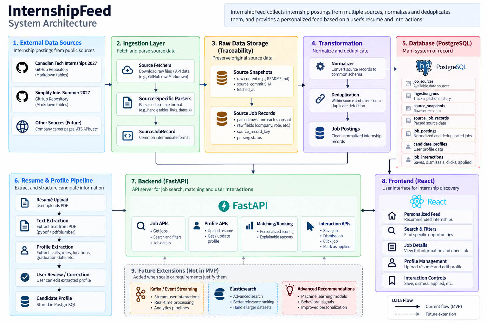
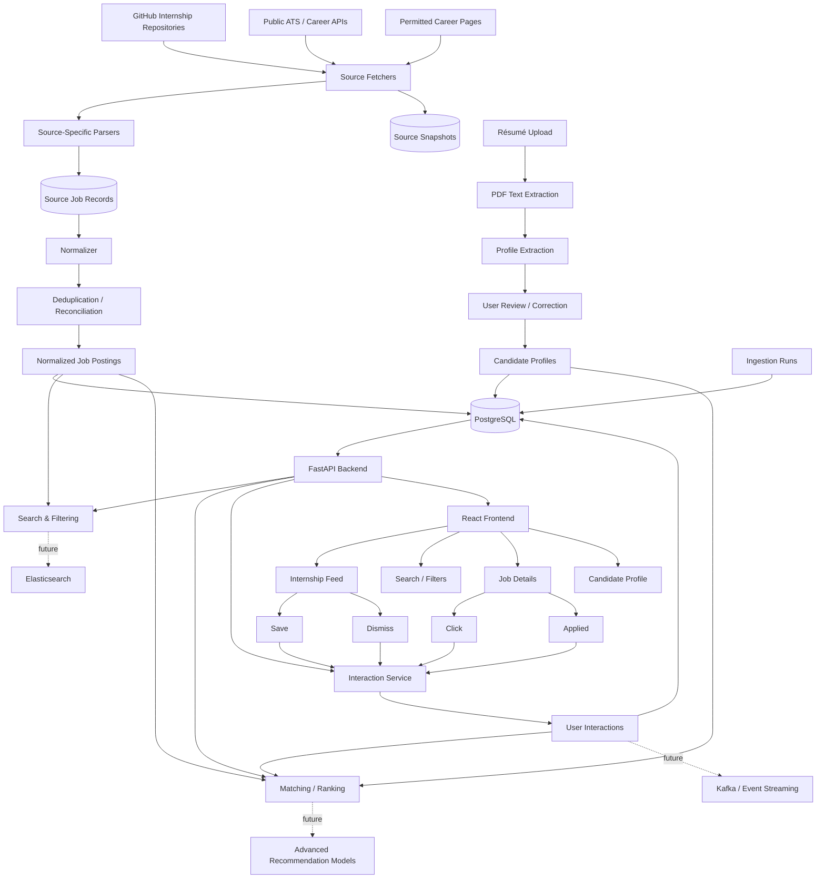

Problem Statement: Canadian students are often looking for jobs through co-op portals and externally through career pages and social media platforms such as LinkedIn. Students are having to apply to jobs that are not suited towards their strengths and finding that relevant opportunities have inaccessible/hidden postings. InternshipFeed consolidates internship postings into one searchable feed and uses a student-controlled candidate profile and past interactions to explain why specific jobs may be relevant.



## CHAT GPT System Architecture

InternshipFeed is designed as a modular monolith with a clear data pipeline from external internship sources to a personalized user feed.

The system separates source-specific ingestion from normalized application data so that multiple upstream sources can be supported without changing the rest of the platform.



### Data Flow

The primary workflow is:

```text
External internship sources
        ↓
Fetch raw source data
        ↓
Preserve source snapshot
        ↓
Parse source-specific job records
        ↓
Normalize into common schema
        ↓
Deduplicate and reconcile
        ↓
Store in PostgreSQL
        ↓
Expose through FastAPI
        ↓
Search, filter and rank
        ↓
Display personalized feed in React
```

The candidate workflow runs alongside the job-ingestion pipeline:

```text
Résumé PDF
    ↓
Text extraction
    ↓
Candidate profile extraction
    ↓
User correction
    ↓
Structured candidate profile
    ↓
Matching engine
    ↓
Explainable internship ranking
```

User interactions create another feedback loop:

```text
View job
   ↓
save / dismiss / click / applied
   ↓
interaction history
   ↓
PostgreSQL
   ↓
matching signals
   ↓
future feed ranking
```

---

## Architecture Layers

### 1. Source Layer

InternshipFeed can consume multiple upstream sources.

Initial sources include public GitHub repositories such as:

- `negarprh/Canadian-Tech-Internships-2027`
- `SimplifyJobs/Summer2027-Internships`

Future sources may include public applicant-tracking-system APIs or permitted company career pages.

Each source can have a different schema, so source-specific logic is isolated from the rest of the application.

---

### 2. Ingestion Layer

The ingestion layer is responsible for retrieving external data.

Its responsibilities include:

- fetching repository files or API responses
- recording ingestion attempts
- handling network failures
- preserving the original upstream representation
- preventing repeated ingestion from creating duplicate data

Fetching is deliberately kept separate from parsing and normalization.

---

### 3. Raw Data and Lineage

InternshipFeed preserves upstream data before transforming it.

A source snapshot represents the exact state of an upstream dataset at a particular point in time.

For example:

```text
GitHub README
      ↓
source snapshot
      ↓
parsed source records
      ↓
normalized jobs
```

This allows the system to:

- debug parsing problems
- reprocess historical data
- detect upstream changes
- trace normalized jobs back to their source
- compare previous and current source states

---

### 4. Source-Specific Parsing

Each external source is parsed independently.

For example:

```text
Canadian Tech Internships Parser
            ↓
       SourceJobRecord
```

and:

```text
Simplify Internships Parser
            ↓
       SourceJobRecord
```

Both parsers output a shared intermediate representation.

This prevents source-specific formatting rules from leaking into the rest of the system.

Examples of source-specific behaviour include:

- inherited company names such as `↳`
- Markdown application links
- closed-job markers
- different date formats
- different table columns

---

### 5. Normalization

The normalization layer converts source records into InternshipFeed's common job schema.

For example:

```text
Source A:

Company: Autodesk
Role: Software Development Internship
Location: Toronto, ON
Apply: ...
```

and:

```text
Source B:

Employer: Autodesk
Title: Software Developer Intern
City: Toronto
URL: ...
```

can both become:

```text
JobPosting

company_name
title
location_text
apply_url
date_posted
status
source
first_seen_at
last_seen_at
```

This gives downstream systems one consistent representation regardless of where the job originated.

---

### 6. Deduplication and Reconciliation

InternshipFeed handles two different duplicate problems.

#### Within-source duplicates

The same upstream job should not be inserted repeatedly every time ingestion runs.

Stable identifiers, application URLs, hashes and database uniqueness constraints are used to make ingestion idempotent.

```text
same source job fetched twice
            ↓
same normalized job
```

#### Cross-source duplicates

The same real-world internship may appear in multiple upstream repositories.

For example:

```text
GitHub Source A
Autodesk — Software Developer Intern
                   \
                    → Canonical opportunity
                   /
GitHub Source B
Autodesk — Software Engineering Intern
```

Cross-source deduplication can later use signals such as:

- application URL
- company
- normalized title
- location
- posting date

The MVP begins with deterministic rules before introducing fuzzy matching.

---

### 7. PostgreSQL

PostgreSQL is the primary system of record.

It stores data such as:

```text
job_sources
ingestion_runs
source_snapshots
source_job_records
job_postings
candidate_profiles
resumes
job_interactions
```

PostgreSQL is also used initially for:

- uniqueness constraints
- transactional updates
- filtering
- indexing
- full-text search

External systems such as Elasticsearch are deferred until PostgreSQL search becomes an identified limitation.

---

### 8. FastAPI Backend

FastAPI exposes application functionality to the frontend.

Initial endpoints may include:

```text
GET    /jobs
GET    /jobs/{id}

POST   /resumes
GET    /profile
PUT    /profile

POST   /jobs/{id}/save
POST   /jobs/{id}/dismiss
POST   /jobs/{id}/applied
POST   /jobs/{id}/click
```

The API layer does not contain source-specific ingestion logic.

Instead it works with normalized application data.

---

### 9. Résumé and Candidate Profile Pipeline

Users can upload a résumé as a PDF.

The document pipeline performs:

```text
PDF
 ↓
text extraction
 ↓
structured profile proposal
 ↓
user review
 ↓
candidate profile
```

The system may extract fields such as:

- skills
- target roles
- graduation date
- preferred locations
- education
- experience keywords

Extracted values are treated as suggestions rather than unquestionable facts.

Users can correct their profile before it is used for matching.

---

### 10. Matching and Ranking

The MVP uses deterministic and explainable matching.

Potential signals include:

```text
target-role match
skill overlap
location preference
internship term
graduation eligibility
previous interactions
```

Rather than producing an unexplained machine-learning score, InternshipFeed should be able to provide reasons such as:

```text
Recommended because:

• role matches Software Engineering
• posting is located in Toronto
• job mentions Python and SQL
```

More advanced recommendation models can be introduced later if sufficient interaction data exists.

---

### 11. User Interaction Events

Users can interact with jobs by:

```text
saving
dismissing
clicking
marking as applied
```

These actions are stored as interaction records rather than directly modifying recommendation logic.

This provides a historical event stream that can later be used for:

- recommendation improvements
- analytics
- behavioural features
- event-stream processing

---

## Future Evolution

The MVP intentionally avoids distributed infrastructure.

The initial architecture is:

```text
React
  ↓
FastAPI
  ↓
PostgreSQL
```

with ingestion running as a simple scheduled process.

Technologies such as Kafka, Elasticsearch and advanced recommendation models are introduced only after the system contains a problem that justifies them.

Potential evolution:

```text
                    ┌──────────── Kafka ────────────┐
                    │                               │
User Interactions ──┼→ analytics consumers         │
                    ├→ recommendation consumers     │
                    └→ monitoring / event consumers │
```

Search may later evolve from:

```text
PostgreSQL Full-Text Search
```

to:

```text
Elasticsearch
```

if requirements such as typo tolerance, advanced relevance ranking or large-scale search justify the additional infrastructure.

---

## Design Principles

InternshipFeed follows several architectural principles:

- preserve raw data before transforming it
- make ingestion idempotent
- enforce correctness with database constraints
- isolate source-specific behaviour
- prefer simple infrastructure first
- keep components independently understandable
- make failures observable
- maintain data lineage
- use explainable recommendation logic
- introduce distributed systems only when a concrete limitation exists

The goal is not to simulate unnecessary production complexity, but to build a system that can evolve naturally as new engineering requirements appear.
## Running InternshipFeed

The implemented pipeline is **GitHub README → snapshot → source records → validated
JobListing → PostgreSQL → FastAPI → jobs UI**. The UI lists jobs and opens a detail
view with descriptions, technology/framework keywords, and requirement lines.

### Setup

Python 3.9+ and PostgreSQL are required. From the project root:

```sh
python3 -m venv .venv
source .venv/bin/activate
python -m pip install --upgrade pip
python -m pip install -e '.[test]'
```

For Docker users, start PostgreSQL 16 and configure the connection (copy the
example only if you have not already configured `.env`):

```sh
docker compose up -d --wait
cp .env.example .env
```

Alternatively, set `DATABASE_URL` in `.env` or the environment to an existing
PostgreSQL database. Environment variables take precedence.

For development without Docker/PostgreSQL, the optional launcher runs an actual
PostgreSQL server from bundled binaries:

```sh
python -m pip install -e '.[local-postgres]'
python -m internshipfeed.dev_db
```

Keep that terminal running. On first launch it writes a local connection URL to
`.env` if the file does not exist. An existing `.env` is preserved; configure its
`DATABASE_URL` to the printed local URL if needed. Database files are retained in
`data/postgres`; Ctrl+C stops the server. On macOS/Linux it uses a Unix socket.
This launcher is for local development; use a separately administered PostgreSQL
service for deployments.

In another terminal with the virtual environment activated:

```sh
# Create tables (idempotent; ingestion also does this automatically).
python -m internshipfeed.db

# Fetch and persist listings.
python -m internshipfeed

# Fetch descriptions for up to 10 open listings and save their keywords.
python -m internshipfeed --enrich --enrich-limit 10

# Serve API and UI together.
python -m uvicorn internshipfeed.api:app --host 127.0.0.1 --port 8000
```

Open **http://localhost:8000**. Search/filter listings, click a role for details,
and click Refresh after ingestion. FastAPI serves UI and API from the same
origin. The old `python -m http.server` command no longer serves a working jobs
feed. Run the app from a source checkout containing `index.html` and `web/`.

To reprocess a saved snapshot without downloading GitHub:

```sh
python -m internshipfeed --input data/snapshots/<sha256>.md
```

### Shared model and database

`internshipfeed/models.py` defines a validated Pydantic `JobListing`. Ingestion,
PostgreSQL reads, and API responses use the same contract:

| Field | Meaning |
| --- | --- |
| `id` | Database-generated integer primary key |
| `company`, `title`, `location` | Required listing text |
| `url` | Current application URL; nullable for closed/missing links |
| `last_known_url` | Most recently seen application URL, retained on closure |
| `source` | Source repository URL |
| `external_id` | Deterministic source-specific identity fingerprint |
| `posted_at` | Posting date, stored as PostgreSQL `DATE`; nullable |
| `term` | Explicit season/year from the title; nullable |
| `status` | `open`, `closed`, or `unknown`, according to the repository |
| `description` | Extracted job description; nullable |
| `keywords` | Languages, frameworks, tools/platforms, concepts, and requirement lines |
| `enrichment_status`, `enrichment_error` | Outcome of the latest attempted enrichment |
| `extraction_method`, `resolved_url`, `enriched_at` | Provenance of the retained description |
| `snapshot_id`, `source_line` | Source lineage |
| `first_seen_at`, `last_seen_at` | Database observation timestamps in UTC |

`internshipfeed/migrations/001_jobs.sql` creates `jobs` and `ingestion_runs`.
Jobs have a database **unique constraint on `(source, external_id)`**, so
concurrent ingestions cannot insert multiple rows for the same identity.

The source has no durable upstream job ID. Its fingerprint uses source, company,
title, location, and posting date. URL/status are excluded because links disappear
on closure. Reruns refresh listing content, source lineage, and `last_seen_at`;
`id` and `first_seen_at` remain stable. Source corrections to identity fields
produce a new identity. This is within-source deduplication; cross-source
reconciliation remains a future step. Jobs missing from later snapshots remain
stored, and absence alone does not mark them closed.

Successful enrichment replaces description/keywords. Ordinary reruns and failed
enrichment attempts preserve existing descriptions and their provenance. An
attempted failure updates enrichment status/error; if enrichment is not attempted,
the existing status is preserved. Legacy `data/jobs.json` files are no longer
written or read by the UI.

### Description enrichment

The source is
[negarprh/Canadian-Tech-Internships-2027](https://github.com/negarprh/Canadian-Tech-Internships-2027),
read from `main/README.md`. Parsing handles nested application badges, inherited
company names (`↳`), and closed markers. Terms are populated only when explicit
in the title. `url` is the application URL, not the badge image URL. Status
reflects the repository rather than an independent check of the application page.

`--enrich` checks robots.txt and fetches public pages with timeouts, bounded
responses, retries, and a default one-second delay between listings. It first
extracts a single JSON-LD `JobPosting` description, then tries readable
`main`/`article` HTML with recognizable job sections. JavaScript-only pages,
access restrictions, and ambiguous pages can prevent extraction. Outcomes are
recorded and never imply that a job has closed.

The explicit vocabulary in `enrich.py` finds technology mentions. Requirement
lines come from recognizable qualification/requirement sections. Mentions are
not proof that a skill is mandatory, and the vocabulary is not exhaustive.
The detail view displays the extracted text and keyword groups. Jobs beyond
`--enrich-limit` are not attempted; unavailable descriptions are not invented.

### Observability

Every ingestion prints a JSON summary, for example:

```json
{"status":"success","scraped":508,"inserted":492,"updated":0,"skipped_duplicates":16,"failed":0,"enrichment_failed":0}
```

- `scraped`: parsed source rows, including repeated rows.
- `inserted`: new database jobs committed successfully.
- `updated`: existing jobs whose listing content changed, including new descriptions.
- `skipped_duplicates`: repeated source rows or existing jobs with unchanged content. Observation timestamps/lineage still refresh for existing jobs.
- `failed`: rows that could not be validated or stored, with source line errors.
- `enrichment_attempts`, `enrichment_successes`, `enrichment_failed`: separate description-fetch counters in the full report. An unavailable description does not fail an otherwise valid listing.

After parsing, `scraped = inserted + updated + skipped_duplicates + failed`.
Fetch/parse failures are recorded at run level when no rows can be parsed.
Each job write is transactional; a bad record does not roll back successful jobs.
Partial failures, connection failures, and report-persistence failures exit with
code 1.

Reports are stored in `ingestion_runs`, `data/run.json`, and
`data/runs/<uuid>.json`. If PostgreSQL is unavailable, local reports still capture
the failure. Raw snapshots are retained in `data/snapshots/<sha256>.md`, and source
rows in `data/source_records.json`. Generated data and `.env` are excluded from Git.

### API

- `GET /api/jobs`: database jobs, newest posting date first. Optional `status` and `q` filters.
- `GET /api/jobs/{id}`: one job including description and keywords; missing IDs return 404.
- `GET /api/ingestion-runs/latest`: latest persisted report, or `null` before the first run.
- `GET /api/health`: database connectivity check.
- `GET /docs`: generated API documentation.

Database outages return 503 with a generic message. The UI never reads scraper
output files; snapshots, `.env`, and exports are not served by the API.

### Validation

```sh
# Unit tests; database tests skip without TEST_DATABASE_URL.
python -m unittest discover -s tests -v

# Full suite against disposable real PostgreSQL (needs local-postgres extra).
python scripts/test_with_postgres.py
```

Alternatively, set `TEST_DATABASE_URL` to an existing test database and run
unittest. Each database test creates/drops its own random schema, leaving existing
application tables untouched. Coverage includes concurrent deduplication, unique
constraints, repeat counts, closure updates, preserved descriptions, API filters
and details, and failure isolation.

For the optional browser smoke check, run the API with the source listings loaded
and Solink's description enriched, then use an installed Chromium browser:

```sh
python -m pip install -e '.[browser]'
python scripts/check_ui.py --browser-executable /path/to/chromium
```

The check covers search, status filtering, stored descriptions/requirements,
refresh, and the mobile details dialog. Screenshots are saved in `data/screenshots`.

### Module boundaries

- `fetch.py`: HTTP transport and source configuration.
- `source.py`: repository-specific Markdown parsing.
- `models.py`, `normalize.py`: validated schema and source identity.
- `enrich.py`: description/keyword extraction.
- `db.py`, `migrations/`: PostgreSQL storage/schema setup.
- `cli.py`: ingestion orchestration, snapshots, and reporting.
- `api.py`: database API and UI hosting.
- `dev_db.py`: optional development PostgreSQL launcher.
