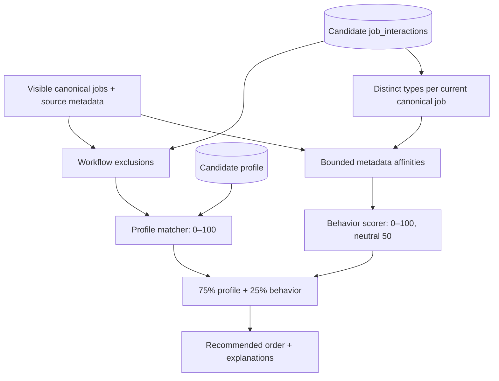

# Deterministic behavioral recommendations

The explicit profile matcher in `matching.py` still awards role 40, skills 30,
location 20, and term 10 points. Its `score`, component values, matched skills,
and reasons retain their original meaning. `behavioral.py` derives separate
preferences; `recommendations.py` combines the independent signals. Nothing is
trained or persisted, and résumé text never enters either behavioral step.



## Evidence selection and aggregation

| Event | Weight |
| --- | ---: |
| click | +1 |
| save | +2 |
| applied | +4 |
| dismiss | −3 |
| view | ignored |
| unsave / unapplied | cancel the corresponding positive signal; no negative weight |

`INTERACTION_WEIGHTS` is the single configuration for preference evidence.
`db.behavior_history()` uses the same recursive canonical-identity lineage as
workflow state. It selects the latest event in each signal family with
`DISTINCT ON (job_id, signal)` ordered by event ID. Unsave cancels Save; Unapplied
cancels Applied until a later positive action. Click and Dismiss stay independent.
Repeated clicks/saves/applications/
dismissals contribute once each per surviving canonical job, including events
recorded against historical aliases before a merge. Event rows remain intact.

Weights of different types add. Save + Applied is +6; Save + Dismiss is −1;
Click + Save + Applied + Dismiss is +4. There is no time decay or recency bonus.
Save → Unsave returns that signal to zero; repeated save/unsave cycles cannot
accumulate positive preference. Reversals never imply dislike or erase history.

For every metadata key in an interacted job, add that job's net weight to the
corresponding affinity map. Sets prevent duplicate source observations/keyword
aliases from multiplying one job's influence on a key. After the complete
aggregation, clamp each key to **−10…+10**. Clamping after all additions makes the
result independent of event/job input order. Zero entries are omitted.

The ephemeral `BehaviorProfile` contains `roles`, `skills`, `companies`,
`locations`, and `terms`. It is rebuilt on request from PostgreSQL history and
current metadata. Historical closed/dead or unlinked canonical records remain
useful; they are loaded explicitly without making them eligible for Recommended.

## Metadata and contributions

| Dimension | Metadata/rules | Multiplier |
| --- | --- | ---: |
| Roles | Existing `ROLE_ALIASES` taxonomy, across canonical and eligible source titles. Unclassified titles create no new family. | 4 |
| Skills | Existing skill aliases and technical-keyword extraction: languages, frameworks, tools/platforms, allowlisted technical concepts. Requirements prose is excluded. | 3 |
| Companies | Exact `normalize_text()` company key. Unknown placeholders contribute nothing; no company alias inference. | 0.5 |
| Locations | Existing geographic normalization and full city/region/remote matching, with explicit country/province conflict checks. | 1 |
| Terms | Existing parser, complete season + year pairs only; Autumn becomes Fall. Source terms/title fallback are allowed. Posting dates and incomplete season/year evidence are excluded. | 0.5 |

Canonical metadata is supplemented by active source observations. When none are
active, historical source observations may supply role/location/term evidence.
Keywords come from the existing canonical keyword union. Missing metadata is
neutral; repository/source identity, description prose, graduation year, and
résumé text are not preference dimensions.

For role/skill/company/term scoring, alignment is the mean affinity over **all**
unique keys on the target job, counting unseen keys as zero. This avoids rewarding
long keyword lists. For location, each unique target location takes the mean
affinity of historical normalized locations that earn the existing full 20-point
location match, then the dimension averages those target-location values. No
matches means zero. Province/country overlap alone does not spread a city's
preference to other cities. Location variants are averaged rather than stacked.

Each dimension alignment is bounded to −10…+10 and multiplied by its configured
weight. Let `C` be the sum of the five signed contributions. The total weight is
9, so `C` lies within −90…+90:

```text
behavior_score = round_half_up(50 + 50 × C / 90)
```

The result is clamped to 0…100. Missing dimensions retain their place in the
constant denominator, so sparse metadata does not inflate the result. With no
meaningful evidence, every contribution is zero and behavior is exactly 50.
`BehaviorScore.contributions` retains signed dimension values internally for
debugging/tests; API explanations show at most two positive dimensions, ordered
by contribution strength, using natural interest-based wording. Negative point
accounting and tracking counts are not shown to candidates.

Example: a single dismissal matching every dimension produces behavior 35,
not zero. Company affinity contributes half the event weight before normalization,
so one company's signal cannot dominate strong role/skill alignment.

## Composition, filtering, and ordering

Eligibility is resolved first: existing active/visible rules, then exclude
dismissed or applied jobs. Saved-only jobs remain eligible. Historical excluded
jobs still inform preferences for other eligible opportunities.

```text
profile_score = existing score, unchanged
final_score   = round_half_up(0.75 × profile_score + 0.25 × behavior_score)
              = (3 × profile_score + behavior_score + 2) // 4
```

Explicit profile choices have the dominant 75% weight; behavior is weaker inferred
evidence. Fraction/integer arithmetic makes rounding deterministic. Ordering is
final score descending, profile score descending, exact posting date descending
(nulls last), then ID descending. The profile tie-break preserves the exact old
ordering with neutral behavior, even when final-score rounding creates ties.
Neutral behavior preserves order, not the old numeric display: profile 40 plus
neutral 50 produces final rank 43; profile 100 plus neutral 50 produces 88.

The existing `min_score` parameter still filters **profile score**, inclusively.
Saved/Applied keep profile-fit responses and action-time ordering. Generic Feed
keeps chronological/search ordering and its existing workflow exclusions; it
does not use behavioral ranking.

## API and UI

`GET /api/recommendations` adds these top-level fields without changing old ones:

```json
{
  "score": 40,
  "profile_score": 40,
  "behavior_score": 65,
  "final_score": 46,
  "behavior_reasons": [
    "Similar to roles you've shown interest in: Data Engineering.",
    "Similar to companies you've shown interest in."
  ]
}
```

The existing seven-field job, four profile components, matched skills, profile
reasons, and interaction snapshot remain present. There is no profile selector,
behavior-profile endpoint, new state table, schema migration, or index.

React consumes server ordering without scoring or sorting. Recommended displays
`final_score`; expanded detail distinguishes Profile fit, Preference fit, and
Final rank, gives the 75/25 formula and neutral baseline, and shows up to two
behavioral reasons above existing profile evidence. Saved/Applied display the
original profile score. Actions confirm workflow state immediately; ranking and
its explanations recompute on the next Recommended navigation/refresh. Cards
therefore do not jump while a candidate is acting on them.

## Query strategy and verification

The focused history helper performs one candidate-scoped grouped-history query
plus two existing bulk metadata queries (canonical jobs and source observations).
There is no per-event/job metadata query and no full event replay in Python.
Empty history avoids metadata queries. Existing profile/time and job/time
interaction indexes and canonical primary keys suffice at current scale. No
cache, worker, materialization, or persistent inferred preference is introduced.

`tests/test_behavioral.py` covers exact aggregation, bounds, conflicts, duplicate
signals, closed history, shared normalization, role/skill/company/location/term
effects, explanations, neutral ordering, final rounding, and preserved profile
fields. PostgreSQL tests cover bulk reads, candidate isolation, merges, inactive/
unlinked metadata, repeated events, fresh sessions, workflow exclusions, and Feed
independence. Frontend tests cover final versus profile display and preserving
server order. The existing browser workflow also verifies a known Data/Product
example: profile 40/40 and neutral rank 43/43 becomes behavior 65/52 and final
46/43 after Save + Applied Data history; refresh puts Data first without changing
profile scores. Profile, résumé, and three-view workflow regressions are retained.
