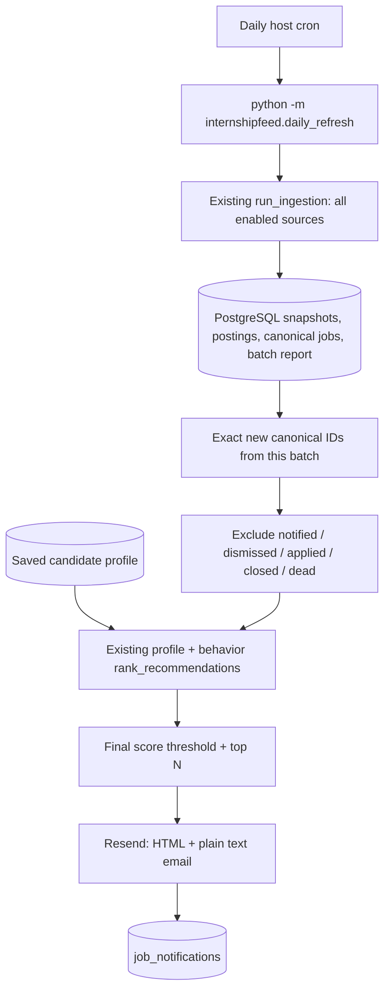

# Daily refresh and email

A one-shot command runs under external cron; FastAPI does not schedule work.
The scheduler consumes the saved candidate profile, independently of résumés.



## Configure and run

Install project dependencies with `python -m pip install -e '.[test]'`. Delivery
uses the official `resend>=2.50.1,<3` Python SDK. Python 3.9 environments use
urllib3 1.26 for compatibility with macOS LibreSSL. No notification SDK runs in
the browser. Keep secrets in ignored `.env` or runtime environment variables;
environment variables take precedence over the repository-root `.env`.

| Setting | Meaning |
| --- | --- |
| `DATABASE_URL` | Existing PostgreSQL connection. |
| `DAILY_NOTIFICATION_CHANNEL` | `email` (default); other values fail validation. |
| `RESEND_API_KEY` | Resend credential; required for sending. |
| `DAILY_EMAIL_FROM` | One verified sender/domain, optionally `Name <address>`. |
| `DAILY_EMAIL_TO` | One recipient email address. |
| `DAILY_EMAIL_MIN_SCORE` | Inclusive minimum **final** score; default 60, range 0–100. |
| `DAILY_EMAIL_TOP_N` | Maximum digest entries; default 5, range 1–5. |
| `APP_BASE_URL` | Optional HTTP(S) app link in the footer. |

Create/configure a Resend account, API key, and verified sender yourself. Code
uses these credentials; it does not provision an email account or verify DNS.
See [Resend's Python setup](https://resend.com/docs/send-with-python).
No real addresses or credentials are committed.

```sh
.venv/bin/python -m internshipfeed.daily_refresh
```

The command validates settings, initializes migrations, acquires a PostgreSQL
session advisory lock, ingests all enabled sources, ranks exact discoveries,
sends at most one digest, records provider acceptance, prints a JSON summary,
and exits. Concurrent daily commands exit nonzero; ingestion retains its own
existing sync lock. No SQL transaction stays open during the provider call.
The SDK's default HTTP client uses a 30-second timeout; this wrapper performs no
automatic retry and redacts provider exception bodies.

## Dry run and retry

```sh
.venv/bin/python -m internshipfeed.daily_refresh --dry-run
```

Dry run **does ingest and persist job/source changes**. It prints subject, plain
text, HTML, and a summary, but needs no delivery credentials, calls no provider,
and writes no notification rows. `--no-enrich` skips job-page fetching;
`--enrich-limit N` limits it. Normal runs reuse automatic enrichment and caching.

A fresh run only considers discoveries from that run. To send a reviewed preview
or retry a failed notification, retain its batch UUID:

```sh
.venv/bin/python -m internshipfeed.daily_refresh --no-ingest --batch-id BATCH_UUID --dry-run
.venv/bin/python -m internshipfeed.daily_refresh --no-ingest --batch-id BATCH_UUID
```

Retries use current profile, workflow state, ranking, and notification history.
Batches predating exact ID tracking are rejected. There is no automatic backlog
of old jobs, earlier unsent batches, or jobs that previously missed the threshold.

## Exact discovery and shared ranking

`run_ingestion()` captures known canonical identity IDs while holding its sync
lock, processes sources, then compares those IDs with surviving canonical roots.
New root IDs are persisted in `ingestion_batches.report.new_canonical_job_ids`
and existing run artifacts before releasing the lock. Updated jobs stay excluded;
two source postings reconciled to one opportunity yield one discovery ID.
Initialization/backfill occurs before this boundary.

This avoids a timestamp trap: reconciliation can inherit an old source posting's
`first_seen_at` even when a corrected URL creates a new canonical identity.
`posted_at` never determines discovery. Canonical writes are assumed to use the
existing cooperating ingestion workflow; arbitrary concurrent manual SQL writes
are outside that contract.

`db.unnotified_job_ids()` follows merge redirects for both discovered IDs and
historical ledger IDs. `db.candidate_job_details()` then applies the same active,
not-dismissed, not-applied eligibility as Recommended. Saved-only jobs remain
eligible. `build_behavior_profile(db.behavior_history(...))` and
`rank_recommendations()` reuse the current saved development profile and the
existing profile/behavior weights and tie-breaking. The threshold applies to
`final_score`; the formatter preserves that order and includes the first N jobs
with usable HTTP(S) application URLs. No résumé is required or read by this task.

## Digest and delivery boundary

`format_email()` returns one subject, HTML body, plain text body, and included
job IDs. Each entry contains company, title, final score, location, term when
available, matched skills, and the full application URL. Warm white, ink, muted
orange, thin borders, and monospace technical tags follow the product style.
HTML text and attributes are escaped. Credential-bearing, malformed, non-HTTP,
and whitespace-containing links are skipped; URLs are never truncated.
No candidate IDs, canonical/source IDs, score components, history, affinity maps,
or résumé contents appear in the message. `APP_BASE_URL` is optional and validated.

`send_email()` is the sole provider boundary and calls `resend.Emails.send()` with
both bodies. A stable hash of the exact payload and job IDs supplies a Resend
idempotency key. [Resend retains keys for 24 hours](https://resend.com/docs/dashboard/emails/idempotency-keys).
Identical retries within that window gain provider deduplication; changed bodies,
recipients, senders, or ordering generate a different key.

A valid provider message UUID means **accepted by Resend**, not confirmed arrival
in an inbox. `sent_at` records that acceptance. Delivery webhooks, bounce handling,
and guaranteed inbox delivery are outside this implementation.

## Persistence and failures

```text
job_notifications
    id
    candidate_profile_id
    canonical_job_id
    channel
    provider_message_id
    sent_at

UNIQUE(candidate_profile_id, canonical_job_id, channel)
```

Migration 009 created the earlier ledger; migration 010 safely renames its provider
column and enables email, preserving historical audit rows. Runtime sends and
queries use **email only**. Historical rows from the prior channel remain audit
records and do not suppress email. No addresses or credentials enter this table.

Ingestion commits independently. Only after provider acceptance are all included
IDs inserted in one short atomic transaction. Top-N-omitted jobs are not marked.
The unique constraint, merge-aware selection, and daily advisory lock prevent
ordinary duplicate sends and concurrent daily-command overlap.

| Outcome | Behavior / exit status |
| --- | --- |
| Success or no qualifying jobs | 0; no-match runs send nothing. |
| Successful dry run | 0; no send or notification rows. |
| Invalid settings/arguments | 2; sending fails configuration before ingestion. |
| One source fails | Keep successful ingestion; eligible matches may send; exit 1. |
| All sources fail / no sources / incomplete batch | No digest; exit 1. |
| Resend fails or returns an invalid receipt | Keep ingestion; no ledger writes; exit 1. |
| Provider accepts, ledger write fails | Keep ingestion; exit 1, instruct operator to check Resend. |
| Another daily command is running | No competing ingestion/send; exit 1. |

A crash or timeout around acceptance can leave delivery uncertain. PostgreSQL
cannot atomically commit an external email. Check Resend before replaying an
ambiguous batch, especially after 24 hours or after changing its payload. The
wrapper does not claim exactly-once external delivery.

## Scheduling

Use an awake host with persistent PostgreSQL. `compose.yaml` provides PostgreSQL
only, so host cron invokes the existing virtual environment. No app/cron container
or background scheduler service was introduced.

```cron
0 9 * * * cd /absolute/path/to/internshipfeed && /absolute/path/to/internshipfeed/.venv/bin/python -m internshipfeed.daily_refresh >> /absolute/path/to/internshipfeed/data/daily-refresh.log 2>&1
```

Replace both absolute paths, quote paths containing spaces, create the log
directory, and add the entry using `crontab -e` without replacing unrelated entries.
This runs at **09:00 in the cron host's timezone**. Configure/verify the host's
zone; `CRON_TZ` is not portable to every cron implementation. Daily local time is
nominally 24 hours apart; daylight-saving transitions change elapsed time. Use a
UTC host schedule if exact UTC daily cadence matters. Sleeping laptops cannot
reliably run this schedule. The checked-in cron file is a template, not an
installed schedule.

## Verification

```sh
.venv/bin/python scripts/test_with_existing_postgres.py
.venv/bin/python scripts/check_daily_email.py --browser-executable /path/to/chromium
```

Tests mock the official SDK and cover digest escaping/content/order, provider
failure and receipts, config, new IDs, two-source canonical deduplication, shared
ranking and behavior, final threshold/top N, workflow exclusions, merge aliases,
no matches, partial/full failures, ledger failure, dry run, retries, lock behavior,
and historical migration preservation. They assert no transaction spans sending.
The browser checker ingests fixture sources in a disposable schema and writes
HTML/text/screenshots under ignored `data/screenshots`; no real email is sent.
