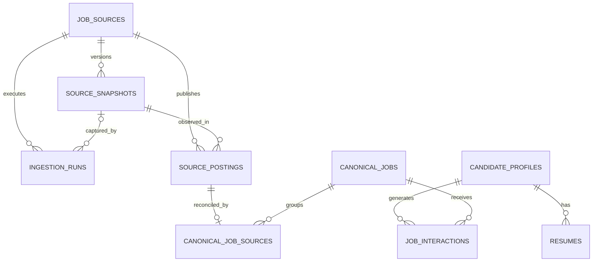

# PostgreSQL architecture

The nine application tables are `job_sources`, `ingestion_runs`,
`source_snapshots`, `source_postings`, `canonical_jobs`,
`canonical_job_sources`, `candidate_profiles`, `resumes`, and `job_interactions`.



## Source configuration

`job_sources` contains:

```text
id bigint PK
key text UNIQUE
name text
provider_type text
repository text
file_path text
branch text
enabled boolean
created_at timestamptz
```

`repository` is the full upstream repository URL. `key` binds a dataset to its
registered parser. `(repository, file_path, branch)` is unique. The initial rows
are Canadian Tech Internships (`main/README.md`) and SimplifyJobs Summer 2027
(`dev/README.md`). Ingestion reads name, repository, branch, file path, and enabled
state from PostgreSQL; the code registry supplies the parser implementation.
Disabling a source prevents future ingestion without deleting its past records.
Feed source filters use dataset IDs, so separate files/branches in the same
repository keep independent identities and filter choices.

Legacy datasets outside the registry are preserved as disabled `legacy` sources.
Adding a new parser requires a registry entry as well as source configuration.

## Dataset versions

`source_snapshots` contains:

```text
id bigint PK
source_id bigint FK -> job_sources
content_hash text
commit_sha text NULL
raw_content text NULL
fetched_at timestamptz
UNIQUE(source_id, content_hash)
```

New ingestion stores the complete downloaded UTF-8 README before parsing.
`content_hash` is its SHA-256 digest. Re-fetching identical content reuses the
snapshot ID and first `fetched_at`, so snapshots are not duplicated. Different
sources have separate snapshot identities even for identical content.

The current raw-README fetcher does not supply a verified commit SHA, so
`commit_sha` stays null unless a caller supplies one. A branch URL or ETag is not
misrepresented as a commit SHA. An ingestion run's timestamp records each new
execution even when its snapshot is reused.

## Source postings

`source_postings` contains all requested source-specific fields:

```text
id bigint PK
source_id bigint FK -> job_sources
snapshot_id bigint FK -> source_snapshots
external_id text
raw_company text NULL
raw_title text NULL
raw_location text NULL
raw_url text NULL
raw_posted_at text NULL
company text
title text
location text
application_url text NULL
posted_at date NULL
status text
first_seen_at timestamptz
last_seen_at timestamptz
UNIQUE(source_id, external_id)
```

Additional diagnostic columns retain `raw_row`, `source_line`, `term`, the last
known application URL, description/keyword extraction results and outcomes, and
link-check timestamps. They support the existing detail UI and retries.

A composite foreign key `(source_id, snapshot_id)` ensures the snapshot belongs
to the posting's own source. Raw cells preserve source formatting and continuation
markers; normalized fields contain resolved company names, readable locations,
and the actual application URL. Relative ages remain in `raw_posted_at`; exact
posting dates remain null when the source does not provide them.

A posting stores its latest observation's snapshot ID. Older dataset versions
remain replayable from `source_snapshots`; this is not a full per-posting revision
history table.

## Canonical opportunities

`canonical_jobs` is a **stored table**, not a view:

```text
id bigint PK
company text
title text
location text
application_url text NULL
posted_at date NULL
status text
description text NULL
keywords jsonb
first_seen_at timestamptz
last_seen_at timestamptz
created_at timestamptz
updated_at timestamptz
```

Canonical fields are refreshed transactionally from linked source observations
when a source posting is saved or groups are merged. Active source observations
win over closed/dead observations. Exact-date metadata is preferred, with stable
source IDs breaking ties. The earliest known exact posting date, latest available
active description, and combined keyword lists are retained. `updated_at` changes
when canonical content changes; observation timestamps remain separate.

The public `CanonicalJob` model and `/api/jobs` responses retain their seven-field
contract. `StoredCanonicalJob` describes the full persisted row, while `JobDetails`
provides the UI's source and enrichment context.

## Explainable reconciliation

`canonical_job_sources` is the mapping table (the `job_sources_map` in the sketch):

```text
canonical_job_id bigint FK -> canonical_jobs
source_posting_id bigint FK -> source_postings
match_method text
match_confidence numeric(4,3) CHECK 0 <= value <= 1
matched_url text NULL
created_at timestamptz
PRIMARY KEY(canonical_job_id, source_posting_id)
UNIQUE(source_posting_id)
```

The unique posting constraint records one current canonical assignment per source
posting. Source IDs and `(source_id, external_id)` remain independent of canonical
IDs. The mapping's creation timestamp is retained unless the decision changes.

Implemented decisions are:

- `exact_application_url`: normalized application URL evidence.
- `resolved_application_url`: additional URL evidence from a successfully read job page.
- `source_identity`: preserve an existing within-source assignment or create an independent opportunity when URL evidence is absent.

Confidence `1.000` denotes a deterministic decision under these rules, not a
calibrated probability or title-based inference. `matched_url` records the URL
evidence when available. The schema reserves `ats_job_id`, `normalized_fields`,
and `fuzzy_match` for later implementations; they are not used by current ingestion.

URL normalization removes known tracking parameters and transport differences
while preserving job identifiers, path case, and meaningful hash routes. Generic
careers/search pages and missing URLs are not matching evidence. Similar titles
alone never merge records. A source URL correction moves only the affected posting.

Private support tables retain canonical identity allocation/merge redirects and
normalized URL aliases. Old merged IDs still resolve to the surviving canonical
job. Those tables avoid rewriting source identities or historical interactions.

## Per-source operational records

`ingestion_runs` contains:

```text
id uuid PK
source_id bigint FK -> job_sources
started_at timestamptz
finished_at timestamptz NULL
status text
records_fetched integer
records_parsed integer
records_inserted integer
records_updated integer
records_failed integer
snapshot_id bigint FK -> source_snapshots NULL
error_summary text NULL
```

Additional fields are `records_skipped`, `batch_id`, and a JSON diagnostic report.
A snapshot foreign key also checks source ownership. A parse failure still retains
the downloaded snapshot and a failed execution with an error summary. When parsing
fails before a row count is available, record counts are zero rather than guessed.
For successful parsing, `records_fetched` is the source record count and
`records_parsed` counts records successfully normalized into `JobListing`.

Each source has its own execution row. A separate `ingestion_batches` support table
tracks a UI sync encompassing multiple sources; one failed source does not roll
back other sources. Batch endpoints power the overall progress UI, while run
endpoints expose these per-source records.

`records_fetched = records_inserted + records_updated + records_skipped + records_failed`
for executions with known row counts. Description-fetch failures are separately
reported and do not fail a valid posting. One posting, its mapping, and refreshed
canonical metadata commit together. Partial row failures preserve committed work.

## Development candidate data

`candidate_profiles` contains `id`, `target_roles`, `skills`,
`preferred_locations`, `preferred_terms`, `graduation_year`, `created_at`, and
`updated_at`. Preference/skill fields use native PostgreSQL text arrays. The
migration creates one empty development profile, and a trigger maintains its
update timestamp. No authentication schema is required for this stage.

Candidate profile persistence + FastAPI profile API is implemented:

- `GET /api/profile` returns the existing development row with all stored profile fields.
- `PUT /api/profile` replaces all five editable fields and returns the stored row.

`development_profile()` selects the lowest-ID row, preserving the existing
single-profile convention. `update_development_profile()` updates that same row
with `UPDATE ... RETURNING *`; it never inserts a profile. ID and `created_at`
remain unchanged. The migration's `candidate_profiles_updated` trigger sets
`updated_at` using `clock_timestamp()`, including for repeated identical PUTs.
psycopg passes Python lists directly as PostgreSQL `text[]`, including empty lists.

`CandidateProfileUpdate` requires every editable field. Its lists must contain
strings; trimming removes surrounding whitespace, blank items disappear, and
exact case-sensitive duplicates retain the first occurrence's spelling and order.
Graduation year is required but nullable, with strict integer values between 1900
and 2200, matching the existing database range. Client-supplied IDs, timestamps,
and other extra fields are rejected with HTTP 422, as are incomplete/invalid
requests. `CandidateProfile` is the response model including stored timestamps.
PUT follows the existing local-only, same-origin mutation policy.

Missing profiles return HTTP 503 with an initialization message; GET/PUT never
silently reseed. Migration tracking remains responsible for the single initial
insert, and repeated initialization preserves both the row count and saved values.
Storage errors use the API's existing HTTP 503 handler without returning PostgreSQL
exception details. No schema migration was needed for this API slice.

`resumes` contains `id`, `candidate_profile_id`, `filename`, `extracted_text`, and
`uploaded_at`. It stores text/metadata only: there is no raw binary column or
permanent file path. Deleting a profile cascades to its résumé records and interactions.

`POST /api/resumes` implements résumé PDF upload → local `pdfplumber` text
extraction → PostgreSQL persistence. It uses the existing database connection
dependency, `development_profile()` lookup, and `save_resume_text()` insert. The
caller cannot select a profile; every upload appends a new history row for the
lowest-ID development profile. The profile itself remains unchanged. No migration
was needed. There is no résumé retrieval/management endpoint in this slice.

The multipart field is `file` (`UploadFile`). A successful request returns HTTP 201
with a `Resume` response: `id`, `candidate_profile_id`, `filename`, `extracted_text`,
and `uploaded_at`. Only the client filename's basename is retained, not directory
components. No raw PDF bytes, base64 data, temporary paths, or inferred candidate
data are persisted or sent to another service.

Validation uses three checks: a case-insensitive `.pdf` filename, a compatible
MIME type, and actual PDF parsing. `application/pdf`, unspecified MIME, and generic
`application/octet-stream` are permitted; parsing is always required. Other
extensions/MIME types receive HTTP 415. Files are limited to **5 MiB (5,242,880
bytes)**, checked before extraction with a bounded read and the upload's reported
size; larger files receive HTTP 413. FastAPI may spool multipart data to temporary
disk before the endpoint runs; the handler limits its own memory read and parsing.

`extract_pdf_text()` opens the document locally, enforces **10 pages** before
extracting text, and reads pages in order. Pages returning `None` or blank text do
not discard other pages. Cleanup normalizes CRLF/CR to LF, strips trailing spaces
and outer whitespace, collapses runs of blank lines, and removes non-readable NUL
characters (unsupported by PostgreSQL text). It preserves line order, indentation,
case, and technical symbols. The API rejects corrupt/unreadable PDFs, excess
pages, and effectively empty extraction with HTTP 422. Scanned/image-only PDFs
are unsupported; no OCR, AI, skill extraction, or profile updates are performed.

The PDF context and upload are closed on success and failure. Temporary upload
files are not retained. Document contents and parser diagnostics are not logged;
insert failures also use a generic HTTP 503 without logging PostgreSQL diagnostics
that might contain rejected row text. Missing profiles return HTTP 503 without
creating a candidate. Uploads follow the existing local-only mutation policy.

`job_interactions` contains `id`, `candidate_profile_id`, `canonical_job_id`,
`interaction_type`, and `created_at`. Allowed types are `view`, `click`, `save`,
`dismiss`, and `applied`. Every event inserts a new row; two views create two
records. There is no uniqueness constraint that overwrites interaction history.

`POST /api/jobs/{job_id}/interactions` exposes click/save/dismiss/applied for the
development profile; view stays internal. An explicit request model rejects extra
fields and invalid actions. `record_interaction()` resolves merged IDs and checks
the stored canonical job exists before insertion. Existing inactive canonical
records can receive events too, so historical application actions remain valid.

`GET /api/interactions` derives candidate-specific effective state. A recursive
query follows canonical identity merge redirects from each historical event ID,
then groups by the surviving job. `bool_or` derives Saved, Dismissed, and Applied;
`max(created_at)` across all event types gives the last interaction time. Repeated
events do not duplicate state rows. View/click-only jobs have all three flags
false. Never-interacted jobs are absent and the frontend defaults their flags
to false. History is not rewritten or deleted when jobs merge.

These flags are monotonic because no unsave/undo events exist in this slice.
Dismiss takes precedence for UI visibility, while an applied nondismissed card
remains visible with its Applied label. Interaction state does not affect matching
scores or canonical job fields. No migration or extra state table was needed.

Repository helpers expose the development profile, append interaction events,
and save extracted résumé text. The React profile interface at `/profile` consumes
GET/PUT profile and POST résumé APIs; the existing vanilla feed remains at `/feed`.
See [frontend.md](frontend.md) for build and development details. Résumé-to-profile
suggestions, authentication, and dedicated Saved/Applied views are future work.

## On-request recommendations

Candidate Profile + Canonical Jobs → Deterministic Matching → Recommendations API
is implemented by `matching.py` and `GET /api/recommendations`. The endpoint reuses
`development_profile()` and `list_job_details()`; it contains no SQL. The latter
already provides visible canonical jobs, persisted keyword lists, and alternate
source observations, so no schema or query changes were necessary.

Matching is rule-based, string-based, skills-based, and explainable. The fixed
weights are role 40, skills 30, location 20, and term 10. Results contain the same
seven-field canonical job plus component scores, total, matched skills, and
evidence reasons. Optional `min_score` is an integer in 0–100, default 0.
Closed/dead canonical jobs are excluded; unknown status follows feed visibility.

Scores are calculated in Python on each request and never written to PostgreSQL.
There is no score column or recommendations table. Profile changes affect the next
request without a backfill. Résumé text, interaction events, graduation year,
descriptions, and posting dates do not contribute points. Posting date and ID only
break score ties. See [matching.md](matching.md) for exact rules and limitations.

## Constraints and indexes

The schema enforces source snapshot uniqueness, within-source posting uniqueness,
snapshot ownership, one canonical assignment per posting, valid match confidence,
valid statuses, event types, and profile/job foreign keys. Indexes support source
posting lookups, source execution history, canonical dates/statuses, mapping joins,
and interactions by profile/job and time.

## Migration and legacy data

`007_relational_architecture.sql` upgrades existing data in one transaction:

1. Registers upstream source datasets.
2. Converts hash-only references into deduplicated snapshot rows.
3. Moves `source_jobs` to `source_postings`, preserving IDs and observations.
4. Copies canonical assignments into `canonical_job_sources`.
5. Materializes canonical job descriptions, keywords, and timestamps.
6. Keeps earlier aggregate run records as `ingestion_batches` and imports their source-level history into `ingestion_runs`.
7. Creates the development profile, résumé metadata, and event tables.

A checked migration hook restores retained snapshot files only when their hashes
match, recovers raw source cells where possible, and fills reconciliation metadata.
If an old snapshot file is unavailable, legacy `raw_content`/raw cell fields remain
null rather than inventing upstream facts. Fresh ingestion always stores raw data.
Reinitialization does not duplicate sources, snapshots, postings, mappings, or the
seed profile. Existing source IDs, external IDs, canonical IDs, and observation
timestamps are preserved.

## Useful queries

```sql
-- Every source identity behind a canonical opportunity.
SELECT c.id AS canonical_job_id, s.name, p.id AS source_posting_id,
       p.external_id, m.match_method, m.match_confidence, m.matched_url
FROM canonical_jobs c
JOIN canonical_job_sources m ON m.canonical_job_id = c.id
JOIN source_postings p ON p.id = m.source_posting_id
JOIN job_sources s ON s.id = p.source_id
WHERE c.id = 420;

-- Per-source ingestion health.
SELECT s.name, r.started_at, r.status, r.records_fetched, r.records_parsed,
       r.records_inserted, r.records_updated, r.records_failed, r.error_summary
FROM ingestion_runs r JOIN job_sources s ON s.id = r.source_id
ORDER BY r.started_at DESC;
```
