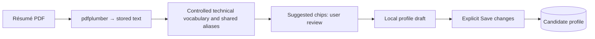

# Frontend

InternshipFeed is one React + TypeScript application. Recommended is the home
experience; All listings is a neutral directory. Saved and Applied retain their
existing workflow semantics. Profile and job details open in right-side drawers
over the current view. The old vanilla directory UI has been removed.

## Run and routes

Build with Node.js 22.12+ and use the existing Python/PostgreSQL setup:

```sh
npm --prefix frontend ci
npm --prefix frontend run build
.venv/bin/python -m uvicorn internshipfeed.api:app --host 127.0.0.1 --port 8000
```

| Route | Experience |
| --- | --- |
| `/`, `/recommendations` | Recommended, ordered by server profile + preference rank. |
| `/listings` | All listings: search, location/term/source/status filters, chronological order. |
| `/saved` | Saved and not dismissed; includes saved/applied combinations. |
| `/applied` | Application history, newest application first. |
| `/profile` | Compatibility entry: Recommended with Profile drawer open. Closing returns the URL to `/`. |
| `/feed` | Compatibility alias for the React All listings view. |

FastAPI serves the same compiled HTML for these routes and trailing-slash forms.
Production assets keep their existing `/profile/assets` URL prefix. Missing builds
return a clean 503. Restart FastAPI after backend route updates. `frontend/dist`
and `node_modules` are ignored; dependency inputs are unchanged in this pass.

For development, run `npm --prefix frontend run dev` alongside FastAPI and open
`http://127.0.0.1:5173/`. Vite proxies only `/api`, preserving Host/Origin for the
existing local-write guard. Set `BACKEND_URL=http://127.0.0.1:8004` if necessary.
All UI routes stay on Vite. No router package or global state library is needed.

## Information architecture and navigation

The restrained top bar contains Recommended, All listings, Saved, Applied, and a
separate Profile button. Active destinations use a fine orange underline. The
wordmark returns home. Ordinary destination links load their server-backed view;
Profile does not navigate, and closing either drawer preserves the underlying
page, filter input, and browsing context. A successful profile save refreshes the
current collection so revised recommendations come from the backend.

Recommended/Saved/Applied share `JobCollectionPage` and `RecommendationCard`.
All listings uses compact `ListingsPage` rows without scores or preference
explanations. Both surfaces share tags, actions, and the same job drawer. They
progressively render 24 cards or 40 rows with Show more.

## Design system

`styles/tokens.css` is the single token source; `styles.css` contains component,
layout, focus, and responsive rules. No CSS/UI/icon framework was introduced.

| Token | Value / purpose |
| --- | --- |
| `--bg` | `#f6f4ef`, warm paper background |
| `--surface` | `#fffefa`, cards/drawers/inputs |
| `--surface-muted` | `#f0eee7`, quiet tags/placeholders |
| `--text`, `--text-muted` | `#252522`, `#6c6a63` |
| `--border`, `--border-strong` | `#dedbd3`, `#bcb8ae` |
| `--accent`, `--accent-soft` | `#a44c30`, `#f4eae3` |
| `--danger-muted` | `#993d31`, inline errors |
| Spacing | 4, 8, 12, 16, 24, 32, 48 px |
| Radius | 3 px panels/buttons, 2 px technical tags |
| Typography | Self-hosted IBM Plex Sans 400/500/600; system monospace for compact tags |

Page titles are 25 px; job titles are the strongest card text at 18 px, company
and metadata 12 px, supporting labels 10–11 px. Orange is reserved for active
navigation, compact scores, and confirmed Saved/Applied state. Surfaces use thin
borders without shadows, gradients, oversized headings, gauges, or large panels.
Apply uses near-black; other controls are quiet borders or plain icon buttons.

`SkillTag` renders one consistent thin-border technical tag in profile controls,
cards, rows, and details. Profile skills remain a flat editable array; no category
inference is added. Details use only actual nonempty language/framework/tool/
concept groups from the backend. Tags wrap and removal buttons have specific
accessible labels. `Icon` centralizes the existing SVG bookmark/clock/X/external
language and adds matching profile/update icons.

## Cards, actions, and server state

Cards show company, clickable title, location/term, available technical skills,
a compact score, one shortened backend fit reason, a preference reason when
available, and Why this job? Expanded detail
shows the backend's separate Profile/Preference/Final scores, at most two behavior
reasons, and original profile component evidence. React does not score or reorder
recommendations. Saved/Applied show profile fit; Applied includes its event date
and Open application link. Missing metadata is omitted rather than inferred.

`JobActions` fixes action order everywhere: Apply, Save, Applied, Dismiss. Applied
history omits Dismiss as before. Apply is a native absolute HTTP(S) anchor with
`target="_blank"` and `rel="noopener noreferrer"`; click telemetry cannot delay
navigation and never implies a completed application. Invalid URLs disable Apply.

`useJobActions` owns transient pending/error/announcement state shared between a
view and its drawer. Successful actions install server snapshots through the
existing event cursor helper; requests arriving late cannot overwrite newer
state. No raw event semantics are replayed in React. Workflow membership updates
only after confirmation, including removal after Applied/Dismiss. Failed actions
retain the previous state and allow retry. Navigation/refresh restores PostgreSQL
state; preference rank recomputes on the next Recommended load.

Save/Saved and Mark applied/Applied are reversible controls. Clicking an active
bookmark appends `unsave`; clicking Applied appends `unapplied`. Accessible labels
and tooltips announce the inverse action. Shared pending state prevents duplicate
clicks; failed reversals retain the active state. Unsave removes a card from Saved,
unmark removes it from Applied, and nondismissed active jobs return to Recommended
on its next load. Details and background cards share the confirmed snapshot.

Collections attach state directly. All listings loads `/api/feed` plus the
existing `/api/interactions` projection together, showing a retry state if either
fails. Client filters only browse the returned metadata; they do not infer fit,
reconcile sources, or derive interaction flags. Existing discovery exclusions
remain: dismissed/applied jobs are absent from Recommended and All listings.
The directory is broader because explicit profile fit never filters or ranks it.

## Drawers and profile

`Drawer` wraps native `<dialog>`: background content is inert, Escape/backdrop/X
close it, Tab/Shift-Tab wrap between enabled visible controls, and focus returns to
the opener. If an action removes that opener, focus falls back to the page title.
Body scrolling is locked while open. Drawers become full-width sheets on narrow
screens, with an independently scrollable body and a persistent close control.
Reduced-motion settings remove transitions.

`ProfileDrawer` loads the development profile and reuses `ProfileForm`, `TagInput`,
and `ResumeUpload`. Open-ended role/skill/location tags support Enter, removal,
and duplicate handling; Enter guidance remains available to screen readers.
`TermSelector` uses removable chips and one add dropdown for all fifteen
Winter/Summer/Fall terms from 2026–2030. Selected options are disabled. Graduation
year is a select with Not specified → null and 2026–2030; the backend still accepts
its original integer/null range. Legacy stored terms/years are preserved rather
than silently deleted. Explicit
Save changes includes pending input and preserves the existing complete payload.
Errors retain the draft; confirmation is subtle. Closing discards unsaved edits.
The backend remains authoritative for profile validation and PDF limits.

Résumé presentation is a small filename/date row with Upload PDF or Replace PDF.
`GET /api/resumes/latest` returns only the current candidate's latest metadata,
restoring it after reopening or refresh. No extracted text is returned by that
endpoint. Upload still appends a résumé record; Replace selects the latest version
without changing profile fields or deleting history. Corrupt/type/size/page and
network errors remain concise. Latest-file loading cannot overwrite a newer
upload response. Raw document contents are never rendered or retained in UI state.

`GET /api/resumes/{resume_id}/skill-suggestions` returns canonical skills and the
matching system's alias map. `ProfileDrawer` fetches suggestions separately from
upload, cancels stale requests, and accepts only a response for the current latest
résumé. Upload success survives suggestion errors; the Skills section offers a
separate retry. `SkillSuggestions` filters saved and draft skills (including pending
input) through shared alias metadata. Clicking a chip or Add all updates only the
profile draft; Save changes performs the existing complete PUT. Replacing a PDF
changes suggestions while keeping selected skills. Empty detection and already
selected results have quiet status text. No raw résumé text reaches UI state.



`JobDetailsDrawer` loads `/api/jobs/{id}/details`, renders plain escaped description
text and available keyword groups, and reuses shared actions. Provenance is a
quiet Listed by line with repository links near the bottom. Source/canonical IDs,
match methods/confidence, and parsing/reconciliation terminology are absent.
Loading/error/retry and missing-description states preserve context.

All listings keeps the source update workflow through a quiet Update listings
control and short status line. It calls the existing sync APIs and reloads after
completion. No operational dashboard or backend diagnostics are exposed.

## Implementation inventory

| File | Purpose |
| --- | --- |
| `index.html` (frontend) | Shared HTML entry and product description. |
| `src/App.tsx` | View selection, drawers, shared workflow and refresh boundary. |
| `src/components/TopNav.tsx` | Four destinations plus Profile dialog trigger. |
| `src/components/Drawer.tsx` | Native dialog, focus handling, close/context behavior. |
| `src/components/ProfileDrawer.tsx` | Profile loading/retry and form/upload composition. |
| `src/components/ProfileForm.tsx` | Existing tag/preferences form, explicit save callback. |
| `src/components/TermSelector.tsx` | Removable predefined terms and add select. |
| `src/components/SkillSuggestions.tsx` | Alias-filtered draft-only suggestions and retry. |
| `src/lib/profile-options.ts` | Bounded year/term choices and normalized skill comparison. |
| `src/components/TagInput.tsx` | Editable shared tags and Enter/removal behavior. |
| `src/components/ResumeUpload.tsx` | Compact upload/replace and persistent latest metadata. |
| `src/components/RecommendationCard.tsx` | Rich shared Recommended/Saved/Applied card. |
| `src/components/MatchSummary.tsx` | Compact explanation and expanded backend scores. |
| `src/components/JobActions.tsx` | Consistent native Apply and confirmed utilities. |
| `src/components/SkillTag.tsx` | Shared technical tag and optional removal button. |
| `src/components/Icon.tsx` | One SVG icon vocabulary. |
| `src/components/JobDetailsDrawer.tsx` | Metadata, description, keywords, actions, provenance. |
| `src/components/FilterBar.tsx` | Compact accessible directory controls. |
| `src/components/SyncControl.tsx` | Existing source-update workflow and status. |
| `src/pages/JobCollectionPage.tsx` | Three scored server collections. |
| `src/pages/ListingsPage.tsx` | React directory, filtering, details, actions. |
| `src/hooks/useJobActions.ts` | Shared pending/confirmed snapshot handling. |
| `src/lib/listings.ts`, `src/lib/navigation.ts` | Directory filter and route helpers. |
| `src/api/jobs.ts`, `src/api/resumes.ts` | Job/source/sync and latest-file API functions. |
| `src/types/jobs.ts` | Details, source, keywords, and sync response types. |
| `src/styles/tokens.css`, `src/styles.css` | Design tokens and complete shared styles. |
| `vite.config.ts` | UI routes handled locally, API-only proxy. |
| `src/lib/product.test.ts` | Navigation/filter/tag/action contracts. |
| `src/lib/recommendation-card.test.ts` | Profile/final score presentation and response fixture. |

`ProfilePage.tsx` and `web/styles.css` were removed. Root `index.html` and
`web/app.js` are tiny compatibility redirects for cached older pages, with no
legacy product UI. Backend `api.py` serves all views and attaches existing
term/keyword metadata to collection cards; `models.py` defines those additions
and metadata/suggestion résumé contracts; `db.py` supplies latest metadata.
`resume_skills.py` detects technical phrases using the enrichment vocabulary and
matching aliases, with longest-span precedence and deterministic sorted labels.
Base profile scoring and authentication remain unchanged. Reversible Save/Applied
actions use migration `008_reversible_interactions.sql` to extend the existing
event-type constraint; all workflow state remains derived from event history.

`scripts/check_profile_ui.py`, `scripts/check_ui.py`, and
`scripts/check_recommendations_ui.py` exercise the consolidated surfaces.
`tests/test_database.py` adds metadata privacy/isolation and shared-page/missing-
build checks, using a temporary HTML fixture so backend tests do not depend on
ignored frontend build output. `README.md`, `docs/database.md`, and
`docs/interactions.md` update the entry points, API, and workflow documentation.

## Verification

```sh
.venv/bin/python scripts/test_with_existing_postgres.py
npm --prefix frontend test
npm --prefix frontend run build
.venv/bin/python scripts/check_recommendations_ui.py
```

The browser script accepts `--browser-executable /path/to/chromium` and uses an
isolated schema on the existing PostgreSQL server plus a temporary API process.
It checks home/navigation, shared drawer/card actions, Saved/Applied combinations,
refresh persistence, known behavioral ordering, errors/retries, click/new-tab
safety, profile edits/validation, real PDF extraction, latest-file restoration,
directory filters/search/details/update progress, keyboard trapping/restoration,
Escape, and desktop/narrow widths. External application URLs are intercepted
locally; sync progress is simulated without starting external scraping. Fixture
schemas/processes are removed and live candidate history is untouched.

Screenshots are written to ignored `data/screenshots`: Recommended, Saved,
Applied, profile, directory, and details, at desktop/mobile widths. The reference
screenshots mentioned in the brief were not included in the attachment; the
written hierarchy/tag guidance and existing product typography supplied the design.
Physical devices, Firefox/Safari, and screen-reader announcement quality have not
been manually tested.
