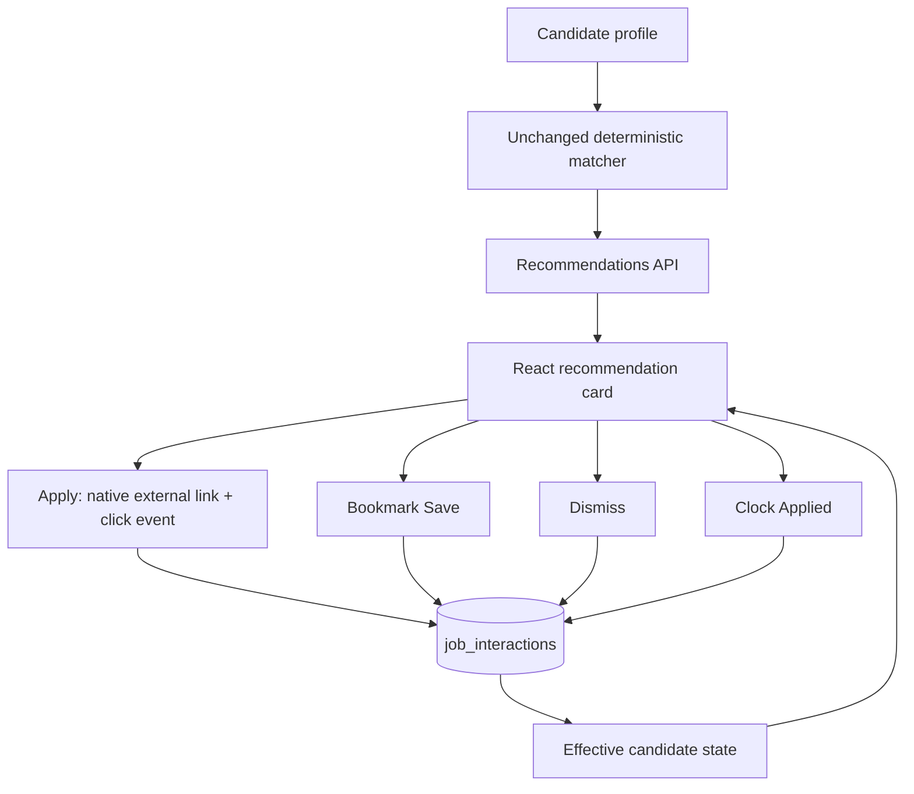

# Candidate job workflow

Implemented:



There is no interaction-weighted ranking, new database table, boolean field on
canonical jobs, authentication, or enum migration. The existing five-event table
remains append-only. `view` stays available to internal helpers but is not exposed
by the public action endpoint.

## API

### Append an event

`POST /api/jobs/{job_id}/interactions`

```json
{"type": "save"}
```

Allowed types are `click`, `save`, `dismiss`, and `applied`. Extra fields, including
`candidate_profile_id`, are rejected with HTTP 422. The endpoint always selects
the seeded development profile using the existing lowest-ID convention and the
existing connection dependency/local-write guard. Merged job IDs resolve through
the existing identity redirects. Unknown IDs and identities without a canonical
job row return HTTP 404. Existing inactive canonical records can still receive
historical actions.

HTTP 201 returns the inserted event:

```json
{
  "id": 7,
  "candidate_profile_id": 1,
  "canonical_job_id": 420,
  "interaction_type": "save",
  "created_at": "2026-11-02T12:00:00Z"
}
```

Repeated successful requests append separate events. There is no idempotency key
or deduplication constraint on event history. The UI disables completed one-way
actions, while callers can still append repeats intentionally. Missing development
profiles and unavailable storage return sanitized HTTP 503 responses. Cross-origin
or nonlocal writes follow the existing HTTP 403 policy.

### Read effective state

`GET /api/interactions`

```json
[
  {
    "job_id": 420,
    "saved": true,
    "dismissed": false,
    "applied": false,
    "last_interaction_at": "2026-11-02T12:00:00Z"
  }
]
```

Only the development candidate's events are included. Jobs without events are
omitted; React defaults their flags to false. Responses have one row per current
canonical job, ordered by ID.

## State semantics

| Event | Effective state / behavior |
| --- | --- |
| `save` | Saved becomes true; bookmark fills with restrained orange. |
| `dismiss` | Dismissed becomes true; the card is hidden after confirmation and on refresh. |
| `applied` | Applied becomes true; the card remains visible with a clock/Applied state unless dismissed. |
| `click` | Records opening the application; it does not imply Applied, Saved, or Dismissed. |
| `view` | Internal historical event; affects only the latest interaction time. |

Flags are independent and monotonic. Save → applied → click keeps Saved and
Applied true. Dismiss takes precedence for card visibility, even if Applied is
also true. There is no unsave, undismiss, or applied reset in this slice, and no
events are deleted to simulate toggles.

`interaction_states()` starts from candidate-scoped historical job IDs, follows
`canonical_job_identities.merged_into_id` recursively, and groups events by the
surviving ID. `bool_or` computes each flag and `max(created_at)` gives the last
interaction across all event types and aliases. Multiple events and multi-hop
merges produce one state row. Historical event IDs remain unchanged for auditing.

## UI and Apply behavior

`/recommendations` loads scores and effective state together. A state-load failure
shows a retry state instead of displaying potentially dismissed jobs. The screen
preserves backend score ordering and progressively renders batches of 24 cards.

Each card uses job information first, expandable match evidence second, and
actions last. Apply is leftmost and strongest, followed by bookmark Save, clock
Applied, and a quiet × Dismiss. Icon controls have accessible labels and focus
styles. The displayed score is out of 100, not a success probability; expanding
it reveals the existing component scores and reason strings.

Apply is a native absolute HTTP(S) anchor with a new tab and
`rel="noopener noreferrer"`. The click callback starts a POST without awaiting it
or cancelling the anchor's default action. A failed POST shows a concise inline
message and does not block navigation. Clicking Apply never marks Applied;
completion is a separate explicit action. Invalid/missing URLs show an unavailable
Apply control. Actual employer-page loading and application completion are not
tracked.

Save/Dismiss/Applied update only after HTTP success. Pending utility actions are
disabled for that card, failures retain prior state, and retries remain available.
A merge response updates the displayed and surviving IDs without losing earlier
flags. Click recording is independent so another pending action cannot disable
the external application link.

`GET /api/recommendations`, matching weights, the seven-field canonical contract,
source ingestion, profile editing, and résumé extraction remain unchanged. The
recommendation API continues returning dismissed jobs with identical scores; only
candidate-specific UI presentation hides them. There is no dedicated Saved or
Applied view yet.

## Verification

```sh
npm --prefix frontend test
npm --prefix frontend run build
.venv/bin/python scripts/test_with_existing_postgres.py
.venv/bin/python scripts/check_recommendations_ui.py --browser-executable '/Applications/Brave Browser.app/Contents/MacOS/Brave Browser'
```

Backend tests cover all action types, repeated history, independent flags, latest
time, invalid payloads, nonexistent/orphan IDs, missing profile/storage, local
write policy, candidate isolation, multi-hop merge projection, and unchanged scores
and canonical metadata. Existing view/resume helper tests remain intact.

Frontend helper tests cover confirmed-state updates, click versus Applied,
monotonic flags, merged response IDs, out-of-order timestamps, dismissed/active
visibility, safe URLs, and exact POST payloads. Browser checks use a temporary
schema on the existing PostgreSQL server and a real FastAPI process. They verify
Save, Dismiss, Applied, click persistence, new-tab/no-opener/no-referrer behavior,
failed-click navigation, pending confirmation, failure/retry, reload restoration,
unchanged scoring, and desktop/mobile layouts. External fixture pages are served
locally at a reserved test URL. Profile and feed regression checks run too.
Cleanup removes only the isolated schema and owned server, leaving live candidate
history untouched. Screenshots are under ignored `data/screenshots`.
