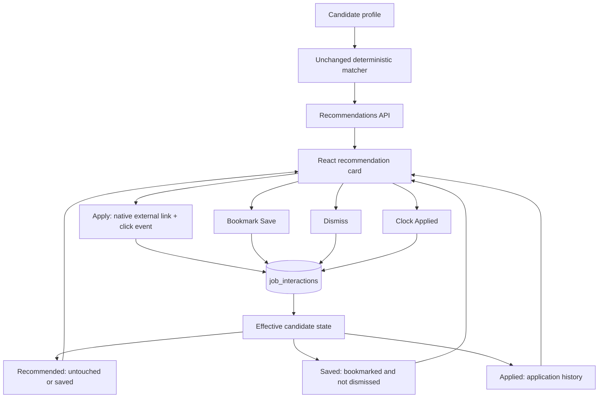

# Candidate job workflow

Implemented:



There is no interaction-weighted ranking, new database table, boolean field on
canonical jobs, authentication, or enum migration. The existing five-event table
remains append-only. `view` stays available to internal helpers but is not exposed
by the public action endpoint.

## API

### Append an event

`POST /api/jobs/{job_id}/interactions`

```json
{"type": "save"}
```

Allowed types are `click`, `save`, `dismiss`, and `applied`. Extra fields, including
`candidate_profile_id`, are rejected with HTTP 422. The endpoint always selects
the seeded development profile using the existing lowest-ID convention and the
existing connection dependency/local-write guard. Merged job IDs resolve through
the existing identity redirects. Unknown IDs and identities without a canonical
job row return HTTP 404. Existing inactive canonical records can still receive
historical actions.

HTTP 201 returns the inserted event and authoritative state snapshot:

```json
{
  "id": 7,
  "candidate_profile_id": 1,
  "canonical_job_id": 420,
  "interaction_type": "save",
  "created_at": "2026-11-02T12:00:00Z",
  "interaction_state": {
    "job_id": 420,
    "saved": true,
    "dismissed": false,
    "applied": false,
    "last_interaction_at": "2026-11-02T12:00:00Z",
    "saved_at": "2026-11-02T12:00:00Z",
    "applied_at": null,
    "last_event_id": 7
  }
}
```

Repeated successful requests append separate events. There is no idempotency key
or deduplication constraint on event history. The UI disables completed one-way
actions, while callers can still append repeats intentionally. Missing development
profiles and unavailable storage return sanitized HTTP 503 responses. Cross-origin
or nonlocal writes follow the existing HTTP 403 policy.

### Read effective state

`GET /api/interactions`

```json
[
  {
    "job_id": 420,
    "saved": true,
    "dismissed": false,
    "applied": false,
    "last_interaction_at": "2026-11-02T12:00:00Z",
    "saved_at": "2026-11-02T12:00:00Z",
    "applied_at": null,
    "last_event_id": 7
  }
]
```

Only the development candidate's events are included. Jobs without events are
omitted; React defaults their flags to false. Responses have one row per current
canonical job, ordered by ID.

### Product collections

`GET /api/recommendations`, `GET /api/saved`, and `GET /api/applied` each return
complete scored cards with `interaction_state` attached. They reuse the same
profile lookup, SQL projection, canonical details, and pure matcher. The existing
seven-field canonical job stays nested in `job`; existing component-score,
matched-skill, and reason fields are unchanged. Recommended alone accepts the
existing `min_score=0..100` filter.

| View | Membership | Order |
| --- | --- | --- |
| Recommended | Active/visible, not dismissed, not applied. Saved alone remains eligible. | Fit score, exact posting date, then ID descending. |
| Saved | Saved and not dismissed, including applied jobs. | Latest save time, then ID descending. |
| Applied | Applied, including saved, dismissed, closed, or unavailable jobs. | Latest applied time, then ID descending. |

Normal `/api/jobs` and `/api/feed` discovery applies the same workflow exclusions
as Recommended, while retaining its existing field shapes/search/source filters.
Single-job access and raw repository helpers are not turned into workflow filters.
Ingestion/operational counts still describe source/canonical data, not candidate
discovery membership.

Saved and Applied retain inactive canonical records and jobs whose source
observations have moved to a corrected URL. Closed jobs are labelled accordingly;
missing application links cannot be opened. No jobs or historical events are
deleted to implement these views. Match scores are recomputed against the current
profile/available metadata even for history; interaction flags never earn points.

## State semantics

| Event | Effective state / behavior |
| --- | --- |
| `save` | Saved becomes true; appears in Saved and remains in discovery unless applied/dismissed. |
| `dismiss` | Dismissed becomes true; hidden from Recommended, normal feed, and Saved after confirmation and refresh. |
| `applied` | Applied becomes true; leaves discovery and appears in Applied; may remain in Saved. |
| `click` | Records opening the application; it does not imply Applied, Saved, or Dismissed. |
| `view` | Internal historical event; affects only the latest interaction time. |

Flags are independent and monotonic. Save → applied → click keeps Saved and
Applied true. Dismiss takes precedence in discovery and Saved; Applied history
remains available even when dismissed. There is no unsave, undismiss, or applied reset in this slice, and no
events are deleted to simulate toggles.

`interaction_states()` starts from candidate-scoped historical job IDs, follows
`canonical_job_identities.merged_into_id` recursively, and groups events by the
surviving ID. `bool_or` computes each flag, `max(created_at)` gives the last
interaction, and `max(created_at) FILTER (WHERE interaction_type = 'applied')`
gives the latest application time. The corresponding save filter gives `saved_at`.
Later clicks/views do not reorder Applied. `max(id)` is a derived snapshot cursor
(`last_event_id`), which lets React reject older responses without replaying events.
Multiple events and multi-hop
merges produce one state row. Historical event IDs remain unchanged for auditing.

`candidate_job_details()` selects membership from those SQL-derived states and
loads only the selected/excluded canonical ID sets through `list_job_details()`.
Saved/Applied allow inactive/unlinked metadata; discovery does not. Raw event
rows are never shipped to Python or React for reconstruction. Event storage is
still the only persistent state model.

`record_interaction_with_state()` wraps the existing insert and SQL projection in
a transaction with the existing reconciliation advisory lock, so a merge cannot
change canonical identity between insertion and receipt. This adds no new table,
column, or migration.

The existing PostgreSQL indexes were inspected and retained:

- `job_interactions_profile_time_idx(candidate_profile_id, created_at DESC)` supports candidate-scoped history reads.
- `job_interactions_job_time_idx(canonical_job_id, created_at DESC)` supports job-history access.
- The primary key on `id` and canonical-job primary keys support identity lookups.

No speculative or materialized-state index was added. SQL aggregation is cheap
at the current scale; there is no cache or mutable candidate-job state table.

## UI and Apply behavior

`/recommendations`, `/saved`, and `/applied` reuse `JobCollectionPage` and the same
card. Each screen loads one server collection containing effective state. Failures
show a retry state instead of a partial list. Navigation/reload reconstructs the
screen from PostgreSQL. The page preserves server ordering and progressively renders
batches of 24 cards. The wordmark links back to the normal feed.

Each card uses job information first, expandable match evidence second, and
actions last. Apply is leftmost and strongest, followed by bookmark Save, clock
Applied, and a quiet × Dismiss. Icon controls have accessible labels and focus
styles. The displayed score is out of 100, not a success probability; expanding
it reveals the existing component scores and reason strings.

Apply is a native absolute HTTP(S) anchor with a new tab and
`rel="noopener noreferrer"`. The click callback starts a POST without awaiting it
or cancelling the anchor's default action. A failed POST shows a concise inline
message and does not block navigation. Clicking Apply never marks Applied;
completion is a separate explicit action. Applied uses Open application and shows
the applied event date in UTC. Invalid/missing URLs show an unavailable
Apply control. Actual employer-page loading and application completion are not
tracked.

Save/Dismiss/Applied update only after HTTP success. Pending utility actions are
disabled for that card, failures retain prior state, and retries remain available.
A receipt installs the server's snapshot under displayed and surviving IDs. The
newest event cursor wins if responses arrive out of order; React does not derive
booleans from the raw event type. Click recording is independent so another pending action cannot disable
the external application link.

Matching weights, the seven-field canonical contract, source ingestion, profile
editing, and résumé extraction remain unchanged. This slice intentionally changes
server-side discovery membership: applied/dismissed jobs are excluded instead of
being returned and hidden only by React. Included jobs have the same fit scores
as before. Saved/Applied are query-backed views rather than new persistence models.

## Verification

```sh
npm --prefix frontend test
npm --prefix frontend run build
.venv/bin/python scripts/test_with_existing_postgres.py
.venv/bin/python scripts/check_recommendations_ui.py --browser-executable '/Applications/Brave Browser.app/Contents/MacOS/Brave Browser'
```

Backend tests cover all action types, repeated history, independent flags, latest
time, invalid payloads, nonexistent/orphan IDs, missing profile/storage, local
write policy, candidate isolation, multi-hop merge projection, all collection
combinations, fresh-session persistence, closed/unlinked history, applied ordering
despite later clicks, and unchanged scores/canonical metadata. Existing view/resume helper tests remain intact.

Frontend helper tests cover server snapshots, three-view membership, combined
flags, merged response IDs, out-of-order event cursors, closed-history visibility,
safe URLs, endpoint selection, and exact POST payloads. Browser checks use a temporary
schema on the existing PostgreSQL server and a real FastAPI process. They verify
Save in both Recommended/Saved, Dismiss exclusion after refresh, Applied transfer,
Saved+Applied coexistence, Saved+Dismiss precedence, click persistence, new-tab/no-opener/no-referrer behavior,
failed-click navigation, pending confirmation, failure/retry, reload restoration,
unchanged scoring, and desktop/mobile layouts. External fixture pages are served
locally at a reserved test URL. Profile and feed regression checks run too.
Cleanup removes only the isolated schema and owned server, leaving live candidate
history untouched. Screenshots are under ignored `data/screenshots`.
