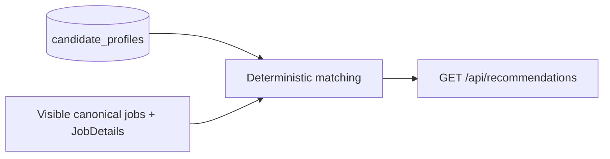

# Deterministic recommendations

Implemented flow:



`matching.py` uses pure string/set rules. `GET /api/recommendations` reads the
development profile and existing `JobDetails`, scores in Python, and returns
results. Scores are recomputed on every request. No database migration, score
storage, AI, embeddings, interaction ranking, or résumé-text ranking is involved.
Graduation year is not a scoring input. No candidate or job data is modified.

## Exact scoring

| Component | Maximum | Rules |
| --- | ---: | --- |
| Role | 40 | 40 for a normalized target phrase in a title or a shared explicit role family; otherwise 30 for at least two overlapping role tokens including a specialty token, 15 for one specialty token, and 0 otherwise. |
| Skills | 30 | `30 × matched unique job skills / unique detected job skills`, rounded to the nearest integer with halves rounded up. No detected job skills or no overlap earns 0. |
| Location | 20 | 20 for an exact normalized city/region, city-token containment, or an explicit remote match; 15 for province overlap; 8 for country-only overlap; 0 otherwise. Explicit conflicting provinces/countries block a match for that location. |
| Term | 10 | 10 for matching season and year; 6 for matching season when either year is absent; 4 for matching year when either season is absent; 0 for missing evidence or conflicting known seasons/years. |

Each dimension takes its best piece of evidence; multiple preferences or source
observations never stack points. Total is the sum of the four integer components,
clamped to 0–100. Missing profile fields or missing matching metadata contribute
0, without reweighting other dimensions. These are rule scores, not probabilities
of suitability, eligibility, or an offer.

Every nonzero component supplies a reason naming the preference and evidence.
Role/location reasons quote the matching title/location; skills reasons show the
matched labels and overlap count; term reasons show the term and evidence level.

For example, a backend candidate with Python and SQL, Toronto, and Summer 2027
preferences matches a backend job in Toronto for Summer 2027 with Python, SQL,
and Docker keywords as **40 + 20 + 20 + 10 = 90**.

## Text and role rules

`normalize_text()` folds case and accents, trims/collapses whitespace, and turns
punctuation such as slashes, hyphens, commas, underscores, and parentheses into
separators. Dots, plus signs, and hashes remain meaningful: `C++`, `C#`, `.NET`,
and `Node.js` retain distinct normalized forms. Phrase checks use whole tokens.

The following small role families are defined in `ROLE_ALIASES`. Each family name
also matches itself:

| Family | Additional aliases |
| --- | --- |
| Software engineering | software engineer, software developer, application developer, SWE |
| Backend engineering | backend, back end, server side |
| Data engineering | data engineer, data platform, data pipeline, ETL |
| Machine learning | ML engineer, ML intern, applied scientist, AI engineer |
| Data science | data scientist, analytics scientist |
| Product management | product manager, technical product manager |
| Frontend engineering | frontend, front end, web developer |
| DevOps | site reliability, SRE, infrastructure, platform engineer |

Token fallback removes internship/seniority terms and standalone numbers, and
maps engineering→engineer, development→developer, management→manager, and
scientist→science. Engineer/developer/manager/science alone are generic; they
cannot establish a specialty overlap. For example, Security Engineering versus
Security Engineer earns 30; Security Operations versus Security Engineering earns
15; Backend Engineering versus Civil Engineer earns 0.

The canonical title and active (`open`/`unknown`) source titles provide role
evidence. Closed/dead alternate observations do not supply title/location/term
evidence. The explicit families are intentionally small and may miss specialties.

## Skill rules

Detected languages, frameworks, and tools/platforms form one normalized set.
Duplicates across categories or aliases count once. Requirements prose is never
treated as a skill. Concepts are included only from this technical allowlist:
machine learning, data analysis, distributed systems, REST, GraphQL, CI/CD, unit
testing, and object-oriented.

`SKILL_ALIASES` maps postgres→postgresql, js→javascript, ts→typescript,
node/nodejs→node.js, k8s→kubernetes, google cloud→gcp,
amazon web services→aws, and dotnet→.net. Other skills compare exactly after text
normalization. SQL does not imply PostgreSQL, C does not imply C++, and Java does
not imply JavaScript. Candidate profile length is not the denominator.

`matched_skills` is ordered by normalized job-skill key. Known aliases use readable
canonical labels such as PostgreSQL and Node.js; other entries retain the first
job keyword's spelling. The matcher uses the existing canonical keyword union,
which may retain metadata from historical source observations of the same job.
It performs no new keyword extraction and does not scan job descriptions.

## Geographic rules

Location evidence includes canonical and active source locations. Semicolon,
newline, and pipe-separated locations are checked separately. Province aliases
are ON/Ontario, QC/Quebec, BC/British Columbia, AB/Alberta, NS/Nova Scotia,
NB/New Brunswick, MB/Manitoba, SK/Saskatchewan, NL/Newfoundland and Labrador,
and PE/Prince Edward Island. Recognized country aliases cover Canada/Canadian,
US/USA/United States/United States of America, and UK/United Kingdom.

Recognized Canadian provinces imply Canada only when no explicit country is
present. `CA` is not interpreted as Canada. Toronto matches Toronto, ON; Ontario
matches Toronto, ON for 15 points; Canada matches Toronto, ON for 8 points.

Remote preferences require `remote` in the job location. Generic Remote can match
any explicit remote location. Remote Canada/Canada Remote additionally requires
Canada or a recognized Canadian province in that same location. Remote alone and
Remote, USA do not satisfy Remote Canada. Repository names never imply work
eligibility. More specific remote city/province preferences require that evidence.

Unknown/generic locations contribute 0. These are location-string rules, not a
geocoder: no city-to-province catalog, immigration eligibility, radius/distance,
or worldwide location database is inferred.

## Term rules

Structured detail/source terms are preferred. Each observation's title is a
fallback only when its structured term is absent. Seasons are Summer, Winter,
Spring, and Fall (Autumn aliases Fall). Season/year pairs and standalone seasons
or years are read explicitly from the text. Posting dates never supply terms.

Terms are compared as pairs, not as independently pooled seasons/years. Winter
2027 and Summer 2028 do not combine into Summer 2027. A known conflicting season
or year earns 0, even if the other part agrees. Unstated information is not guessed.

## API contract and ordering

`GET /api/recommendations?min_score=20` returns `List[MatchResult]`:

```text
job: CanonicalJob (the existing seven fields)
score: integer 0..100
role_score: integer 0..40
skills_score: integer 0..30
location_score: integer 0..20
term_score: integer 0..10
matched_skills: list of readable labels
reasons: list of evidence explanations
```

`min_score` is inclusive, defaults to 0, and validates 0–100 (invalid values receive
HTTP 422). An empty profile still returns visible jobs with zero scores and empty
reasons. Closed/dead canonical jobs are excluded; unknown jobs follow current feed
visibility. No profile ID or authentication is introduced. A missing development
profile returns HTTP 503 without reseeding; database failures use the existing
sanitized HTTP 503 handler.

Sort order is score descending, exact `posted_at` descending with nulls last, then
canonical ID descending. Posting date breaks ties and never earns points. The
existing jobs feed, UI ordering, ingestion, and reconciliation are unchanged.
